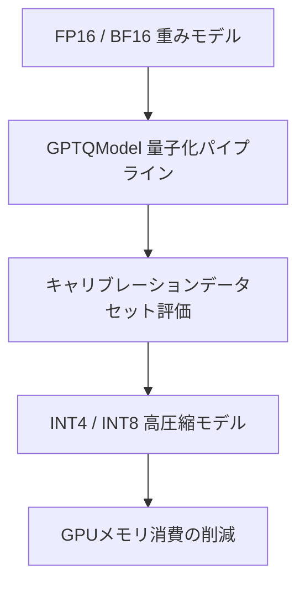

# GPTQModel: 概要

ModelCloud/GPTQModel は 2024-06-17 に GitHub で作成されたリポジトリです。2026-10-09 時点のスター数は 1,270 です。

GPTQModelは、大規模言語モデル（LLM）の量子化、検証、およびデプロイメントを統合的に支援する拡張可能なプラットフォームです。本ツールは、GPTQ、AWQ、ParoQuant、GGUF、FP8、EXL3、QQQといった多様な量子化手法をサポートし、NVIDIA CUDA、AMD ROCm、Huawei Ascend、Intel XPU、Apple Silicon (MPS)、およびIntel/AMD/Apple CPUといった広範なハードウェア環境での高速化推論を実現します。Hugging Face Transformers、vLLM、SGLangといった主要なLLMエコシステムとのネイティブ統合により、LLMの効率的な運用と広範なアクセシビリティを可能にします。

## 解決する主要な課題とアーキテクチャ


### 従来の技術スタックにおける問題点

従来のLLM運用において、以下の課題が顕在化していました。

*   **高コストなリソース要件**: LLMの巨大なモデルサイズは、推論時に大量のGPUメモリを消費し、高価なハードウェア投資やクラウドインフラコストを要求します。
*   **推論レイテンシ**: 大規模モデルの推論は高い計算負荷を伴い、リアルタイムアプリケーションにおける応答速度のボトルネックとなります。
*   **複雑なツールチェイン**: 多様な量子化手法が個別のツールやAPIとして提供され、それぞれが異なるハードウェア最適化やデプロイパスを持つため、開発・運用プロセスが複雑化し、技術的負債が増大します。
*   **クロスプラットフォーム対応の不足**: 特定のハードウェアベンダーに最適化されたソリューションが多く、異なるハードウェア環境への移植性や互換性が低いという問題がありました。
*   **品質管理の課題**: 量子化によるモデル性能の劣化を評価し、品質を維持するための統一されたフレームワークが不足していました。

### 本ツールが採用するアプローチと仕組み

GPTQModelは、これらの課題に対し、以下の統合的かつモジュール化されたアプローチで解決策を提供します。

*   **統一されたプラットフォーム**: 量子化、検証、モデル変換、および高速推論のための単一かつ一貫したAPIを提供し、開発・運用プロセスを簡素化します。
*   **モジュール化されたアーキテクチャ**: 量子化メソッド (`METHOD`)、フォーマット (`FORMAT`)、バックエンド (`BACKEND`)、およびカーネルが独立したモジュールとして設計されており、新しい量子化技術やハードウェアの統合が容易です。
    *   **量子化メソッド**: GPTQ, AWQ, ParoQuant, QQQ, GGUF, FP8, EXL3, GPTAQ, EoRA, GAR, FOEM, BitsAndBytes, Rotationなど。
    *   **フォーマット**: GPTQ, GPTQ_V2, MARLIN, BITBLAS, GEMM, GGUF, FP8, EXL3など。
    *   **バックエンド/カーネル**: GPTQ_TORCH_ATEN, GPTQ_MACHETE, GPTQ_MARLIN, AWQ_MARLIN, GGUF_CPP_CUDA, EXL3_EXLLAMA_V3, FP8_TORCHなど。
*   **広範なハードウェアサポート**: NVIDIA CUDA (Turing+), AMD ROCm (7900XT+, ROCm 6.2+), Huawei Ascend NPU (Ascend 910B), Intel XPU (Arc, Datacenter Max), Apple Silicon (M1+), Intel/AMD CPU (AVX, AMX) に対応し、多様なインフラ環境でのLLM運用を可能にします。
*   **主要ランタイムとの統合**: Hugging Face Transformers, vLLM, SGLang, MLX (Apple Silicon) とのネイティブ統合により、既存のLLMエコシステムにシームレスに組み込み、量子化モデルのデプロイを加速します。
*   **高度な最適化技術**:
    *   **データ並列処理**: マルチGPU環境での量子化処理を高速化し、大規模モデルの量子化時間を大幅に短縮します。
    *   **Python 3.13t (free threading) 最適化**: ロックフリーのスレッディングにより、マルチコアCPUでのパッキング処理やMoEモデルの量子化性能を向上させます。
    *   **動的な混合量子化制御**: 各レイヤー/モジュールに対して個別の量子化設定を適用したり、量子化から除外したりすることで、精度と性能のバランスを最適化します。
    *   **JITカーネルキャッシュ**: コンパイル済みカーネルをキャッシュし、マルチプロセス環境でのビルドをシリアライズすることで、起動時間と安定性を向上させます。
    *   **Microsoft/BitBLAS統合**: タイルベースの推論最適化により、特定のハードウェアでの性能を向上させます。
    *   **W4A (Weight-only 4-bit, Activation 8-bit) 量子化**: NVIDIA GB10 (SM121) 向けに、重みはINT4、アクティベーションはFP8で量子化し、推論性能を最大化します。
*   **品質保証と継続的改善**: CI/CDパイプラインに組み込まれた包括的なユニットテストとポスト量子化品質回帰テストにより、量子化モデルの品質を継続的に監視・保証します。
*   **GGUFネイティブサポート**: Prism/Bonsai GGUFチェックポイントを外部パッケージなしで直接ロード・推論できる内部GGUFランタイムシムを提供します。
*   **量子化ジョブのチェックポイント**: 長時間かかる量子化プロセスの中断と再開をサポートし、運用上の堅牢性を高めます。

## インストール（README からの転記）

以下は [README](https://github.com/ModelCloud/GPTQModel#readme) のインストール手順のコードブロックを、そのまま転記したものです。当サイトでは動作を確認していません。最新の手順は README を確認してください。

```bash
# You can install optional modules like autoround, ipex, vllm, sglang, bitblas.
# Example: pip install -v gptqmodel[vllm,sglang,bitblas]
pip install -v gptqmodel
uv pip install -v gptqmodel
```

```bash
# clone repo
git clone https://github.com/ModelCloud/GPTQModel.git && cd GPTQModel

# python3-dev is required for some source installs
apt install python3-dev

# pip: install from source
# You can install optional modules like  vllm, sglang, bitblas.
# Example: pip install -v .[vllm,sglang,bitblas]
pip install -v .
```

```py
from gptqmodel import GPTQModel

model = GPTQModel.load("ModelCloud/Llama-3.2-1B-Instruct-gptqmodel-4bit-vortex-v2.5")
result = model.generate("Uncovering deep insights begins with")[0] # tokens
print(model.tokenizer.decode(result)) # string output
```

```py
from gptqmodel import GPTQModel

model = GPTQModel.load("ModelCloud/Qwen2.5-0.5B-Instruct-gptqmodel-w4a16")
print(model.generate(prompt="The capital of France is", max_tokens=16))
```

## ライセンス

- ライセンス: Apache License 2.0（SPDX: Apache-2.0）
- 確認先: [LICENSE ファイル](https://github.com/ModelCloud/GPTQModel/blob/main/LICENSE)

この節はライセンスの名称と確認先を示すもので、法的な助言ではありません。利用の可否は、LICENSE ファイルの本文と利用する状況に照らして確認してください。
