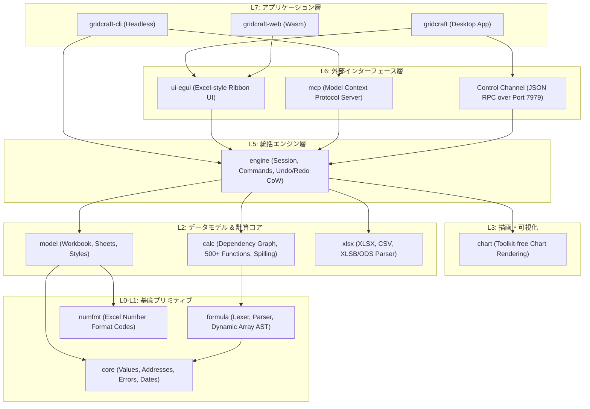

# gridcraft: 概要

storytold/gridcraft は 2026-10-07 に GitHub で作成されたリポジトリです。2026-10-18 時点のスター数は 5,729 です。

**GridCraft**は、ArtCraftチームが手掛けるピュアRust実装のオープンソース・スプレッドシート基盤です。Microsoft Excelの仕様を「クリーンルーム手法（リバースエンジニアリングに頼らず外部仕様のみからゼロスクラッチ再構築）」によって忠実に再現しており、デスクトップ（macOS, Windows, Linux, BSD）およびブラウザ（WebAssembly）で同一コードベースからネイティブ動作します。

従来のWebベースのスプレッドシート（HandsontableやUniver等）やヘビーなOfficeスイート（LibreOffice等）と異なり、GridCraftは**Copy-on-Write（CoW）**による極小メモリ消費、**依存グラフ計算エンジン**による差分再計算、そして**MCP をネイティブサポートしたAIエージェント対応**を中核に据えている点が最大の革新性です。

## 🎯 成熟度の目安（AI による見立て）

- **根拠**:
  - **カバー率と完成度**: Excelリボンコマンドの89%、ワークシート関数523種中513種を実装済みだが、公式ロードマップでは「Alpha版」と位置付けられており、実業務利用における忠実度は約50%と見積もられている。
  - **設計**: Rust で書かれ、レイヤー（L0〜L7）に分けた構成です（ヘッドレス CLI や MCP サーバーとしての安定性は当サイトでは検証していません）。
  - **検証候補になる用途**: README で alpha とされているため、主要な業務用スプレッドシートの置き換えには時期尚早です。**「AI エージェントに計算・集計・グラフ作成をさせるバックエンド」**や**「閉域環境での XLSX のバッチ生成」**などの PoC で検証候補になります。

## 解決する主要な課題とアーキテクチャ

### 既存技術のペイン
1. **重厚すぎるLibreOffice/Office365 API**: ヘッドレス実行時のメモリ消費が膨大で、コンテナでのスケールが困難。
2. **AIエージェントとの親和性不足**: 従来のExcelファイル操作（openpyxl等）は数式エンジンのリアルタイム再計算や動的配列（Dynamic Arrays: LET/LAMBDA/MAP等）の評価ができない。
3. **ベンダーロックインとテレメトリ**: 商用クラウドスプレッドシートは機密データの外部流出リスクや高額な月額シート課金が課題。

### GridCraftのアーキテクチャ構造

GridCraftは厳格なレイヤードアーキテクチャを採用しており、GUI層（`ui-egui`）と計算エンジン層（`model`, `calc`, `formula`）が完全に分離されています。



## インストール（README からの転記）

以下は [README](https://github.com/storytold/gridcraft#readme) のインストール手順のコードブロックを、そのまま転記したものです。当サイトでは動作を確認していません。最新の手順は README を確認してください。

```sh
cargo run --release -p gridcraft                              # desktop app
cargo run --release -p gridcraft -- --sample sales            # open a sample (sales, budget, grades)
cargo run --release -p gridcraft -- book.xlsx                 # open a workbook
cargo run --release -p gridcraft -- --sample sales --control 7979   # + JSON control channel
cargo xtask ci                                                 # fmt, clippy, tests, assets, layering, wasm
```

```sh
cd apps/gridcraft-web && trunk build --release     # → dist/web (serve it with any static server)
cd apps/gridcraft-web && trunk serve --release     # http://127.0.0.1:8771  (?sample=sales opens a sample)
```

## ライセンス

- ライセンス: Apache License 2.0（SPDX: Apache-2.0）
- 確認先: [LICENSE ファイル](https://github.com/storytold/gridcraft/blob/main/LICENSE-APACHE)

この節はライセンスの名称と確認先を示すもので、法的な助言ではありません。利用の可否は、LICENSE ファイルの本文と利用する状況に照らして確認してください。
