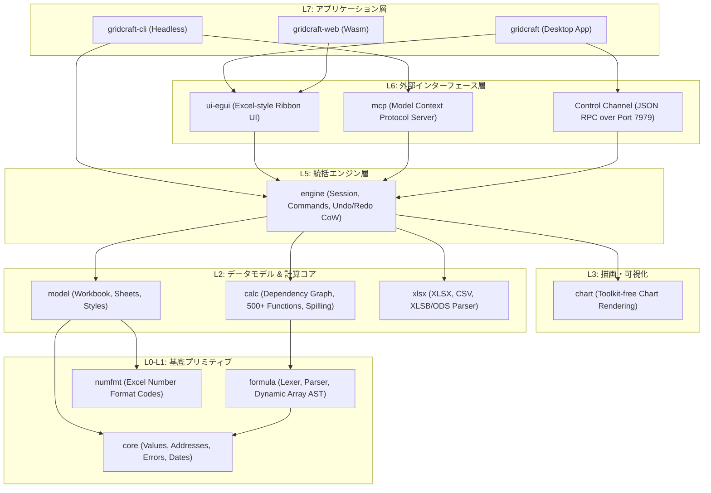

# gridcraft: 概要と革新性

**GridCraft**は、ArtCraftチームが手掛けるピュアRust実装のオープンソース・スプレッドシート基盤です。Microsoft Excelの仕様を「クリーンルーム手法（リバースエンジニアリングに頼らず外部仕様のみからゼロスクラッチ再構築）」によって忠実に再現しており、デスクトップ（macOS, Windows, Linux, BSD）およびブラウザ（WebAssembly）で同一コードベースからネイティブ動作します。

従来のWebベースのスプレッドシート（HandsontableやUniver等）やヘビーなOfficeスイート（LibreOffice等）と異なり、GridCraftは**Copy-on-Write（CoW）**による極小メモリ消費、**依存グラフ計算エンジン**による差分再計算、そして**Model Context Protocol (MCP) をネイティブサポートしたAIエージェント対応**を中核に据えている点が最大の革新性です。

## 🎯 成熟度の目安（AI による見立て）

- **根拠**:
  - **カバー率と完成度**: Excelリボンコマンドの89%、ワークシート関数523種中513種（98%）を実装済みだが、公式ロードマップでは「Alpha版」と位置付けられており、実業務利用における忠実度は約50%と見積もられている。
  - **設計**: Rust で書かれ、レイヤー（L0〜L7）に分けた構成です（ヘッドレス CLI や MCP サーバーとしての安定性は当サイトでは検証していません）。
  - **検証候補になる用途**: README で alpha とされているため、主要な業務用スプレッドシートの置き換えには時期尚早です。**「AI エージェントに計算・集計・グラフ作成をさせるバックエンド」**や**「閉域環境での XLSX のバッチ生成」**などの PoC で検証候補になります。

## 解決する主要な課題とアーキテクチャ

### 既存技術のペイン
1. **重厚すぎるLibreOffice/Office365 API**: ヘッドレス実行時のメモリ消費が膨大で、コンテナでのスケールが困難。
2. **AIエージェントとの親和性不足**: 従来のExcelファイル操作（openpyxl等）は数式エンジンのリアルタイム再計算や動的配列（Dynamic Arrays: LET/LAMBDA/MAP等）の評価ができない。
3. **ベンダーロックインとテレメトリ**: 商用クラウドスプレッドシートは機密データの外部流出リスクや高額な月額シート課金が課題。

### GridCraftのアーキテクチャ構造

GridCraftは厳格なレイヤードアーキテクチャを採用しており、GUI層（`ui-egui`）と計算エンジン層（`model`, `calc`, `formula`）が完全に分離されています。



## 競合ツール/商用SaaSとの徹底比較

| 比較項目 | **GridCraft (OSS)** | **Microsoft Excel** | **Google Sheets** | **Univer / Handsontable** |
|---|---|---|---|---|
| **ライセンス** | MIT / Apache 2.0 デュアル | 商用プロプライエタリ | 商用SaaS | オープンコア / 商用商標 |
| **ランタイム** | ピュアRust (Native / Wasm) | C++ / Win32 / Cloud | JavaScript (Cloud) | TypeScript / DOM / Canvas |
| **メモリ/起動速度** | 極めて軽量・ミリ秒起動 | 重厚（数百MB消費） | ブラウザ依存 | ブラウザ依存 |
| **計算エンジン** | 依存グラフ + 動的配列内蔵 | 完全（業界標準） | クラウドエンジン | 一部数式のみ対応 |
| **AIエージェント親和性** | **ネイティブMCP / JSON RPC** | Copilot（GUI依存/高額） | Gemini Workspace | REST API要開発 |
| **完全閉域稼働** | **可（オンプレ/完全オフライン）** | 不可（M365要認証） | 不可 | 可 |
| **月額コスト** | **$0（完全無料）** | $12〜/月/ユーザー | $6〜/月/ユーザー | 無料〜数千ドル/年 |

## 💡 ビジネス・マネタイズ活用アイデア（実践例）

1. **AIエージェント連動型「財務分析・予算策定ボット」受託構築**:
   - Claude Desktopや自社LLMエージェントにGridCraftのMCPを接続。
   - プロンプトから直接「先月のP/Lから売上成長率を算出し、予算シートのB4:F12を更新してウォーターフォールチャートを挿入」といった操作を自動実行する社内システムを開発・納品。
2. **完全閉域オンプレミス向け「帳票生成＆再計算マイクロサービス」**:
   - 金融機関や医療現場など、外部クラウドにデータを送信できない環境向けに、ヘッドレスDockerコンテナとしてGridCraftをデプロイ。複雑なマクロ計算やXLSX生成を爆速で処理するAPI基盤の提供。
3. **Rust製WebAssemblyを組み込んだ「エッジ対応組み込みスプレッドシートSaaS」**:
   - Next.js / Astro製WebアプリにWasm版GridCraftを埋め込み、オフラインでも完全に計算可能なSaaSダッシュボードを月額課金モデルで提供。

## インストール & クイックスタート手順

### デスクトップアプリのビルドと起動

```bash
# リポジトリのクローン
git clone https://github.com/storytold/gridcraft.git
cd gridcraft

# デスクトップ版のビルド＆実行（サンプル売上データを表示）
cargo run --release -p gridcraft -- --sample sales

# リモート制御チャンネル（JSON-RPC ポート7979）を有効化して起動
cargo run --release -p gridcraft -- --control 7979
```

### ヘッドレスCLIによる数式評価とMCPサーバー起動

```bash
# 数式の即時評価（動的配列XLOOKUPの計算）
cargo run --release -p gridcraft-cli -- eval '=XLOOKUP("b",{"a","b"},{1,2})'
# 出力: 2

# 既存のXLSXを読み込み、コマンドを適用して別名保存
cargo run --release -p gridcraft-cli -- run \
  --sample budget \
  --cmd 'home.bold={"range":"B4:F4"}' \
  --out modified_budget.xlsx
```

### WebAssembly（ブラウザ版）のビルド

```bash
# trunkのインストール（未導入の場合）
cargo install trunk
rustup target add wasm32-unknown-unknown

# Web版のローカルサーバー起動
cd apps/gridcraft-web
trunk serve --release
# ブラウザで http://127.0.0.1:8771 にアクセス
```

## 商用利用可否 & ライセンス考察

GridCraftは**MITライセンス**または**Apache License 2.0**のデュアルライセンスを採用しています。
- **商用利用**: 自社プロダクトへの組み込み、受託開発でのクライアント納品、クラウドSaaSとしてのホスティング、社内業務での利用すべてにおいて無償かつ自由に利用可能です。
- **商標に関する注意**: `ArtCraft`の名称およびブランドロゴ（`docs/brand/`内）は商標保護されており、フォークや改変版を公開する際は独自の名称・ロゴに差し替える必要があります。
- **クリーンルーム性**: 本プロジェクトはMicrosoft Excelのコードを一切流用せず外部仕様から再設計されているため、知財侵害のリスクが極めて低く、エンタープライズへの提案においても法務クリアランスが容易です。
