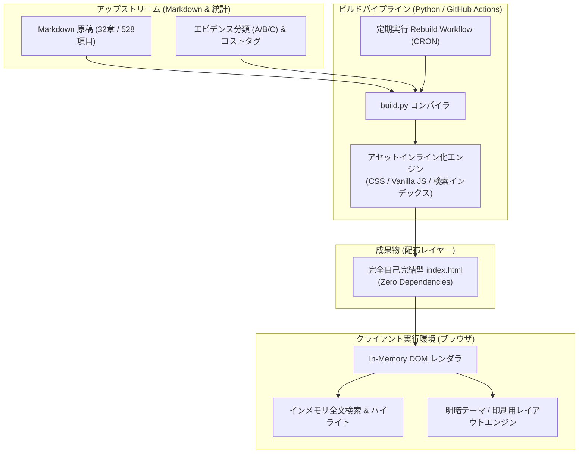

# how-to-live-better: 概要

cdyforever/how-to-live-better は 2026-09-18 に GitHub で作成されたリポジトリです。2026-10-11 時点のスター数は 10,927 です。

「`cdyforever/how-to-live-better`」は、公有領域（Unlicense）のオープンソース書籍『高性价比人生指南（高コスパ人生ガイド）』全32章・528項目を、**単一のHTMLファイル（Single-File HTML）**として再構築したナレッジリーダーです。

最大の特徴は、**「外部依存ゼロ（Zero External Dependencies）」**と**「完全オフライン動作（Offline-First）」**の設計思想にあります。CDN経由の外部フォント、CSSフレームワーク、クライアントサイドAPIフェッチを一切排除し、全文検索インデックス、レスポンシブUI、ダークモード切り替え、印刷用CSSに至るまですべてが1つの`index.html`に内包されています。

現代のWebフロントエンドが過剰な依存関係と重厚なSPAフレームワークに傾倒する中、静的ファイル1枚で高速かつ堅牢なナレッジ配信を実現するその構造は、エッジ環境や機密ネットワーク向けWeb開発に極めて強力な指針を与えています。

---

## 解決する主要な課題とアーキテクチャ

本プロジェクトは、現代のナレッジ共有システムが抱える「通信遮断時の閲覧不可」「重厚なビルドパイプラインによる高運用コスト」「外部トラッカーやCDN障害に伴う可用性低下」という課題を根本から解決しています。

### システム構成とビルド・レンダリングフロー

データソースとなるMarkdownリポジトリから単一HTMLをコンパイルし、ブラウザ上で完全閉域動作するまでのフローは以下の通りです。

### アーキテクチャの要点
1. **Zero External Requests**: ブラウザ起動後、追加のHTTPリクエストを1回も発生させません。
2. **インメモリ全文検索**: JavaScriptにより全528件のタイトル・本文・コスト・統計タグをリアルタイム探索し、該当キーワードを動的ハイライトします。
3. **ステートレスな同期設計**: Upstreamリポジトリの更新をGitHub Actionsで常時監視し、差分発生時のみ決定論的（Deterministic）に単一HTMLを再ビルドします。

---

## インストール（README からの転記）

README にインストール手順のコードブロックが見つかりませんでした。導入方法は [README](https://github.com/cdyforever/how-to-live-better#readme) を確認してください。

## ライセンス

- ライセンス: ライセンス未指定（利用許諾なし）
- 確認先: [リポジトリ](https://github.com/cdyforever/how-to-live-better)（LICENSE ファイルが見つかりません）
- 補足: ライセンス未指定（利用許諾なし）のため、著作権者の許諾なしに利用・改変・再配布できない可能性があります。

この節はライセンスの名称と確認先を示すもので、法的な助言ではありません。利用の可否は、LICENSE ファイルの本文と利用する状況に照らして確認してください。
