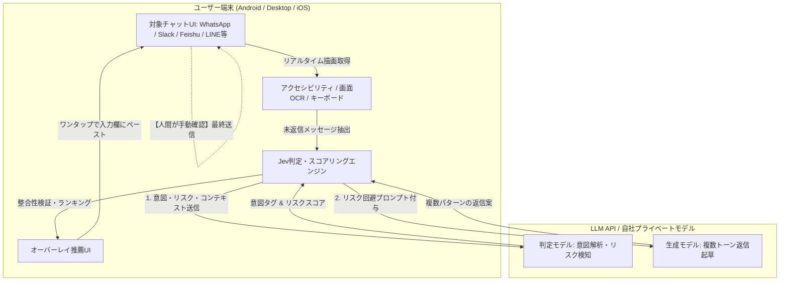

# jev-chat-jarvis: 概要

jev-chat/jev-chat-jarvis は 2026-09-21 に GitHub で作成されたリポジトリです。2026-10-16 時点のスター数は 7,815 です。

チャットコミュニケーションにおいて最も重大なインシデントは、「タイピングの遅さ」ではなく「相手の真意の誤読による不適切な返答」や「感情的な即レスによる炎上・トラブル」です。従来のAIチャットアシスタントは、文脈を考慮せずに定型的な返信を自動生成するものが大半であり、ビジネスやセンシティブな対話では誤送信リスクを抱えていました。

GitHubでスター数7,800を突破した**jev-chat-jarvis**（jev-chat）は、この課題を根本から解決する「チャット意思決定アシスタント（Chat Decision Assistant）」です。
最大の特徴は、**「書く前に、まず相手を看破・判定する（Judge before writing）」** という設計思想にあります。画面上のメッセージをリアルタイムに解析し、相手の「真の意図（Intent）」「リスク度（Risk）」「本質的ニーズ」を判定した上で、複数の返答シナリオをスコアリングして提示します。さらに、AIが勝手に送信することは一切なく、**「入力欄へのワンタップ挿入にとどめ、送信ボタンを押すのは常に人間」** という厳格なHuman-in-the-loop設計を貫いています。

## 解決する主要な課題とアーキテクチャ

多くの企業や個人が直面しているチャット上の課題は以下の3点です。
1. **コンテキストと感情の誤読**: 皮肉、クレームの前兆、駆け引きを見落とし、火に油を注ぐ返信をしてしまう。
2. **AIの暴走・誤送信不安**: フルオートのチャットボットを導入すると、規約違反や不適切な回答を即座に送信してしまうリスクがある。
3. **プライバシーとデータ主権**: SaaS型ツールでは社内外の機密チャットログが外部ベンダーのサーバーに蓄積されてしまう。

`jev-chat-jarvis` は、クライアントサイド（AndroidのAccessibility API、デスクトップのローカルOCR/画面キャプチャ、iOSのカスタムキーボード）でチャットテキストを取得し、BYOK方式で指定LLMにダイレクト接続します。自社サーバーを一切介さないため、プライバシーリスクを最小化しています。

### アーキテクチャの特長
- **非侵襲型インターフェース**: チャットアプリ自体の改変やリバースエンジニアリングを行わず、OS標準のアクセシビリティ機能やオーバーレイ、カスタムキーボードで動作。
- **2フェーズ評価パイプライン**: 「判定（意図/リスク）」→「ドラフト生成・スコア付け」の2段階を実行し、最も安全で効果的な文面を上位表示。
- **ゼロ・トラスト・データフロー**: プロジェクト運営側のバックエンドサーバーは存在せず、APIコールはユーザー自身のキーまたは社内ゲートウェイへ直接送信。

## インストール（README からの転記）

README にインストール手順のコードブロックが見つかりませんでした。導入方法は [README](https://github.com/jev-chat/jev-chat-jarvis#readme) を確認してください。

## ライセンス

- ライセンス: MIT License（SPDX: MIT）
- 確認先: [LICENSE ファイル](https://github.com/jev-chat/jev-chat-jarvis/blob/main/LICENSE)

この節はライセンスの名称と確認先を示すもので、法的な助言ではありません。利用の可否は、LICENSE ファイルの本文と利用する状況に照らして確認してください。
