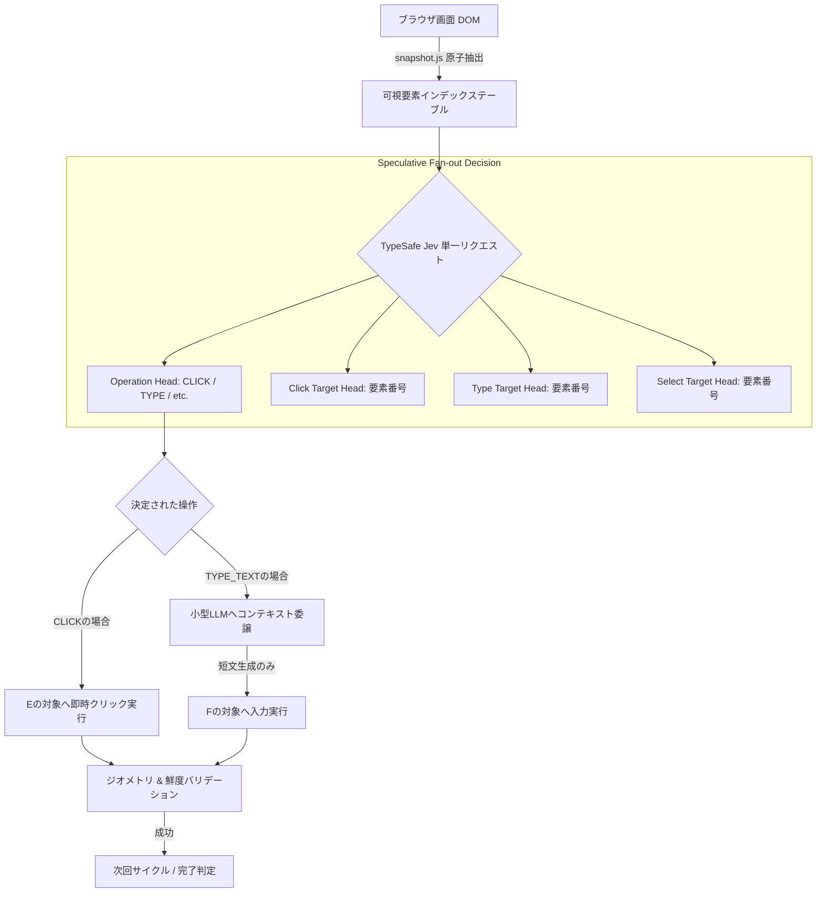

# jev-ultrafast: 概要

browser-use/jev-ultrafast は 2026-09-17 に GitHub で作成されたリポジトリです。2026-10-10 時点のスター数は 22,480 です。

**jev-ultrafast**は、Webブラウザ自動化における最大のボトルネックであった「推論レイテンシ」と「トークンコスト」を減らすことを目的とした、自律型ブラウザエージェントフレームワークです。

従来のマルチモーダルWebエージェント（GPT-4VやClaude 3.5 Sonnetなどを用いた画面キャプチャベースの方式）は、1ステップごとに高解像度スクリーンショットをモデルへ送信し、巨大なコンテキストを消費しながら数秒〜十数秒かけて次の操作（座標クリックや入力）を推論していました。このアプローチは精度こそ高いものの、API課金額の爆発と極度の遅延が商用本番導入の致命的な壁となっていました。

jev-ultrafastはこのパラダイムを根本から刷新します。TypeSafeの「Jev」アーキテクチャを採用し、**「1回のネットワーク往復で操作タイプと対象要素を同時に投機的推論」「スクリーンショットを排除した極小DOMスナップショット」「テキスト入力時のみ小型LLMに委譲」**という3段階のハイブリッドパイプラインを構築。Google Flightsでの複雑なフライト検索タスクをわずか**7.1秒**で完結させ、従来のBrowser Use構成と比較してCDPコール数を**1,092回から101回へ削減**、実行速度を25%高速化することに成功しました。

---

## 解決する主要な課題とアーキテクチャ

### 1. 従来型ブラウザエージェントの課題
- **高額なVLMコスト**: スクリーンショット1枚あたり数千トークンを消費し、1タスク数十ステップで数百円のコストが発生。
- **直列的レイテンシ**: 「画面解析 → アクション決定 → ターゲット要素特定 → 入力文字列生成」が直列に行われる。
- **DOM肥大化によるコンテキスト溢れ**: 巨大なHTMLツリーをそのまま投じることによるトークン圧迫とハルシネーション。

### 2. jev-ultrafastのコアアーキテクチャ

jev-ultrafastは、観察（Observation）ごとに可視領域のインタラクティブ要素のみを抽出した「番号付きエレメントテーブル」を原子的に構築し、1リクエスト内で操作（Operation）と各操作ごとのターゲット候補（Target Heads）を投機的に同時取得します。

### 3. 高速化のための主要技術
1. **投機的ファンアウト（Speculative Fan-out）**: 
   「次がCLICKならどの要素か」「TYPE_TEXTならどの要素か」を1回の推論パスで並列予測。確定したOperationに応じたTargetをそのまま使うため、ネットワークRTTを半減。
2. **Atomic DOM Snapshot**: 
   JavaScriptフックを用いて、ビューポート内の操作可能ノード（ボタン、入力欄、コンボボックス）のみをインデックス化し、ノード参照を保持したままテーブル化。
3. **小型LLMによるテキスト補完の分離**: 
   ナビゲーションやクリックの決定には汎用大型モデルを使わず、フォーム入力に必要な文脈生成時のみ小型のLLM（Mercury-2.5、GLM、DeepSeek等）を呼び出すことで、ミリ秒単位の応答と最小コストを両立。

---

## インストール（README からの転記）

README にインストール手順のコードブロックが見つかりませんでした。導入方法は [README](https://github.com/browser-use/jev-ultrafast#readme) を確認してください。

## ライセンス

- ライセンス: MIT License（SPDX: MIT）
- 確認先: [LICENSE ファイル](https://github.com/browser-use/jev-ultrafast/blob/main/LICENSE)

この節はライセンスの名称と確認先を示すもので、法的な助言ではありません。利用の可否は、LICENSE ファイルの本文と利用する状況に照らして確認してください。
