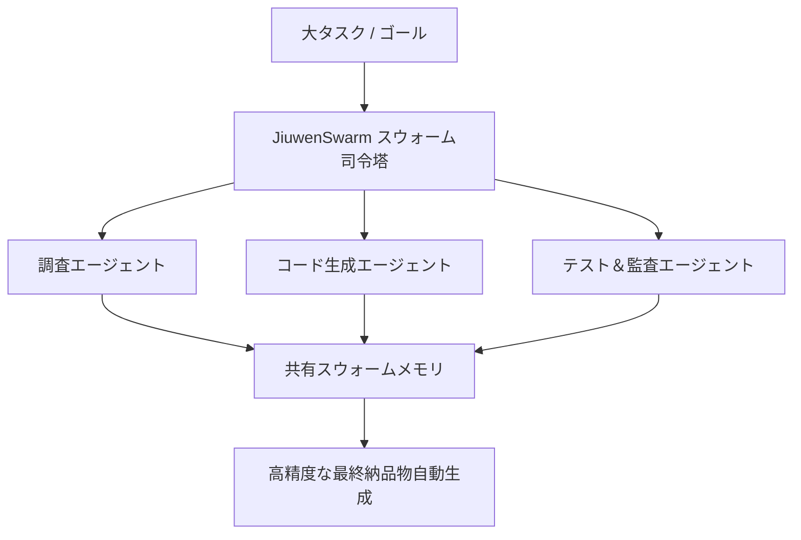

# jiuwenswarm: 概要

openJiuwen-ai/jiuwenswarm は 2026-03-05 に GitHub で作成されたリポジトリです。2026-10-09 時点のスター数は 5,978 です。

JiuwenSwarmは、オープンソースのAIエージェントシステムであり、大規模言語モデル（LLM）の能力を日常のコミュニケーションアプリを通じて直接利用可能にするインテリジェントなプラットフォームです。

このプロジェクトの核心は、「マルチエージェントコラボレーション」を現実のものにすること。複雑なタスクを自然言語で指示するだけで、AIエージェントが自律的に分解し、専門エージェントチームを編成、協調してタスクを完遂します。さらに、エージェントの「スキル自己進化」機能により、エラーやユーザーの不満を検知して自動的にスキル定義を最適化し、継続的な改善を実現します。

## 解決する主要な課題とアーキテクチャ


現代のビジネス環境では、複雑なタスクの自動化と効率化が喫緊の課題です。しかし、従来のAIエージェントは単一タスクに特化しがちで、複数のステップや専門知識を要する複雑なプロセスには対応が困難でした。JiuwenSwarmは以下の課題を解決します。

*   **複雑なタスクの分解と実行:** リーダーエージェントが複雑なタスクを分解し、専門エージェントチームを動的に編成。各エージェントが連携し、タスクをエンドツーエンドで実行します。
*   **エージェント間の協調とスケーラビリティ:** 分散型エージェントスウォームアーキテクチャにより、リーダーとチームメイトがプロセスやマシンを跨いでデプロイされ、大規模な協調作業を可能にします。
*   **スキルの継続的な最適化:** 「Skill Self-Evolution」機能により、エージェントは実行結果やユーザーフィードバックから学習し、自身のスキル定義を自動で改善します。これにより、一度構築したスキルが陳腐化することなく、常に最新の状態に保たれます。
*   **ヒューマン・イン・ザ・ループ (HITL) の統合:** SwarmflowというPythonスクリプトによる決定論的なマルチステージワークフローを通じて、人間による介入（`human` / `human_session`）を組み込むことができ、AIの自律性と人間の制御のバランスを取ります。
*   **幅広いAIインフラ互換性:** Huawei Cloud MaaS、OpenAI互換API、ローカルモデルなど、多様なAIプラットフォームに対応し、既存のインフラを最大限に活用できます。

## インストール（README からの転記）

以下は [README](https://github.com/openJiuwen-ai/jiuwenswarm#readme) のインストール手順のコードブロックを、そのまま転記したものです。当サイトでは動作を確認していません。最新の手順は README を確認してください。

```bash
# Install JiuwenSwarm
pip install workswarm

# Use China mirror (recommended)
pip install workswarm -i https://pypi.tuna.tsinghua.edu.cn/simple

# Initialize JiuwenSwarm (first-time setup)
jiuwenswarm-init

# Start JiuwenSwarm
jiuwenswarm-start
```

```bash
git clone https://github.com/openJiuwen-ai/jiuwenswarm.git
cd jiuwenswarm
uv venv
uv pip install -e .
```

```yaml
model_name: deepseek-v4-flash
api_base: https://api.deepseek.com
api_key: sk-your-api-key
model_provider: OpenAI
```

```text
Conduct an in-depth research on the new energy vehicle industry and generate an analysis report.
```

## ライセンス

- ライセンス: Apache License 2.0（SPDX: Apache-2.0）
- 確認先: [LICENSE ファイル](https://github.com/openJiuwen-ai/jiuwenswarm/blob/develop/LICENSE)

この節はライセンスの名称と確認先を示すもので、法的な助言ではありません。利用の可否は、LICENSE ファイルの本文と利用する状況に照らして確認してください。
