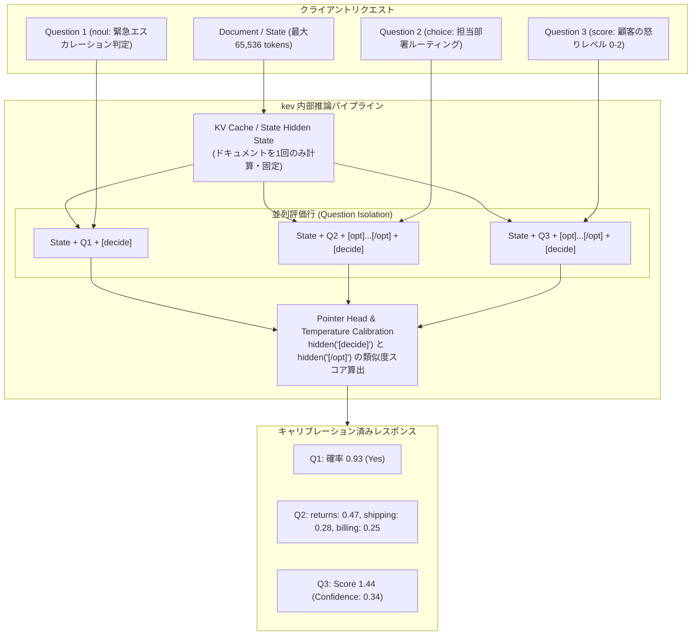

# kev: 概要と革新性

大規模言語モデル（LLM）を実務の自動化パイプラインに組み込む際、最大の障壁となるのが「ハルシネーション（幻覚）」と「確率の不透明さ（信頼度スコアの欠如）」、そして「トークン生成による推論遅延とコスト」です。分類、ルーティング、コンプライアンスチェック、トリアージといった日常の意思決定タスクにおいて、チャット特化型LLMに自由形式で回答を出力させ、それを正規表現やJSON Modeでパースするアプローチは、構造的に不安定であり運用コストも跳ね上がります。

この構造的課題を打破するのが、Vercelの元VP of ProductでありTurborepoの作者としても知られるJared Palmer氏が主導するオープンソースプロジェクト **「kev」** です。

`kev` は、TypeSafe社が提供するクローズドな商用意思決定モデル「Jev（System One）」のアーキテクチャをリバースエンジニアリング・拡張し、オープンウェイトの **Qwen3.5 / Qwen3.8** 上に構築された意思決定（Decision-Making）専用モデルファミリーです。0.8B、4B、9B、27Bの4サイズを展開し、単一のリクエスト内で「Yes/No判定（noul）」「多肢選択（choice）」「多段階評価（score）」を同時に高精度かつキャリブレーション（較正）された信頼度確率付きで実行します。

### 主な特徴と革新性
1. **確率分布を直接出力（Calibrated Probabilities）**: 単一ラベルのテキスト生成ではなく、較正された温度パラメータ（Fitted Temperature）に基づき、数学的に正確な確率分布を出力。信頼度が閾値未満の場合は人間にエスカレーションする運用設計が容易。
2. **質問間の完全な分離（Question Isolation）**: 共通の長文コンテキスト（最大65,536トークン）を参照しつつ、同時に投入された質問同士が互いに影響を与えない独立推論設計。
3. **商用API（TypeSafe System One）とのドロップイン互換**: 公式Python SDKのエンドポイントをローカルホストに向けるだけで、一切のコード変更なしに自前インフラへ移行可能。
4. **極限の推論効率**: H100上で6問の同時判定をわずか18.1msで完了。Apple Silicon（Mシリーズ）向けにはMLXバックエンドによる高速推論を標準サポート。

---

## 解決する主要な課題とアーキテクチャ

従来のLLMを用いたワークフロー自動化では、プロンプトインジェクションへの脆弱性や、複数質問を投じた際のコンテキスト内バイアス（前の回答に引きずられる現象）、出力トークン生成に伴うレイテンシがボトルネックでした。`kev` はこの課題を **「ポインターヘッド（Pointer Head）方式」** と **「独立した状態キャッシュ再利用」** によって根本から解決しています。



### アーキテクチャの要点
- **ハイブリッドバックボーン対応**: Qwen3.5/3.8のハイブリッド構造（Attention層 ＋ 再帰型Gated DeltaNet層）に最適化。DeltaNet層がアテンションマスクを無視する特性に対応するため、共通の`State`計算結果をキャッシュしつつ、質問ごとに独立した行（Row）としてフォワードパスを実行。質問間の完全な推論分離を保証。
- **Pointer Headメカニズム**: 各選択肢末尾の`<opt>...</opt>`トークンの隠れ状態と、質問末尾の`<decide>`トークンの隠れ状態の内積を取り、Softmaxを適用することで選択確率を計算。次トークン予測に依存しないため、ハルシネーションの余地がゼロ。
- **Fitted Temperature**: チェックポイントごとに検証セットを用いて最適なTemperatureパラメータを事前フィッティング。Brierスコアを最小化し、確率値そのものを信頼度メトリクスとして直結可能。

---

## 競合ツール/商用SaaSとの徹底比較

| 評価項目 | kev (Self-Hosted OSS) | TypeSafe Jev (商用API) | 一般的なLLM (OpenAI / Claude) |
|---|---|---|---|
| **提供形態** | 完全OSS (ウェイト・学習コード全公開) | クローズドSaaS | クラウドAPI |
| **ライセンス** | Apache-2.0 | プロプライエタリ | 利用規約準拠（従量課金） |
| **ベースモデル** | Qwen3.5-0.8B/4B/9B, Qwen3.8-27B | 非公開 | GPT-4o / Claude 3.5 Sonnet 等 |
| **確信度 (Confidence)** | キャリブレーション済み確率を出力 | キャリブレーション済み確率を出力 | logprobs等の間接的推定（不正確） |
| **推論レイテンシ** | 18ms〜50ms (H100) / 100ms台 (M5 Mac) | 200ms〜500ms (ネットワーク依存) | 800ms〜3,000ms (生成型) |
| **データプライバシー** | 完全オンプレミス / 自社VPC完結 | 外部送信必須（SOC2等の制約） | 外部送信必須 |
| **ドメイン特化学習** | Modal / 独自GPUで安価にLoRA・FT可能 | 不可（事前提供モデルのみ） | Fine-tuningは高額かつ制御困難 |
| **月額インフラコスト** | ゼロ〜自社GPU代（Modalスケールtoゼロ可）| リクエスト従量課金（大規模運用で高額）| 高額（トークン従量課金） |

---

## 💡 ビジネス・マネタイズ活用アイデア（実践例）

### 1. カスタマーサポート / チケット自動トリアージ基盤の自社内製化
- **背景**: ZendeskやSalesforceに届く問い合わせを、高額な商用AIアドオンを使わずに高精度分類したい。
- **実装**: `kev-4b` を用いて「問い合わせカテゴリ（Choice）」「解約リスク（Score）」「即時対応要否（Noul）」を単一リクエストで判定。
- **ビジネスメリット**: 信頼度90%以上のみ自動処理し、それ以外は人間にルーティング。誤判定率5%未満を維持したまま、全体の50〜60%の対応を完全自動化。

### 2. 金融・法務・保険のコンプライアンス審査自動化エンジン
- **背景**: 契約書や申告書類の規約適合チェックは機密性が高く、パブリッククラウドのLLM APIに送信できない。
- **実装**: 65,536トークン対応の `kev-27B` をオンプレミス（H100/H200環境）またはローカルMac Studioクラスタで運用。数十ページの契約書に対して、禁止条項の有無やリスクスコアを確率付きで判定。
- **ビジネスメリット**: 完全閉域網で動作し、監査証跡として「判定の確率分布」を保持できるため、金融機関向けエンタープライズDX案件として高単価受注が可能。

### 3. LLMエージェントの超高速ガードレール・ルーティングゲートウェイ
- **背景**: LangChainやLlamaIndex等で構築されたAIエージェントにおいて、意図分類（Intent Classification）や有害性検知（Guardrails）に大型LLMを使うと遅く高コスト。
- **実装**: `kev-0.8B` または `kev-4B` をエージェントの前段に配置。入力が「DB検索」「API呼び出し」「拒絕」のどれに該当するかをサブ20msでルーティング。

---

## インストール & クイックスタート手順

### ⚠️ 注意事項: PyPIパッケージ名衝突
`pip install kev` を実行すると、同名の別パッケージ（K.E.V. ORM）がインストールされてしまいます。本プロジェクトはリポジトリから直接インストールして利用します。

### 前提条件
- Python 3.12 または 3.13
- パッケージマネージャー: [uv](https://docs.astral.sh/uv/)（推奨）
- GPU環境（CUDA / ROCm）または Apple Silicon（MLX）

### 1. リポジトリのクローンと環境構築

```bash
git clone https://github.com/jaredpalmer/kev.git
cd kev

# 依存関係の同期（サービング用パッケージ含む）
uv sync --extra serve
```

### 2. ローカル推論サーバーの起動

```bash
# Kev-4Bをポート8009で起動（CUDA環境またはApple Silicon Mac）
uv run --extra serve python -m kev.serve --run jaredpalmer/kev-4b --port 8009
```
*初回起動時にBaseモデルとLoRAアダプタのウェイトが自動ダウンロードされます。*

### 3. APIリクエストの送信（cURL）

別のターミナルから、System One互換エンドポイントへリクエストを送信します。

```bash
curl -s localhost:8009/v1/systemone -H 'content-type: application/json' -d '{
  "state": "注文したスニーカーが2週間遅れて届き、しかもサイズが間違っていました。さらにクレジットカードに二重請求が発生しています。至急返金してください。",
  "model": "kev-latest",
  "questions": {
    "department": {
      "type": "choice",
      "instructions": "この問い合わせを担当すべき部署はどこですか？",
      "criteria": {
        "returns": "返品・交換・商品破損",
        "shipping": "配送遅延・配送状況・荷物紛失",
        "billing": "二重請求・返金・決済トラブル"
      }
    },
    "urgent": {
      "type": "noul",
      "instructions": "この案件は管理職による至急のエスカレーションが必要ですか？"
    },
    "sentiment": {
      "type": "score",
      "instructions": "顧客のフラストレーション度合いを評価してください。",
      "criteria": ["冷静", "不満", "極めて怒っている"]
    }
  }
}'
```

#### レスポンス例
```json
{
  "model": "kev-latest",
  "answers": {
    "department": {
      "type": "choice",
      "choice": "billing",
      "confidence": 0.28,
      "probabilities": {
        "returns": 0.38,
        "shipping": 0.22,
        "billing": 0.40
      }
    },
    "urgent": {
      "type": "noul",
      "noul": 0.94
    },
    "sentiment": {
      "type": "score",
      "score": 1.72,
      "confidence": 0.45,
      "legend": { "0": "冷静", "1": "不満", "2": "極めて怒っている" },
      "probabilities": { "0": 0.01, "1": 0.26, "2": 0.73 }
    }
  },
  "usage": { "input_tokens": 128, "output_tokens": 184 },
  "latency_ms": 38
}
```

### 4. Python（TypeSafe公式SDK）からの呼び出し

TypeSafeのSDKコードをそのまま流用可能です。

```python
from typesafe_sdk import TypeSafeClient, Noul, Choice, Score

client = TypeSafeClient(
    api_key="local",
    base_url="http://127.0.0.1:8009",
    model="kev-latest",
)

response = client.system_one(
    state="アカウントにログインできません。パスワードリセットのメールも届きません。",
    questions={
        "is_auth_issue": Noul(instructions="認証・ログイン関連の問題ですか？"),
        "severity": Score(
            instructions="重要度を設定してください",
            criteria=["低", "中", "高"]
        )
    }
)

print(f"Auth Issue Prob: {response.nouls['is_auth_issue'].noul:.2f}")
print(f"Severity Score: {response.scores['severity'].score:.2f}")
```

---

## 商用利用可否 & ライセンス考察

`kev` のソースコードおよび公開されているモデルウェイトは **Apache License 2.0** で提供されています。

- **商用利用**: ソースコードの改変、商用サービスへの組み込み、受託開発でのクライアント納品、SaaS化のすべてが無償で許可されています。
- **ベースモデルのライセンス**:
  - `Kev-0.8B`, `Kev-4B`, `Kev-9B`: 基盤となる **Qwen3.5-Base** シリーズは Apache 2.0 ライセンスです。商用利用における制約は極めて軽微です。
  - `Kev-27B`: **Qwen3.8-27B** をベースとしており、こちらも Apache 2.0 準拠です。51GBのフルウェイトが提供されています。
- **蒸留データの非使用**: `kev` の学習には、TypeSafe社の商用モデル「Jev」の生成データ（蒸留データ）は一切使用されておらず、パブリックデータセットおよび独自生成データのみで訓練されています。そのため、規約違反リスクや著作権・競合条項上の懸念なしに、安心してプロダクション環境へ投入できます。
