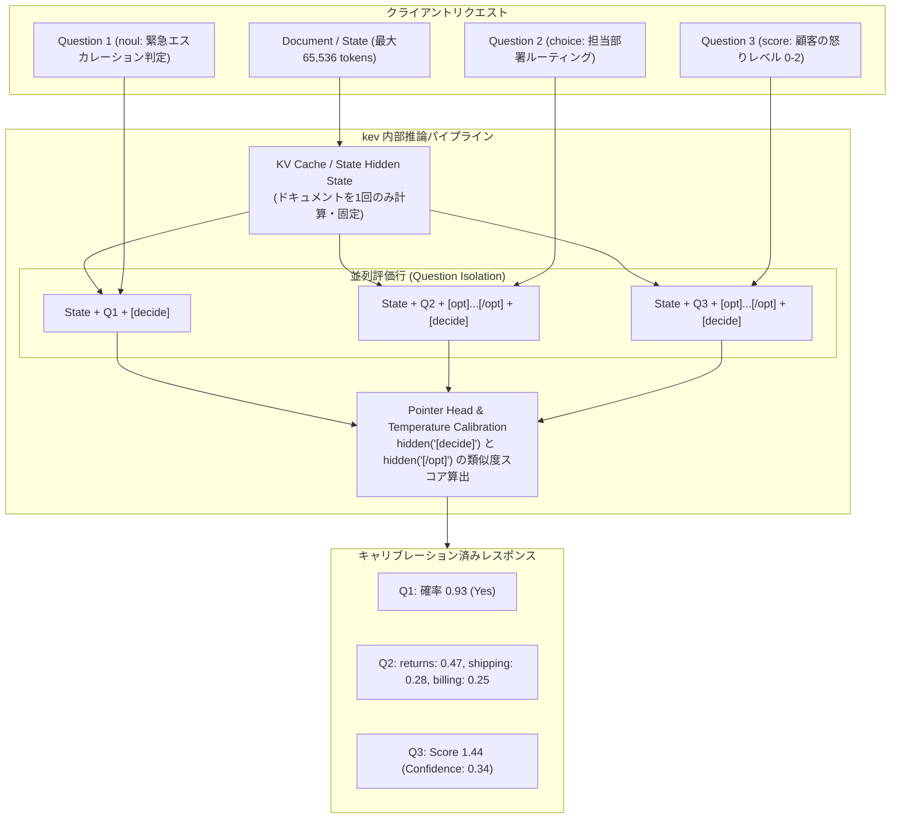

# kev: 概要

jaredpalmer/kev は 2026-09-18 に GitHub で作成されたリポジトリです。2026-10-14 時点のスター数は 9,128 です。

大規模言語モデル（LLM）を実務の自動化パイプラインに組み込む際、最大の障壁となるのが「ハルシネーション（幻覚）」と「確率の不透明さ（信頼度スコアの欠如）」、そして「トークン生成による推論遅延とコスト」です。分類、ルーティング、コンプライアンスチェック、トリアージといった日常の意思決定タスクにおいて、チャット特化型LLMに自由形式で回答を出力させ、それを正規表現やJSON Modeでパースするアプローチは、構造的に不安定であり運用コストも跳ね上がります。

この構造的課題を打破するのが、Vercelの元VP of ProductでありTurborepoの作者としても知られるJared Palmer氏が主導するオープンソースプロジェクト **「kev」** です。

`kev` は、TypeSafe社が提供するクローズドな商用意思決定モデル「Jev（System One）」のアーキテクチャをリバースエンジニアリング・拡張し、オープンウェイトの **Qwen3.5 / Qwen3.8** 上に構築された意思決定（Decision-Making）専用モデルファミリーです。0.8B、4B、9B、27Bの4サイズを展開し、単一のリクエスト内で「Yes/No判定（noul）」「多肢選択（choice）」「多段階評価（score）」を同時に高精度かつキャリブレーション（較正）された信頼度確率付きで実行します。

### 主な特徴と革新性
1. **確率分布を直接出力（Calibrated Probabilities）**: 単一ラベルのテキスト生成ではなく、較正された温度パラメータ（Fitted Temperature）に基づき、数学的に正確な確率分布を出力。信頼度が閾値未満の場合は人間にエスカレーションする運用設計が容易。
2. **質問間の完全な分離（Question Isolation）**: 共通の長文コンテキスト（最大65,536トークン）を参照しつつ、同時に投入された質問同士が互いに影響を与えない独立推論設計。
3. **商用API（TypeSafe System One）とのドロップイン互換**: 公式Python SDKのエンドポイントをローカルホストに向けるだけで、一切のコード変更なしに自前インフラへ移行可能。
4. **推論効率**: H100上で6問の同時判定をわずか18.1msで完了。Apple Silicon（Mシリーズ）向けにはMLXバックエンドによる高速推論を標準サポート。

---

## 解決する主要な課題とアーキテクチャ

従来のLLMを用いたワークフロー自動化では、プロンプトインジェクションへの脆弱性や、複数質問を投じた際のコンテキスト内バイアス（前の回答に引きずられる現象）、出力トークン生成に伴うレイテンシがボトルネックでした。`kev` はこの課題を **「ポインターヘッド（Pointer Head）方式」** と **「独立した状態キャッシュ再利用」** によって根本から解決しています。



### アーキテクチャの要点
- **ハイブリッドバックボーン対応**: Qwen3.5/3.8のハイブリッド構造（Attention層 ＋ 再帰型Gated DeltaNet層）に最適化。DeltaNet層がアテンションマスクを無視する特性に対応するため、共通の`State`計算結果をキャッシュしつつ、質問ごとに独立した行（Row）としてフォワードパスを実行。質問間の完全な推論分離を保証。
- **Pointer Headメカニズム**: 各選択肢末尾の`<opt>...</opt>`トークンの隠れ状態と、質問末尾の`<decide>`トークンの隠れ状態の内積を取り、Softmaxを適用することで選択確率を計算。次トークン予測に依存しない方式で、出力は与えた選択肢のどれかになります。
- **Fitted Temperature**: チェックポイントごとに検証セットを用いて最適なTemperatureパラメータを事前フィッティング。Brierスコアを最小化し、確率値そのものを信頼度メトリクスとして直結可能。

---

## インストール（README からの転記）

以下は [README](https://github.com/jaredpalmer/kev#readme) のインストール手順のコードブロックを、そのまま転記したものです。当サイトでは動作を確認していません。最新の手順は README を確認してください。

```bash
git clone https://github.com/jaredpalmer/kev.git && cd kev
uv sync --extra serve
uv run --extra serve python -m kev.serve --run jaredpalmer/kev-4b --port 8009
```

```bash
curl -s localhost:8009/v1/systemone -H 'content-type: application/json' -d '{
  "state": "Shoes arrived two weeks late and in the wrong size. Also I see two charges on my card.",
  "model": "kev-latest",
  "questions": {
    "department":  {"type": "choice", "instructions": "Which team should handle this?",
                    "criteria": {"returns": "Exchanges, refunds, wrong or damaged items",
                                 "shipping": "Delivery status, delays, lost packages",
                                 "billing": "Charges, invoices, payment problems"}},
    "escalate":    {"type": "noul",  "instructions": "Does this need urgent human attention?"},
    "frustration": {"type": "score", "instructions": "How frustrated is the customer?",
                    "criteria": ["Calm", "Frustrated", "Very angry"]}
  }}'
```

```json
{
  "model": "kev-latest",
  "answers": {
    "department":  { "type": "choice", "choice": "returns", "confidence": 0.21,
                     "probabilities": { "returns": 0.47, "shipping": 0.28, "billing": 0.25 } },
    "escalate":    { "type": "noul", "noul": 0.93 },
    "frustration": { "type": "score", "score": 1.44, "confidence": 0.34,
                     "legend": { "0": "Calm", "1": "Frustrated", "2": "Very angry" },
                     "probabilities": { "0": 0.00, "1": 0.56, "2": 0.44 } }
  },
  "usage": { "input_tokens": 101, "output_tokens": 161 },
  "latency_ms": 495
}
```

```python
from typesafe_sdk import Choice, Noul, Score, TypeSafeClient

client = TypeSafeClient(
    api_key="local",
    base_url="http://127.0.0.1:8009",
    model="kev-latest",
)
response = client.system_one(
    state="I was charged twice. Please fix this ASAP.",
    questions={
        "billing": Noul(instructions="Is this ticket about billing?"),
        "tone": Choice(
            instructions="What is the customer's tone?",
            criteria={"calm": None, "frustrated": None, "angry": None},
        ),
        "urgency": Score(
            instructions="How urgent is this ticket?",
            criteria=["can wait", "this week", "today"],
        ),
    },
)
print(response.nouls["billing"].noul)
print(response.choices["tone"].choice)
print(response.scores["urgency"].score)
```

## ライセンス

- ライセンス: Apache License 2.0（SPDX: Apache-2.0）
- 確認先: [LICENSE ファイル](https://github.com/jaredpalmer/kev/blob/main/LICENSE)

この節はライセンスの名称と確認先を示すもので、法的な助言ではありません。利用の可否は、LICENSE ファイルの本文と利用する状況に照らして確認してください。
