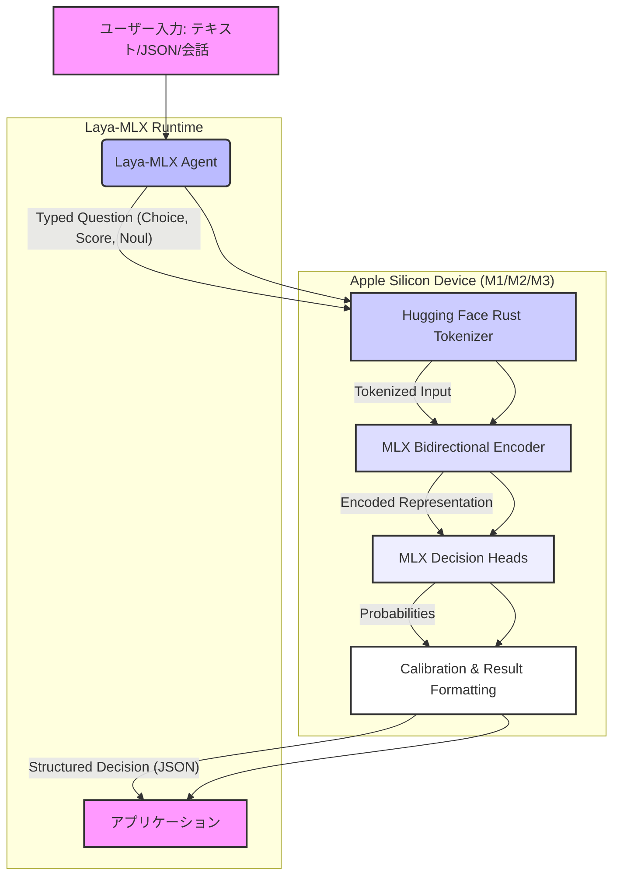

# laya-mlx: 概要と革新性

`laya-mlx`は、Apple Siliconデバイス上でLayaの型付き意思決定モデルをネイティブに実行するための、超高速なMLXランタイムです。従来のLLM（大規模言語モデル）が抱える高遅延、高コスト、クラウド依存といった課題を解決し、ミリ秒単位でのリアルタイムな意思決定を可能にします。テキスト生成を伴わない「選択」「スコア付け」「真偽判定」といった特定のタスクに特化することで、M3 Maxチップ上でわずか7〜14ミリ秒という驚異的な応答速度を実現します。PyTorchやTransformersランタイム、さらにはクラウドAPIへの依存も一切ありません。

## 🎯 成熟度の目安（AI による見立て）

**判定: TRIAL**

### 根拠
*   **高いパフォーマンスと特化性**: Apple Siliconに最適化され、M3 Maxで7ms台という圧倒的な低遅延を実現しています。特定の「型付き意思決定」タスクに特化することで、LLMのオーバースペック問題を解消しています。
*   **活発なコミュニティと開発**: GitHubスター数6956は、このニッチな分野における高い注目度とコミュニティの活発さを示しています。詳細なベンチマーク、ドキュメント、デモが提供されており、開発の成熟度が高いです。
*   **MLXの採用**: Appleが提供する機械学習フレームワークMLXをネイティブに利用しており、Appleエコシステム内での将来性と最適化の可能性を秘めています。
*   **限定的な適用範囲**: 現時点ではApple Siliconデバイスに特化しており、幅広いハードウェア環境での利用は限定的です。また、汎用的なテキスト生成には対応していません。

### 推奨活用フェーズ
*   **Apple Silicon環境でのAI推論を高速化したい企業**: 特にMシリーズチップを搭載したMacやiPad Proを開発・運用環境として利用している企業にとって、既存のAIワークロードを劇的に高速化する可能性があります。
*   **エッジAI・リアルタイム意思決定システム**: 製造ラインでの品質検査、金融取引のリアルタイム不正検知、ゲームAIの行動決定など、ミリ秒単位の応答が求められるエッジAIアプリケーションやリアルタイムシステムでの採用が推奨されます。
*   **LLMのコスト・遅延問題に直面している企業**: テキスト生成が不要な「分類」「判定」タスクにおいて、高額なLLM API利用料や応答遅延に課題を感じている場合、Laya-MLXは費用対効果の高い代替手段となり得ます。

## 解決する主要な課題とアーキテクチャ

`laya-mlx`が解決する主要な課題は、現代のAIアプリケーションにおける「意思決定」プロセスのボトルネックです。従来のLLMは強力ですが、以下の問題点がありました。

1.  **高遅延**: テキスト生成プロセスは本質的に時間がかかり、リアルタイム性が求められるアプリケーションには不向きです。
2.  **高コスト**: クラウドベースのLLM APIは利用量に応じてコストが増大し、大規模な運用では予算を圧迫します。
3.  **クラウド依存とプライバシー**: センシティブなデータをクラウドに送信する必要があり、データプライバシーやセキュリティの懸念が生じます。
4.  **オーバースペック**: 単純な「分類」や「判定」にLLMを使うのは、機能的に過剰であり、リソースの無駄です。

`laya-mlx`は、これらの課題に対し、Apple Siliconに最適化されたMLXランタイムとLayaの型付き意思決定モデルを組み合わせることで、以下のようなアーキテクチャで解決策を提供します。



**アーキテクチャの主要コンポーネント:**

*   **Laya-MLX Agent**: ユーザーからの入力と型付き質問（`choice`, `score`, `noul`）を受け取ります。
*   **Hugging Face Rust Tokenizer**: 入力テキストを高速にトークン化します。
*   **MLX Bidirectional Encoder**: トークン化された入力を双方向エンコーダで処理し、意味的な表現を生成します。この部分はApple SiliconのGPU上でMLXによって最適化され、高速に実行されます。
*   **MLX Decision Heads**: エンコーダの出力を基に、指定された型（選択肢、スコア、真偽）に応じた確率を計算します。
*   **Calibration & Result Formatting**: 計算された確率をキャリブレーションし、指定されたスキーマに従ってJSON形式の意思決定結果を返します。

このアーキテクチャにより、`laya-mlx`はテキスト生成を伴わない特定の意思決定タスクにおいて、極めて高速かつ効率的なオンデバイスAI推論を実現します。

## 競合ツール/商用SaaSとの徹底比較

| 特徴/ツール | laya-mlx | クラウドLLM API (例: OpenAI GPT-4) | PyTorch/Transformersローカル推論 | 汎用的な分類SaaS (例: Google Cloud AI Platform) |
|---|---|---|---|---|
| **主要機能** | 型付き意思決定 (選択、スコア、真偽) | テキスト生成、要約、翻訳、分類など汎用 | モデルに応じた多様なタスク | 特定タスクの分類、予測 |
| **実行環境** | Apple Silicon (Mシリーズチップ) 上でネイティブ | クラウドAPI (インターネット接続必須) | GPU/CPU (環境構築が複雑) | クラウドAPI (インターネット接続必須) |
| **応答速度** | **7-14 ms (M3 Max)** | 数百ms〜数秒 (モデル、負荷による) | 数十ms〜数秒 (ハードウェア、モデルによる) | 数十ms〜数百ms |
| **コスト** | **初期ハードウェア投資のみ** (ランニングコストほぼゼロ) | **従量課金制** (トークン数、リクエスト数に応じる) | 初期ハードウェア投資 + 電力コスト | 従量課金制 |
| **データプライバシー** | **完全オフライン処理** (データがデバイス外に出ない) | データがクラウドプロバイダに送信される | 完全オフライン処理 (設定による) | データがクラウドプロバイダに送信される |
| **セットアップ** | `pip install laya-mlx` で容易 | APIキー取得、SDK導入 | PyTorch, Transformers, CUDA等の複雑な環境構築 | APIキー取得、SDK導入、モデル学習 |
| **依存関係** | MLX, Hugging Face Rust Tokenizer | クラウドAPIプロバイダ | PyTorch, Transformers, CUDA/cuDNN, Python | クラウドAPIプロバイダ |
| **スケーラビリティ** | デバイスの数に依存 (エッジスケーリング) | クラウドプロバイダが管理 (高スケーラブル) | ハードウェア増強、分散処理 | クラウドプロバイダが管理 (高スケーラブル) |
| **ユースケース** | リアルタイム意思決定、エッジAI、低遅延分類 | 顧客対応、コンテンツ生成、複雑な分析 | 研究開発、カスタムモデルデプロイ | 顧客セグメンテーション、スパム検出 |

**laya-mlxの優位性:**

*   **圧倒的な速度と低コスト**: 特定の意思決定タスクにおいて、クラウドLLM APIや汎用SaaSと比較して桁違いの速度とランニングコストの削減を実現します。
*   **究極のデータプライバシー**: 全てオンデバイスで処理されるため、機密性の高いデータを外部に送信する必要がありません。
*   **Apple Siliconへの最適化**: Appleエコシステムを活用する企業にとって、既存のハードウェア投資を最大限に活かせます。

## 💡 ビジネス・マネタイズ活用アイデア（実践例）

1.  **リアルタイムカスタマーサポートの自動化**:
    *   **課題**: 顧客からの問い合わせを瞬時に適切な部門にルーティングしたり、緊急度を判定したりするのに時間がかかる。LLMを使うとコストが高い。
    *   **laya-mlx活用**: 顧客の問い合わせテキストを`laya-mlx`に入力し、「部門（billing, technical, sales）」や「緊急度（not urgent, soon, critical）」をミリ秒単位で判定。判定結果に基づき、自動でチケットを割り振ったり、優先順位を付けたりする。
    *   **実践例**: 顧客がチャットボットに「二重請求されたので返金してほしい」と入力すると、即座に「部門: billing」「緊急度: critical」と判定され、担当者に通知される。

2.  **金融取引のリアルタイムリスク評価**:
    *   **課題**: クレジットカードの不正利用検知や、高頻度取引におけるリスク評価は、ミリ秒単位の応答が求められる。
    *   **laya-mlx活用**: 取引データ（状態）とリスクに関する質問（例: 「この取引は不正の可能性が高いか？」「承認すべきか？」）を`laya-mlx`に入力。瞬時に「真偽（noul）」や「スコア（score）」を判定し、取引の承認/拒否や追加認証の要否を決定する。
    *   **実践例**: ユーザーがオンラインで高額商品を購入しようとした際、過去の取引履歴やデバイス情報から「不正利用の可能性: true」と判定され、即座に取引が一時停止される。

3.  **ゲームAIの高度な意思決定**:
    *   **課題**: ゲーム内のNPC（非プレイヤーキャラクター）がリアルタイムで複雑な状況判断を行い、自然な行動を取るには高速な意思決定が必要。
    *   **laya-mlx活用**: ゲームの状態（プレイヤーの位置、敵の数、アイテムの有無など）を`laya-mlx`に入力し、「次の行動（攻撃、回避、アイテム使用）」や「優先ターゲット」を瞬時に決定。READMEのSnakeデモのように、ミリ秒単位でキャラクターの動きを制御する。
    *   **実践例**: 敵キャラクターがプレイヤーの接近を感知すると、`laya-mlx`が「攻撃」か「回避」かを瞬時に判断し、最適な行動を取る。

4.  **エッジデバイスでの品質管理・異常検知**:
    *   **課題**: 製造ラインやIoTデバイスで、リアルタイムに製品の品質を判定したり、異常を検知したりする必要がある。クラウド連携は遅延やコストの問題がある。
    *   **laya-mlx活用**: カメラ画像から抽出された特徴量やセンサーデータ（状態）を`laya-mlx`に入力し、「製品は合格か不合格か（noul）」や「異常の種類（choice）」を判定。
    *   **実践例**: 製造ライン上のカメラが製品の欠陥を検知すると、`laya-mlx`が「欠陥の種類: 傷」と判定し、不良品を自動で排除する。

## インストール & クイックスタート手順

`laya-mlx`のインストールと利用は非常に簡単です。Apple Siliconを搭載したMac（macOS 14+、Python 3.11+）が必要です。

### 1. インストール

```bash
pip install laya-mlx
```

### 2. クイックスタート（Python API）

基本的な使い方は、モデルをロードし、`predict`メソッドを呼び出すだけです。

```python
import laya_mlx as laya

# モデルをロード（初回実行時にチェックポイントをダウンロード）
# "aac6fef/laya-mlx" はHugging Faceに公開されているFP16変換済みモデルID
agent = laya.load("aac6fef/laya-mlx")

# 意思決定のコンテキストとなる「状態」と、実行したい「質問」を定義
# 質問は「型付き」で、choice, score, noul のいずれかを指定
state = "I was billed twice. Please refund the duplicate."
questions = {
    "department": {
        "type": "choice",
        "instructions": "Who should handle this?",
        "criteria": ["billing", "technical", "sales"],
    }
}

# 予測を実行
result = agent.predict(state, questions)

# 結果を出力
print(result["answers"]["department"])
# 例: {'answer': 'billing', 'act_probability': 0.9876, ...}
```

### 3. Snakeデモの実行

`laya-mlx`のリアルタイム意思決定能力を体験できるSnakeゲームデモも用意されています。

```bash
# デモに必要な依存関係をインストール
pip install 'laya-mlx[demo]'

# 多言語モデルをダウンロード（オフラインデモ用）
hf download aac6fef/laya-multilingual-mlx

# Snakeゲームを実行
laya-snake
```

ターミナルでゲームが起動します。スペースキーで一時停止、↑/↓で速度変更、Rでリセット、Qで終了です。`laya-snake --optimize --max-speed`で最適化された高速モードを体験できます。

## 商用利用可否 & ライセンス考察

`laya-mlx`は**Apache License 2.0**で提供されています。

### 商用利用可否
**はい、商用利用は可能です。** Apache License 2.0は非常に寛容なオープンソースライセンスであり、以下の条件を満たせば、商用製品やサービスに組み込むことができます。

*   **ライセンス表示**: プロジェクト内で`laya-mlx`を使用していることを明記し、Apache License 2.0のコピーを含める必要があります。通常、製品のドキュメントや「About」セクションに記載します。
*   **著作権表示**: オリジナルの著作権表示（`mizorewww/laya-mlx`およびConvai Innovations）を保持する必要があります。
*   **変更点の明記**: もし`laya-mlx`のソースコードを改変して使用する場合、その変更点を明確に表示する必要があります。
*   **特許**: Apache License 2.0は、貢献者が提供する特許権の付与を含みます。

### ライセンス考察
Apache License 2.0は、MIT LicenseやBSD Licenseと同様に、企業がオープンソースソフトウェアを商用利用する上で非常に友好的なライセンスです。GPL系ライセンスのように、派生作品も同じライセンスで公開する義務（コピーレフト）がないため、クローズドソースの商用製品に組み込むことが可能です。

したがって、`laya-mlx`を基盤とした商用サービスや製品を開発する際も、ライセンス上の大きな制約なく、安心して利用・展開できます。ただし、上記のライセンス表示義務は必ず遵守してください。
