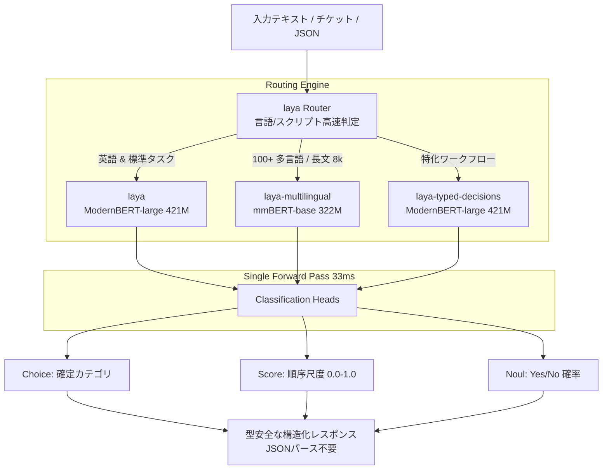

# laya: 概要

NandhaKishorM/laya は 2026-09-18 に GitHub で作成されたリポジトリです。2026-10-10 時点のスター数は 31,976 です。

LLM（大規模言語モデル）の台頭により、カスタマーサポートのトリアージ、コンテンツモデレーション、ルーティングなどのテキスト分類タスクにGPT-4やClaude等の生成モデルを組み込む例が急増しました。しかし、そこでエンジニアが直面するのが**「トークン生成による大きなレイテンシ（数百ms〜数秒）」「高額なAPIコスト」「JSONパース失敗」「確率的ハルシネーション」**というSystem 2（熟慮型）推論特有の致命的ペインです。

GitHubで31,000スターを超える急上昇OSS **「laya」** は、この課題を根本から覆す**「Non-autoregressive（非自己回帰型）System 1意思決定エンジン」**です。

Daniel Kahnemanの提唱する「System 1（直感的・瞬時な思考）」をAIアーキテクチャに落とし込み、テキスト生成（Token-by-token generation）を一切行いません。独自のエンコーダ構造（ModernBERT / mmBERT）と、厳密適格スコアリングルール（Strictly Proper Scoring Rules: RLCD）で学習された分類ヘッドにより、**単一のフォワードパス（わずか33ms）**で型付けされた決定（Typed Choice、Score、Yes/No）を出力します。

### 主なポイント
- **超低レイテンシ・高スループット**: 単一クエリ33ms、バッチ処理時7.2ms/クエリ（T4 GPU測定）。
- **ゼロ・ハルシネーション & 堅牢な型安全性**: テキストを生成しないため、存在しないラベルの出力やJSONの構文エラーが構造的にゼロ。
- **100以上の言語を自動ルーティング**: サブミリ秒で言語とスクリプトを判定し、最適なチェックポイントへ振り分ける内蔵`Router`。
- **長文対応（最大8,192トークン）**: `laya-multilingual`は最大8,192トークンまでの長文コンテキストに対応。

---

## 解決する主要な課題とアーキテクチャ

従来のLLMベースの意思決定パイプラインでは、プロンプトにJSONスキーマを埋め込み、生成された文字列をPydantic等でバリデーションしていました。この方式はトークン課金が嵩むだけでなく、並列リクエスト時のキュー詰まりを引き起こします。

`laya`は、リクエスト判定を瞬時に行う「Router層」と、特化型エンコーダで構成された「Decision Engine層」の2層構造を採用しています。



### モデルチェックポイントの役割分担
1. **`laya` (421M / ModernBERT-large)**: 英語テキストに最適化されたベースモデル。
2. **`laya-multilingual` (322M / mmBERT-base)**: 100以上の言語に対応し、ベースモデルの約2倍の推論速度を誇る。最大8,192トークンまで拡張可能。
3. **`laya-typed-decisions` (421M)**: 業務意思決定ベンチマークでRLCDによりファインチューニングされた高精度モデル。

---

## インストール（README からの転記）

以下は [README](https://github.com/NandhaKishorM/laya#readme) のインストール手順のコードブロックを、そのまま転記したものです。当サイトでは動作を確認していません。最新の手順は README を確認してください。

```bash
python -m pip install laya
```

```python
from laya import Router

router = Router()  # downloads a checkpoint on first use; Router(preload=True) loads all three up front

state = "Hi, we were billed twice for March. Please refund the duplicate today or we will cancel our plan."
questions = {
    "department": {"type": "choice", "instructions": "Which department should handle this?",
                   "criteria": {"billing": "invoices, payments, refunds",
                                "technical": "bugs, outages, system errors",
                                "other": "everything else"}},
    "urgency": {"type": "score", "instructions": "How urgent is this?",
                "criteria": ["not urgent", "soon", "blocking"]},
    "churn_risk": {"type": "noul", "instructions": "Does the user threaten to cancel or leave?"},
}

result = router.predict(state, questions)
print(result["answers"]["department"]["choice"])  # billing
print(result["answers"]["churn_risk"]["noul"])    # probability the answer is yes
print(result["routing"]["model"])                 # english
```

```python
for text in ["मुझसे मार्च में दो बार शुल्क लिया गया, कृपया डुप्लिकेट राशि वापस करें।",
             "La aplicación se cierra cada vez que abro la configuración."]:
    r = router.predict(text, {"department": questions["department"]})
    print(r["routing"]["model"], r["answers"]["department"]["choice"])
# multilingual billing
# multilingual technical
```

```bash
python -m pip install laya
```

## ライセンス

- ライセンス: Apache License 2.0（SPDX: Apache-2.0）
- 確認先: [LICENSE ファイル](https://github.com/NandhaKishorM/laya/blob/main/LICENSE)

この節はライセンスの名称と確認先を示すもので、法的な助言ではありません。利用の可否は、LICENSE ファイルの本文と利用する状況に照らして確認してください。
