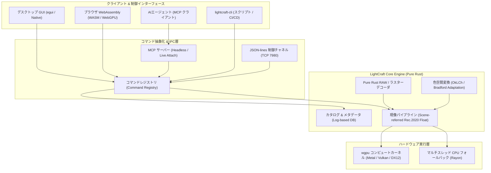

# lightcraft: 概要と革新性

**LightCraft**は、純粋なRust（Pure Rust）のみを用いてゼロからクリーンルーム設計で構築された、オープンソースの非破壊型RAW現像・写真ライブラリ管理エンジンです。Adobe Lightroomのコア機能をオープンソースとして再実装し、デスクトップ（macOS / Windows / Linux）だけでなく、WebAssembly（WASM）によるブラウザ動作、さらにはヘッドレス環境におけるCLIバッチ処理まで完全対応しています。

最大の革新性は、**「Model Context Protocol（MCP）およびJSON-lines制御チャネルのネイティブ統合」**にあります。UIのすべてのスライダー、トグル、マスク描画、書き出し処理が独立したコマンドとして抽象化されており、人間がGUIから操作するのと全く同一のパスで、LLMやAIエージェントがプログラム経由で現像パイプラインをリアルタイム駆動・検証できます。

さらに、C言語依存ライブラリ（LibRawやdcrawなど）を完全に排除し、各種カメラメーカーのRAWデコーダからRec.2020 32-bit浮動小数点リファレンスパイプライン、OkLCh知覚色空間処理、`wgpu`によるGPUコンピュートシェーダーまでを自前で実装。メモリ安全性、並行処理性能、決定論的再現性を兼ね備えた次世代クリエイティブインフラです。

---

## 解決する主要な課題とアーキテクチャ

従来のRAW現像ソフトウェアおよび画像バッチ処理基盤は、以下の深刻なアーキテクチャ的課題を抱えていました：

1. **ベンダーロックインとライセンス・サブスクリプションコスト**: クリエイティブ現場やEC撮影スタジオにおいて、シート数に応じた高額な商用SaaS/ソフトウェアライセンス費が恒常的に発生。
2. **C/C++製レガシーコードの安全性と移植性の低さ**: 既存のOSS現像ツール（RawTherapeeやdarktable等）は歴史的経緯から大量のC/C++ライブラリに依存しており、WebAssembly化やセキュアなマルチテナントクラウド環境への統合が困難。
3. **AI・自動化連携の欠如**: 従来のデスクトップツールはGUI操作を前提としており、外部プログラムやAIエージェントが「パラメータを調整しながら途中プレビューをフィードバックループで確認する」ヘッドレス実行パイプラインが存在しなかった。

LightCraftは、厳格なレイヤードアーキテクチャを採用し、UI層（`ui-egui`）と現像エンジン（`engine` / `pipeline`）を完全に分離することでこれらの課題を解決しています。



パイプラインの各ステージはGPUコンピュートシェーダー（`wgpu`）により並列実行され、24MPのRAW画像であってもスライダー操作の再レンダリングが約4ms、フル解像度エクスポートが約0.3秒で完了します。GPUが存在しないサーバー環境では自動的にCPUマルチスレッドへフォールバックし、1/255以下の誤差でビット完全性を維持した出力が得られます。

---

## 競合ツール/商用SaaSとの徹底比較

| 評価項目 | Adobe Lightroom (Classic/Cloud) | darktable / RawTherapee | **LightCraft (本OSS)** |
| :--- | :--- | :--- | :--- |
| **ソースコード & 実装言語** | クローズドソース (C++ / 独自) | オープンソース (C / C++) | **完全オープンソース (Pure Rust)** |
| **ライセンス形態** | 月額サブスクリプション (高額) | GPL v3+ (制約あり) | **Apache-2.0 / MIT (極めて商用利用しやすい)** |
| **AI/エージェント自動化** | 限定的プラグイン / 手動GUI中心 | スクリプト連携は限定的 | **MCPネイティブ対応・全UI要素へのAPI直接アクセス** |
| **クラウド/ブラウザ実行** | Web版はあるが閉鎖的 | 不可 (デスクトップ専有) | **WebAssembly + WebGPU でブラウザ完全動作** |
| **内部パイプライン** | 独自Floatパイプライン | 32-bit Float パイプライン | **Scene-referred Rec.2020 32-bit Float + OkLCh** |
| **データプライバシー** | クラウド同期・テレメトリ前提 | ローカル完結 | **完全ローカルファースト、通信・テレメトリ皆無** |
| **ヘッドレス実行/CI/CD** | 不可 | CLIはあるが制御性に難 | **CLIおよびJSON-linesプロトコルによる完全外部制御** |

---

## 💡 ビジネス・マネタイズ活用アイデア（実践例）

LightCraftのApache-2.0 / MITデュアルライセンスと堅牢なヘッドレス・MCPアーキテクチャは、以下のような高付加価値ビジネスの基盤として活用可能です。

### 1. EC・アパレル向け「AI自律型カタログ写真現像パイプライン」の受託開発
スタジオ撮影された数千〜数万枚のRAW/JPEG画像に対し、Claude等のLLMエージェントがMCP経由でLightCraftを操作。商品種別を画像認識し、「肌色トーンの保護」「背景白飛び補正」「ブランド規定カラー（OkLCh空間での特定色域保持）」を自動適用してバッチ書き出しを行う完全自動現像システムの構築。

### 2. 写真スタジオ・不動産撮影向けプライベートクラウド現像SaaS
自社サーバーまたはオンプレミスインフラ上にLightCraftのCLI/WASMコンテナを展開。機密性の高い写真データを外部クラウド（Adobe Creative Cloud等）に一切送信することなく、Webブラウザ上でスタッフがリアルタイム現像・共同校正できる社内限定SaaSの提供。

### 3. 高度プリント出力・コンタクトシート生成マイクロサービス
LightCraftが標準搭載する「Contact Sheet PDF生成エンジン」と連動し、撮影現場からRAWをアップロードするだけで、撮影メタデータ（EXIF/露出/レンズ情報）を付与した検収用A4/Letter PDFコンタクトシートを瞬時に生成・配信する自動化Webhookサービスの構築。

---

## インストール & クイックスタート手順

LightCraftのビルドおよび実行には、**Rust 1.95以上**が必要です。

### 1. ソースコードの取得とデスクトップアプリの起動

```bash
# リポジトリのクローン
git clone https://github.com/storytold/lightcraft.git
cd lightcraft

# デスクトップアプリケーションのビルド & 起動 (初回はデモライブラリが自動生成)
cargo run --release -p lightcraft

# 写真フォルダを指定して直接インポート起動
cargo run --release -p lightcraft -- ~/Pictures/Photoshoot
```

### 2. CLIによるヘッドレス現像・エクスポート

UIを起動せず、ターミナルから一括でRAW/JPEGの現像パラメータ変更と書き出しを実行できます。

```bash
# 露出を+0.5補正し、長辺2048pxのJPEGとして書き出し
cargo run --release -p lightcraft-cli -- render input.dng \
  -o output.jpg \
  --set light.exposure=0.5 \
  --set light.highlights=-30 \
  --set light.shadows=20
```

### 3. MCP（Model Context Protocol）サーバーの起動（AI連携）

Claude Desktop等のMCPクライアントからLightCraftを直接駆動するための設定：

```bash
# CLIツールのビルド
cargo build --release -p lightcraft-cli

# MCPサーバーをヘッドレスモードで起動
./target/release/lightcraft-cli mcp ~/Pictures/Photoshoot
```

---

## 商用利用可否 & ライセンス考察

LightCraftは、**Apache License 2.0 および MIT License のデュアルライセンス**で公開されています。

- **商用利用**: ソースコードの商用利用、改変、自社プロプライエタリ製品への組み込み、SaaSバックエンドとしての提供が法的に完全に認められています。
- **GPL汚染の完全回避**: 開発方針として「Clean-Room（クリーンルーム設計）」が徹底されており、Adobeバイナリの解析や、GPLライセンスで提供されている競合ツール（darktable, RawTherapee, LibRaw等）のコードを参照・混入させない運用規約が敷かれています。これにより、企業の法務・知財コンプライアンス基準を極めて容易にクリアできます。
- **配布要件**: 成果物を配布または再頒布する際には、著作権表示およびライセンス通知を保持するだけで運用可能です。
