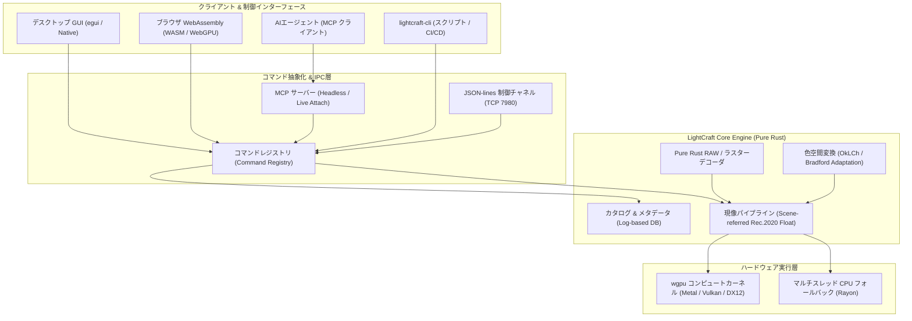

# lightcraft: 概要

storytold/lightcraft は 2026-09-30 に GitHub で作成されたリポジトリです。2026-10-12 時点のスター数は 10,183 です。

**LightCraft**は、純粋なRust（Pure Rust）のみを用いてゼロからクリーンルーム設計で構築された、オープンソースの非破壊型RAW現像・写真ライブラリ管理エンジンです。Adobe Lightroomのコア機能をオープンソースとして再実装し、デスクトップ（macOS / Windows / Linux）だけでなく、WebAssembly（WASM）によるブラウザ動作、さらにはヘッドレス環境におけるCLIバッチ処理まで完全対応しています。

最大の革新性は、**「MCPおよびJSON-lines制御チャネルのネイティブ統合」**にあります。UIのすべてのスライダー、トグル、マスク描画、書き出し処理が独立したコマンドとして抽象化されており、人間がGUIから操作するのと全く同一のパスで、LLMやAIエージェントがプログラム経由で現像パイプラインをリアルタイム駆動・検証できます。

さらに、C言語依存ライブラリ（LibRawやdcrawなど）を使わずに、各種カメラメーカーのRAWデコーダからRec.2020 32-bit浮動小数点リファレンスパイプライン、OkLCh知覚色空間処理、`wgpu`によるGPUコンピュートシェーダーまでを自前で実装。メモリ安全性、並行処理性能、決定論的再現性を兼ね備えた次世代クリエイティブインフラです。

---

## 解決する主要な課題とアーキテクチャ

従来のRAW現像ソフトウェアおよび画像バッチ処理基盤は、以下の深刻なアーキテクチャ的課題を抱えていました：

1. **ベンダーロックインとライセンス・サブスクリプションコスト**: クリエイティブ現場やEC撮影スタジオにおいて、シート数に応じた高額な商用SaaS/ソフトウェアライセンス費が恒常的に発生。
2. **C/C++製レガシーコードの安全性と移植性の低さ**: 既存のOSS現像ツール（RawTherapeeやdarktable等）は歴史的経緯から大量のC/C++ライブラリに依存しており、WebAssembly化やセキュアなマルチテナントクラウド環境への統合が困難。
3. **AI・自動化連携の欠如**: 従来のデスクトップツールはGUI操作を前提としており、外部プログラムやAIエージェントが「パラメータを調整しながら途中プレビューをフィードバックループで確認する」ヘッドレス実行パイプラインが存在しなかった。

LightCraftは、厳格なレイヤードアーキテクチャを採用し、UI層（`ui-egui`）と現像エンジン（`engine` / `pipeline`）を完全に分離することでこれらの課題を解決しています。



パイプラインの各ステージはGPUコンピュートシェーダー（`wgpu`）により並列実行され、24MPのRAW画像であってもスライダー操作の再レンダリングが約4ms、フル解像度エクスポートが約0.3秒で完了します。GPUが存在しないサーバー環境では自動的にCPUマルチスレッドへフォールバックし、1/255以下の誤差でビット完全性を維持した出力が得られます。

---

## インストール（README からの転記）

以下は [README](https://github.com/storytold/lightcraft#readme) のインストール手順のコードブロックを、そのまま転記したものです。当サイトでは動作を確認していません。最新の手順は README を確認してください。

```sh
git clone https://github.com/storytold/lightcraft && cd lightcraft
cargo run --release -p lightcraft                       # opens your library (~/Pictures/LightCraft Library; a new one starts with demo photos)
cargo run --release -p lightcraft -- ~/Pictures/trip    # import your photos (folders are scanned, duplicates skipped)
cargo run --release -p lightcraft -- --memory           # a throwaway in-memory demo session (writes nothing)
cargo run --release -p lightcraft -- --control 7980     # with the automation channel
cargo xtask web --serve                                 # the same app in the browser: http://127.0.0.1:8080/
cargo run --release -p lightcraft-cli -- render photo.jpg -o out.jpg --set light.exposure=0.5
cargo xtask ci                                          # fmt, clippy, HEIF, tests, parity, layers, assets, WASM
```

```sh
CARGO_BUILD_JOBS=1 cargo build --release -p lightcraft -p lightcraft-cli
# Alternatively: CARGO_BUILD_JOBS=2 cargo build --release -p lightcraft -p lightcraft-cli
```

```sh
CARGO_BUILD_JOBS=1 CARGO_PROFILE_RELEASE_DEBUG=0 CARGO_PROFILE_RELEASE_LTO=false CARGO_PROFILE_RELEASE_CODEGEN_UNITS=16 cargo build --release -p lightcraft -p lightcraft-cli
```

```sh
git clone https://github.com/storytold/craft-fonts ../craft-fonts
CRAFT_FONTS_DIR=../craft-fonts cargo run --release -p lightcraft
```

## ライセンス

- ライセンス: Apache License 2.0（SPDX: Apache-2.0）
- 確認先: [LICENSE ファイル](https://github.com/storytold/lightcraft/blob/main/LICENSE-APACHE)

この節はライセンスの名称と確認先を示すもので、法的な助言ではありません。利用の可否は、LICENSE ファイルの本文と利用する状況に照らして確認してください。
