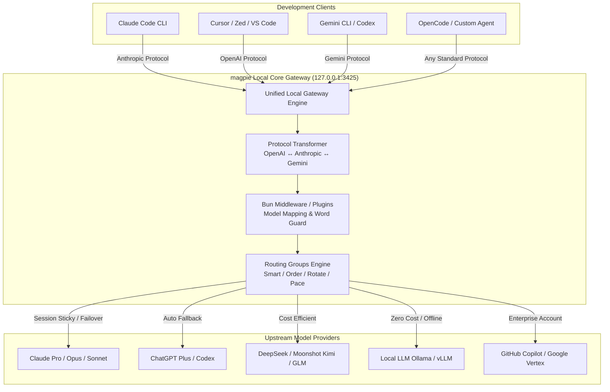

# magpie: 概要

yetone/magpie は 2026-09-24 に GitHub で作成されたリポジトリです。2026-10-14 時点のスター数は 11,503 です。

近年、エンジニアの日常業務には「Claude Code」「Cursor」「Codex」「Gemini CLI」「OpenCode」といった多種多様なAIコーディングエージェントが入り乱れています。しかし、開発現場では深刻な**「エージェント・プロバイダーのサイロ化」**が発生しています。

各エージェントは独自の設定ファイル形式を持ち、有料サブスクリプション（ChatGPT Plus、Claude Pro、GitHub Copilot等）や個別のAPIキーが各ツール内部に閉じ込められています。そのため、「Claude CodeでDeepSeek V4を使いたい」「Cursorの裏側で割安なKimiやローカルLLMを動かしたい」「APIクォータが切れたら別アカウントへシームレスにフェイルオーバーさせたい」という要求に対して、設定ファイルの書き換えやプロトコル変換を泥臭く手作業で行う必要がありました。

この課題を対象にしているのが、Go言語製のオープンソース・統合ゲートウェイ**「magpie」**です。

### magpieのコア革新性
1. **全主要プロトコルのリアルタイム相互変換**：ローカルポート（`127.0.0.1:3425`）で待受し、OpenAI Chat/Responses、Anthropic Messages、Google GeminiのAPI仕様を自動相互トランスパイル（ストリーミング・Tool Use・Reasoning tags完全対応）。
2. **エージェント設定ファイルの非破壊的自動書き換え**：各CLIエージェントの設定（JSON, TOML, YAML等）の構造・コメントを壊すことなく、ターゲットURLとモデル指定をワンクリック／1コマンドで置換。
3. **インテリジェント・ルーティング＆クォータ・フェイルオーバー**：複数アカウントや異なるLLMをグループ化し、トークン残量、更新タイミング（smart/pace）、推論コスト（Intent Routing）に応じてリクエストを自動分散。
4. **JavaScript/Bunベースのゲートウェイミドルウェア拡張**：`onRequest`、`onResponse`をフックし、プロンプトの注入、マスク、モデルリライトを数行で実装可能。

---

## 解決する主要な課題とアーキテクチャ

従来のエージェント利用環境では、ツールごとに個別のAPI設定やキーの分散管理が必要であり、サブスクリプションの利用制限（Rate Limit）到達による作業停止が日常茶飯事でした。

magpieはローカルプロキシアーキテクチャを採用し、すべてのエージェントとすべてのLLMプロバイダ間に透過的なレイヤーを挟み込みます。



### アーキテクチャの強み
- **セッション維持（Sticky Session）**：プロンプトキャッシュの効果を最大化するため、同一セッションのリクエストはキャッシュが有効な同一プロバイダに固定。
- **意図ルーティング（Intent Routing）**：小型LLMがリクエスト内容を瞬時に判定。単純な質問は格安のDeepSeekやKimiへ、複雑なリファクタリングやテストコード生成はClaude Opus/GPT-4oへ自動振り分け。
- **安全な認証抽出**：OSのKeychainやローカルCLIの既存セッションから安全にサブスクリプション認証を同期し、追加キー発行なしで他エージェントに再利用可能。

---

## インストール（README からの転記）

以下は [README](https://github.com/yetone/magpie#readme) のインストール手順のコードブロックを、そのまま転記したものです。当サイトでは動作を確認していません。最新の手順は README を確認してください。

```sh
curl -fsSL https://usemagpie.ai/install.sh | sh
```

> ⚠️ 注意: インターネットから取得したスクリプトをそのまま実行する手順です。実行前にスクリプトの中身を確認し、可能であればバージョン（タグやコミット）を固定してください。

```sh
magpie provider add deepseek sk-…              # a preset needs only the key
magpie claude deepseek/deepseek-v4-pro          # Claude Code on DeepSeek
magpie codex moonshot/kimi-k2.5                 # Codex on Kimi
magpie group add "Opus anywhere" models=claude/claude-opus-5-5,copilot/claude-opus-5.5 routing=smart
magpie claude group/opus-anywhere               # fails over between subscriptions
magpie save work && magpie use work             # profiles
magpie quota                                    # what's left on every plan
magpie tui                                      # the whole thing, in a terminal
```

## ライセンス

- ライセンス: MIT License（SPDX: MIT）
- 確認先: [LICENSE ファイル](https://github.com/yetone/magpie/blob/main/LICENSE)

この節はライセンスの名称と確認先を示すもので、法的な助言ではありません。利用の可否は、LICENSE ファイルの本文と利用する状況に照らして確認してください。
