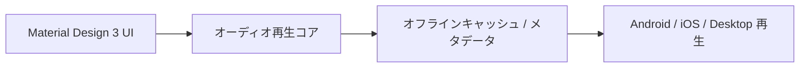

# md3Music: 概要

zzyoxml/md3Music は 2026-05-29 に GitHub で作成されたリポジトリです。2026-10-09 時点のスター数は 858 です。

`md3Music` は、GitHubで858以上のスターを獲得している注目のオープンソースプロジェクトです。Dart言語で書かれたFlutterフロントエンドと、高性能なRust製バックエンドを組み合わせた、次世代のAndroid音楽プレイヤーとして開発されています。その名の通り、Googleの最新デザインシステムであるMaterial Design 3 (MD3) と、Apple Musicの洗練されたユーザーエクスペリエンスを融合させた、モダンで美しいUIが特徴です。

このプロジェクトは、中国の主要音楽サービス「酷狗音楽」のAPIをベースに構築されており、オンライン音楽の検索、再生、管理から、ローカル音楽ファイルの再生まで、幅広い機能を提供します。特に注目すべきは、組み込みのRust APIサーバーを採用している点です。これにより、外部サーバーを別途用意することなく、アプリケーション単体でAPIリクエストをローカルで処理する構成です。なお README には、学習目的のプロジェクトであり商用利用しないよう求める記載があります。

## 解決する主要な課題とアーキテクチャ


`md3Music` が解決する主要な課題は、既存の音楽プレイヤーが抱えるパフォーマンス、リソース消費、そしてプライバシーに関する懸念です。

1.  **外部サーバー依存の排除とプライバシーの向上:** 多くのサードパーティ製音楽プレイヤーは、APIリクエストを処理するために外部サーバーに依存しています。`md3Music` は、Rustで実装された軽量なAPIサーバーをアプリ内に組み込むことで、外部サーバーへの依存をなくしています。全てのAPIリクエストがローカルの `127.0.0.1` で処理されるため、ユーザーデータのプライバシーが強化され、ネットワーク遅延の影響も最小限に抑えられます。
2.  **高性能・低リソース消費:** Rustは、その高いパフォーマンスとメモリ安全性で知られています。従来のNode.jsベースのAPIサーバーと比較して、Rust製サーバーはメモリフットプリントが大幅に削減され、起動時間も高速化されています。これにより、Androidデバイス上での音楽再生体験がよりスムーズかつ効率的になります。
3.  **リッチなユーザーエクスペリエンス:** Flutterの表現力豊かなUIフレームワークを活用し、Material Design 3とApple Musicのスタイルを融合した美しいインターフェースを提供。多音質選択（標準、高質、無損、Hi-Res）、USB独占出力、DLNA投屏、Apple Musicスタイルの逐字歌詞表示、さらには魅族Flymeデバイス特有の状態欄歌詞表示など、ユーザーの音楽体験を向上させるための豊富な機能が盛り込まれています。

**アーキテクチャ概要:**
*   **フロントエンド:** Flutter (Dart) で構築されたUI層。Androidのネイティブ機能（JNI/MethodChannel）を通じてRustサーバーと連携。
*   **バックエンド:** アプリケーションに組み込まれたRust製APIサーバー (`libkugou_server.so`)。`tiny_http` と `ureq` を利用し、酷狗音楽APIへのリクエスト処理、キャッシュ、暗号化などをローカルで実行。
*   **データ層:** ローカルデータとキャッシュ管理にはSharedPreferencesとSQLiteを使用。
*   **プラットフォーム連携:** USB独占出力にはネイティブC++ (JNI/CMake) を、DLNA投屏には`dlna_dart`ライブラリを使用するなど、高度なプラットフォーム機能も統合。

## インストール（README からの転記）

以下は [README](https://github.com/zzyoxml/md3Music#readme) のインストール手順のコードブロックを、そのまま転記したものです。当サイトでは動作を確認していません。最新の手順は README を確認してください。

```bash
git clone https://github.com/zzyoxml/md3Music.git
cd md3Music
```

```bash
flutter pub get
```

```bash
# 主机编译验证
cd kugou_api_server/rust
cargo build --release

# 安卓交叉编译（4 个 ABI，需要 NDK）
./build_android.sh
```

```bash
# 连接 Android 设备后执行
flutter run
```

## ライセンス

- ライセンス: GNU Affero General Public License v3.0（SPDX: AGPL-3.0）
- 確認先: [LICENSE ファイル](https://github.com/zzyoxml/md3Music/blob/rust-local-force/LICENSE)

この節はライセンスの名称と確認先を示すもので、法的な助言ではありません。利用の可否は、LICENSE ファイルの本文と利用する状況に照らして確認してください。
