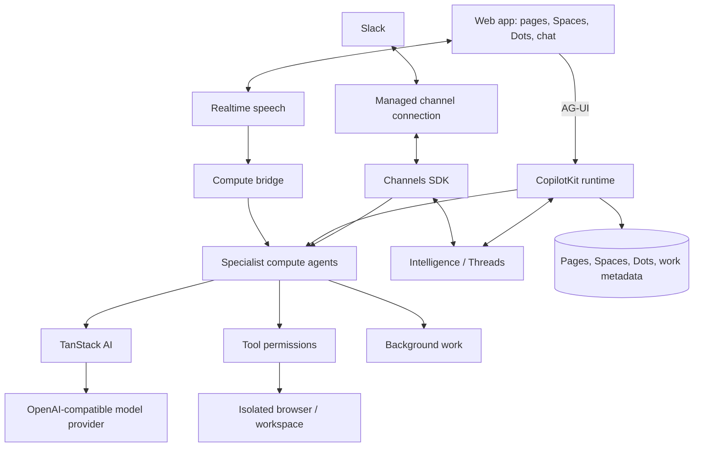

# OpenDots: 概要

CopilotKit/OpenDots は 2026-09-30 に GitHub で作成されたリポジトリです。2026-10-19 時点のスター数は 5,570 です。

以下の箇条書きは、README の文を訳さずに原文のまま抜き出したものです（当サイトによる要約・評価ではありません）。

- 原文（README）: An open-source template for persistent AI agents, each with its own computer.
- 原文（README）: Built with CopilotKit and AG-UI.
- 原文（README）: A template, not a hosted product. You run the application and configure its infrastructure.

## 🎯 成熟度の目安（README の記載）

README にある開発段階の記載を、原文のまま示します（当サイトによる評価ではありません）。

- 原文（README）: The template is in early development; the Features section below describes what's included and distinguishes local verification from connected-service testing.

## 主な機能と構成（README の原文）

- 原文（README）: Each Dot can have its own computer, using OpenBot's container supervisor and computer service.
- 原文（README）: The application keeps service credentials on the server and derives a different computer credential for each Dot.
- 原文（README）: Give a Dot tools from any MCP server, such as email, calendar, GitHub, or your own services. Read-only tools run on their own.
- 原文（README）: Any other tool pauses for an Approve & run card in chat, and only your approval runs it.
- 原文（README）: Pages stay in the local workspace database.

以下は README にある図を、そのまま転記したものです。



## インストール（README からの転記）

以下は [README](https://github.com/CopilotKit/OpenDots#readme) のインストール手順のコードブロックを、そのまま転記したものです。当サイトでは動作を確認していません。最新の手順は README を確認してください。

```sh
git clone https://github.com/CopilotKit/OpenDots.git
cd OpenDots
npm ci
cp .env.example .env
npm run dev
```

```sh
npx copilotkit@latest login
npx copilotkit@latest project select
```

## ライセンス

- ライセンス: MIT License（SPDX: MIT）
- 確認先: [LICENSE ファイル](https://github.com/CopilotKit/OpenDots/blob/main/LICENSE)

この節はライセンスの名称と確認先を示すもので、法的な助言ではありません。利用の可否は、LICENSE ファイルの本文と利用する状況に照らして確認してください。
