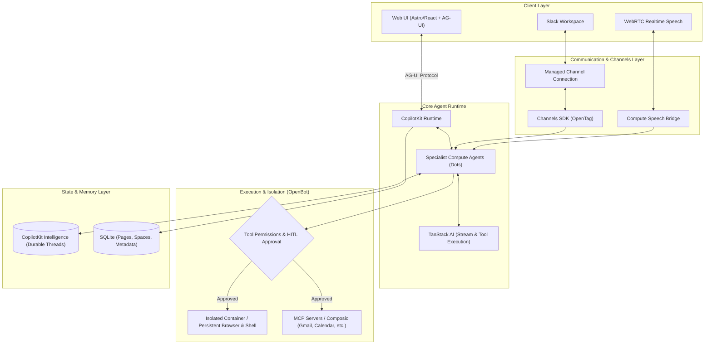

# OpenDots: 概要と革新性

OpenDotsは、CopilotKitチームが開発したオープンソースの常駐型AIエージェント（AI Coworker）ワークスペーステンプレートです。単なるチャットボットではなく、「各エージェント（Dot）が独立したLinuxコンテナ/ブラウザ環境（Dot Computer）を持ち、Web UI・音声通話・Slackの間をシームレスに行き来しながら永続的にタスクを遂行する」という次世代のエージェントアーキテクチャを具現化しています。

従来のAIアシスタントは単一のチャットセッションで完結し、外部ツールの実行状態やファイルシステムを保持できませんでした。OpenDotsは、コンテナスーパーバイザー「OpenBot」と連携することで、エージェントごとに永続化されたブラウザプロファイル・ワークスペースストレージ・シェル環境を提供。さらに、人間による承認（Human-in-the-loop）フローをネイティブで組み込むことで、実務に投入可能な信頼性を担保しています。

## 🎯 成熟度の目安（AI による見立て）

### 根拠
- **スター数・モメンタム**: GitHubスター数5,500超、TrendshiftでもTypeScript部門で急浮上しており、CopilotKitエコシステムの中核テンプレートとして開発が活発。
- **アーキテクチャの先進性**: AG-UI（Agent-User Interface）プロトコル、TanStack AI、Channels SDKによるSlack連携、WebRTCによるリアルタイム音声会話など、2026年の最先端エージェントスタックを網羅。
- **留意点**: 本リポジトリは「ホステッド製品」ではなく「フルスタックテンプレート」。マルチテナント認証や共有編集は未実装のシングルオーナー仕様であり、本番商用利用には追加の認証基盤やインフラ構築が必要。社内での検証や、特定業務の自動化の PoC で検証候補になります。

---

## 解決する主要な課題とアーキテクチャ

OpenDotsは以下の3つの大きな課題を解決します：
1. **コンテキストの分断**: チャット、Slack、音声通話で別々のボットが立ち上がり、記憶や作業状態が同期しない問題。
2. **ツールの実行権限と安全性**: AIが勝手に外部APIやシェルを叩いて破壊的操作を行うリスク（Human-in-the-loopカードで解決）。
3. **作業環境の揮発性**: タスク完了後にブラウザ状態やダウンロードしたファイルが消失し、後続タスクに活かせない問題。



---

## 競合ツール/商用SaaSとの徹底比較

| 機能 / 指標 | OpenDots (OSS) | Devin / Cognition (SaaS) | Multi-On / Browserbase | Dify / Flowise (OSS) |
| :--- | :--- | :--- | :--- | :--- |
| **ライセンス** | **MIT（完全オープンソース）** | プロプライエタリ | 商用SaaS | Apache-2.0 |
| **実行環境** | **エージェント毎の独立永続コンテナ** | クラウド一時VM | クラウドブラウザAPI | なし（API実行のみ） |
| **マルチモーダル連携**| **テキスト / 音声通話 / Slack** | チャット/Webのみ | API/ブラウザのみ | 主にチャットUI |
| **人間介在 (HITL)** | **インライン承認カード標準** | PR/チャット承認 | ダッシュボード介入 | 一部ノードで対応 |
| **ホスティング費用** | **自社インフラ（月数千円〜）** | 月額$500〜/席 | 従量課金制 | 自社インフラ |
| **データプライバシー**| **完全オンプレ/自社VPC可能** | ベンダー預け | ベンダー預け | 自社VPC可能 |

---

## 💡 ビジネス・マネタイズ活用アイデア（実践例）

1. **自社特化型「AIリサーチャー＆ライター」の受託構築**
   - リサーチ部門向けに、Parallel Web Searchと連携したDotを配備。情報収集→Markdownドラフト作成→Notion/Slack同期までを承認フロー付きで半自動化。
2. **社内情シス向け「Slack常駐型オペレーションDot」**
   - Composio経由でGoogle WorkspaceやGitHubと連携。Slackメンションで一次障害調査や権限付与リクエストの承認・実行を担うエージェントを構築。
3. **マイクロSaaS展開: 「LegalDot（契約書レビュー＆要約専用エージェント）」**
   - 専門知識プロンプトと法務MCPサーバーをプリセットし、士業・法務担当者向けに月額29,800円/組織でセキュアに提供。

---

## インストール & クイックスタート手順

### 必要要件
- **Node.js 24** 以上
- **Docker & Docker Compose**
- OpenAI または OpenAI互換モデルAPIキー

```bash
# 1. リポジトリのクローン
git clone https://github.com/CopilotKit/OpenDots.git
cd OpenDots

# 2. 依存関係のインストール
npm ci

# 3. 環境変数設定
cp .env.example .env

# 4. CopilotKit Intelligenceの連携
npx copilotkit@latest login
npx copilotkit@latest project select

# 5. .env に OPENAI_API_KEY を設定後、起動
npm run dev
```
ブラウザで `http://127.0.0.1:5173` にアクセスし、Spaceの作成およびDotの設定を開始します。

---

## 商用利用可否 & ライセンス考察

- **ライセンス**: **MIT License**
- **商用利用**: ソースコードの改変、再配布、商用SaaSへの組み込み、受託開発納品すべてにおいて制限なく利用可能です。著作権表示および許諾表示を保持するだけで問題ありません。
- **外部サービス依存に関する注意点**:
  - `CopilotKit Intelligence`: ローカル評価用Dockerコンテナ、または有償クラウド/自己ホスティングライセンスを選択可能。
  - `Parallel Search / Composio`: 利用量に応じた商用APIキーが必要です。
