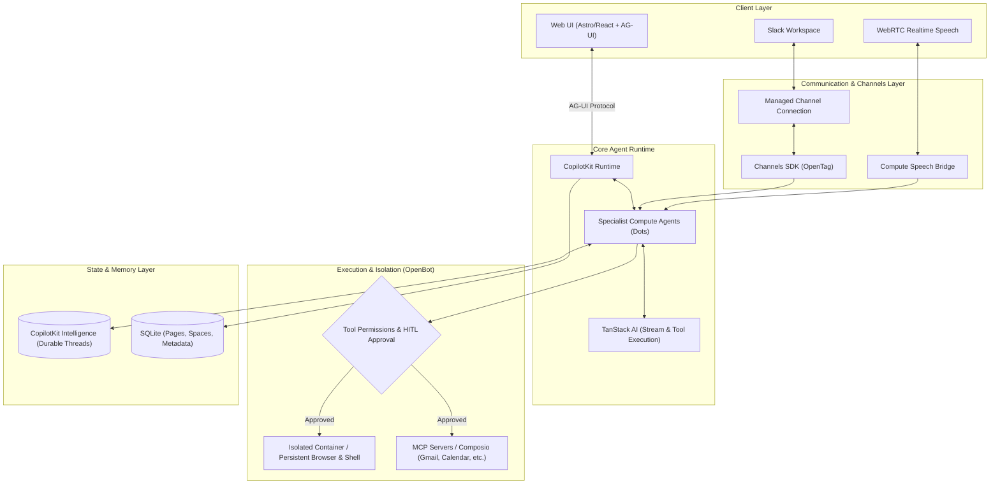

# OpenDots: 概要

CopilotKit/OpenDots は 2026-09-30 に GitHub で作成されたリポジトリです。2026-10-19 時点のスター数は 5,570 です。

OpenDotsは、CopilotKitチームが開発したオープンソースの常駐型AIエージェント（AI Coworker）ワークスペーステンプレートです。単なるチャットボットではなく、「各エージェント（Dot）が独立したLinuxコンテナ/ブラウザ環境（Dot Computer）を持ち、Web UI・音声通話・Slackの間をシームレスに行き来しながら永続的にタスクを遂行する」という次世代のエージェントアーキテクチャを具現化しています。

従来のAIアシスタントは単一のチャットセッションで完結し、外部ツールの実行状態やファイルシステムを保持できませんでした。OpenDotsは、コンテナスーパーバイザー「OpenBot」と連携することで、エージェントごとに永続化されたブラウザプロファイル・ワークスペースストレージ・シェル環境を提供。さらに、人間による承認（Human-in-the-loop）フローをネイティブで組み込むことで、実務に投入可能な信頼性を担保しています。

## 🎯 成熟度の目安（AI による見立て）

### 根拠
- **スター数・モメンタム**: GitHubスター数5,500超、TrendshiftでもTypeScript部門で急浮上しており、CopilotKitエコシステムの中核テンプレートとして開発が活発。
- **アーキテクチャの先進性**: AG-UI（Agent-User Interface）プロトコル、TanStack AI、Channels SDKによるSlack連携、WebRTCによるリアルタイム音声会話など、2026年の最先端エージェントスタックを網羅。
- **留意点**: 本リポジトリは「ホステッド製品」ではなく「フルスタックテンプレート」。マルチテナント認証や共有編集は未実装のシングルオーナー仕様であり、本番商用利用には追加の認証基盤やインフラ構築が必要。社内での検証や、特定業務の自動化の PoC で検証候補になります。

---

## 解決する主要な課題とアーキテクチャ

OpenDotsは以下の3つの大きな課題を解決します：
1. **コンテキストの分断**: チャット、Slack、音声通話で別々のボットが立ち上がり、記憶や作業状態が同期しない問題。
2. **ツールの実行権限と安全性**: AIが勝手に外部APIやシェルを叩いて破壊的操作を行うリスク（Human-in-the-loopカードで解決）。
3. **作業環境の揮発性**: タスク完了後にブラウザ状態やダウンロードしたファイルが消失し、後続タスクに活かせない問題。



---

## インストール（README からの転記）

以下は [README](https://github.com/CopilotKit/OpenDots#readme) のインストール手順のコードブロックを、そのまま転記したものです。当サイトでは動作を確認していません。最新の手順は README を確認してください。

```sh
git clone https://github.com/CopilotKit/OpenDots.git
cd OpenDots
npm ci
cp .env.example .env
npm run dev
```

```sh
npx copilotkit@latest login
npx copilotkit@latest project select
```

## ライセンス

- ライセンス: MIT License（SPDX: MIT）
- 確認先: [LICENSE ファイル](https://github.com/CopilotKit/OpenDots/blob/main/LICENSE)

この節はライセンスの名称と確認先を示すもので、法的な助言ではありません。利用の可否は、LICENSE ファイルの本文と利用する状況に照らして確認してください。
