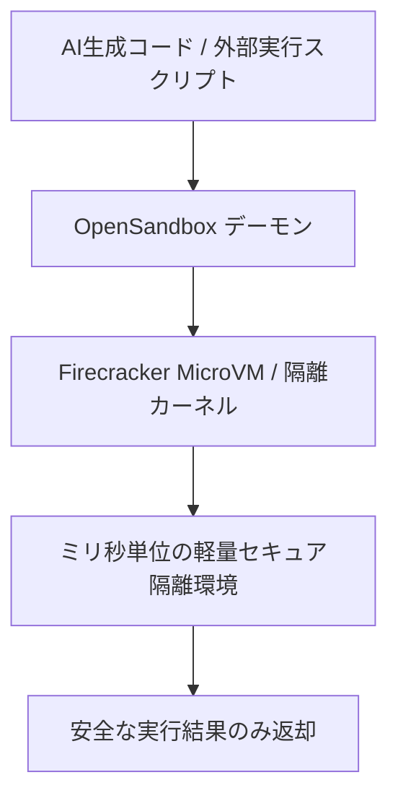

# OpenSandbox: 概要と革新性

OpenSandboxは、AIエージェント向けに設計された、セキュア、高速、かつ拡張可能なサンドボックスランタイムです。AIアプリケーションがコード実行、コマンド実行、ファイル管理、ブラウザ/デスクトップ操作を隔離された環境で実行することを可能にします。Dockerでのローカル開発からKubernetesへのデプロイメントまで、統一されたサンドボックスAPIを通じてシームレスな運用を提供します。

本プロジェクトは、OpenSSF Best PracticesおよびCNCF Landscapeに掲載されており、その信頼性とコミュニティにおける重要性が示されています。

主要機能は以下の通りです。

*   **Fast Sandbox runtime**: Firecrackerベースの高速かつ高密度なサンドボックス実行環境。64 ms P50 (シリアル) / 125.4 ms P99 (10並行) の起動性能を誇り、メモリとディスク状態を保持した一時停止/再開をサポートします。
*   **Agent working environments**: エージェントがコード実行、コマンド実行、ファイル管理を行うための組み込みAPIを提供し、コーディングエージェント、ブラウザ、デスクトップのサンドボックス内実行を可能にします。
*   **Network access control**: 統一されたイングレスゲートウェイによるインバウンドトラフィックルーティングと、サンドボックスごとのエグレスポリシーによるアウトバウンドアクセス制御を実現します。
*   **Credential Vault**: エージェントが外部サービスを呼び出す際に、実際の認証情報をサンドボックスワークロードに公開することなく安全に利用できるメカニズムを提供します。
*   **Local to cluster**: Dockerでのローカル開発からKubernetesへのデプロイメントまで、統一されたライフサイクルAPIを提供。リソースプールとバッチ作成により、エージェント評価や強化学習（RL）トレーニングワークロードをサポートします。
*   **SDKs, CLI, and MCP**: Python, Java/Kotlin, TypeScript/JavaScript, C#/.NET, Go向けのSDK、ターミナルCLI (`osb`)、およびMCP (Model Context Protocol) を通じたエージェント接続をサポートします。
*   **Extensible sandbox protocol**: 定義されたサンドボックスライフサイクルおよび実行APIに基づき、カスタムランタイム統合を構築するための拡張性を提供します。

## 解決する主要な課題とアーキテクチャ


### 従来の技術スタックにおける問題点

AIエージェントが自律的にコードを実行したり、外部リソースにアクセスしたりする際、以下の課題が顕在化します。

1.  **セキュリティリスク**: エージェントがホストシステムに直接アクセスしたり、機密情報を含む環境で実行されたりすると、悪意のあるコード実行や情報漏洩のリスクが高まります。特に、生成AIが生成したコードの安全性を保証することは困難です。
2.  **環境の分離と一貫性**: 複数のAIエージェントが同時に動作する場合、互いの環境に影響を与えたり、依存関係の競合が発生したりする可能性があります。また、エージェントの評価やトレーニングにおいて、毎回クリーンで一貫した環境を迅速にプロビジョニングすることが課題となります。
3.  **パフォーマンスとリソース効率**: 従来の仮想マシン（VM）は起動に時間がかかり、リソース消費も大きいため、多数のAIエージェントを並行して実行する際のボトルネックとなります。コンテナは軽量ですが、カーネル共有によるセキュリティ上の懸念が残ります。
4.  **資格情報の管理**: AIエージェントが外部APIやサービスを利用する際、APIキーや認証情報を安全に管理し、サンドボックス環境に漏洩させずに利用させるメカニズムが不足しています。
5.  **開発からデプロイメントへの移行**: ローカルでの開発環境と本番環境（特にKubernetesのような分散環境）でのサンドボックスの管理・運用に一貫性がなく、移行プロセスが複雑になりがちです。

### 本ツールが採用するアプローチと仕組み

OpenSandboxはこれらの課題に対し、以下の技術的アプローチとアーキテクチャで解決策を提供します。

1.  **マイクロVMベースのサンドボックス化 (Firecracker)**:
    *   AWSが開発した軽量仮想化技術であるFirecrackerを基盤とし、従来のVMよりもはるかに高速な起動（P50で64ms）と、コンテナよりも高いセキュリティ分離（カーネルレベルでの分離）を両立します。
    *   メモリとディスクの状態を保持したまま環境を一時停止・再開できるため、エージェント評価や強化学習における環境リセットのオーバーヘッドを大幅に削減します。
2.  **統一されたサンドボックスAPIと制御プレーン**:
    *   Dockerでのローカル開発環境からKubernetesクラスターへの大規模デプロイメントまで一貫したライフサイクルAPIを提供します。
3.  **厳格なネットワーク制御とCredential Vault**:
    *   エグレスポリシーによるアウトバウンド通信制御と、APIキーをサンドボックス内に直接露出させないCredential Vault機能により、機密情報の漏洩を防ぎます。

## 競合ツール/商用SaaSとの徹底比較

| 比較項目 | OpenSandbox (OSS) | 商用サンドボックスSaaS (E2B等) | 標準Dockerコンテナ |
| :--- | :--- | :--- | :--- |
| **隔離レベル** | Firecracker MicroVM (独立カーネル) | Firecracker MicroVM | ホストOSカーネル共有 |
| **起動速度** | P50 64ms / 一時停止・再開対応 | 数百ms (クラウド通信含む) | 数百ms〜数秒 |
| **データ主権・閉域運用** | オンプレミス / 自社VPC完結可能 | 外部クラウド送信が必要 | 自社環境可能だが隔離性に課題 |
| **資格情報保護** | Credential Vault による非露出注入 | 環境変数渡し中心 | 環境変数渡し中心 |
| **ライセンス・コスト** | Apache-2.0 (ソフトウェア利用料無料) | 実行時間に応じた従量課金 | OSS (管理基盤は別途構築) |

## 💡 ビジネス・マネタイズ活用アイデア（実践例）

1.  **企業向けAIコーディング・データ分析エージェントのセキュア実行基盤構築**:
    *   社内LLMや自律型AIエージェントがPythonスクリプトやシェルコマンドを自動実行する際、ホストOSや社内ネットワークから隔離されたマイクロVM環境をKubernetesまたはオンプレミスサーバー上に構築します。
2.  **ブラウザ自動操作（Playwright/Chrome）エージェントの並列実行クラスター**:
    *   Web調査やE2Eテストを自動化するAIエージェント向けに、セッションごとにクリーンなブラウザ環境をミリ秒単位で立ち上げ、エグレスポリシーで通信先をホワイトリスト制御する基盤を提供します。
3.  **AI生成コードの評価・検証パイプライン（CI/CD統合）**:
    *   社内開発チームがAIで生成したコードのビルド・単体テスト・セキュリティ検証を隔離サンドボックス内で並列実行する検証基盤を構築します。

## インストール & クイックスタート手順

### 1. CLI および Python SDK のインストール

```bash
# Python SDK のインストール
pip install opensandbox

# CLI ツール (osb) でローカルサンドボックスを起動（Docker バックエンド利用時）
osb init
osb run --image python:3.12-slim -- python -c "print('Hello from OpenSandbox!')"
```

### 2. Python SDK によるサンドボックス操作例

```python
from opensandbox import Sandbox

# 隔離サンドボックスの起動とコード実行
with Sandbox.create(template="python-3.12") as sb:
    result = sb.run_code("import platform; print(platform.platform())")
    print(result.stdout)
```

## 商用利用可否 & ライセンス考察

OpenSandboxは **Apache License 2.0** の下で公開されています。商用利用、社内システムへの組み込み、改変、および独自サービスとしての提供が認められており、特許権の明示的な付与条項も含まれているため、エンタープライズ領域でも導入しやすいライセンス形態です。導入時は著作権表示およびライセンス条文の保持を行ってください。
