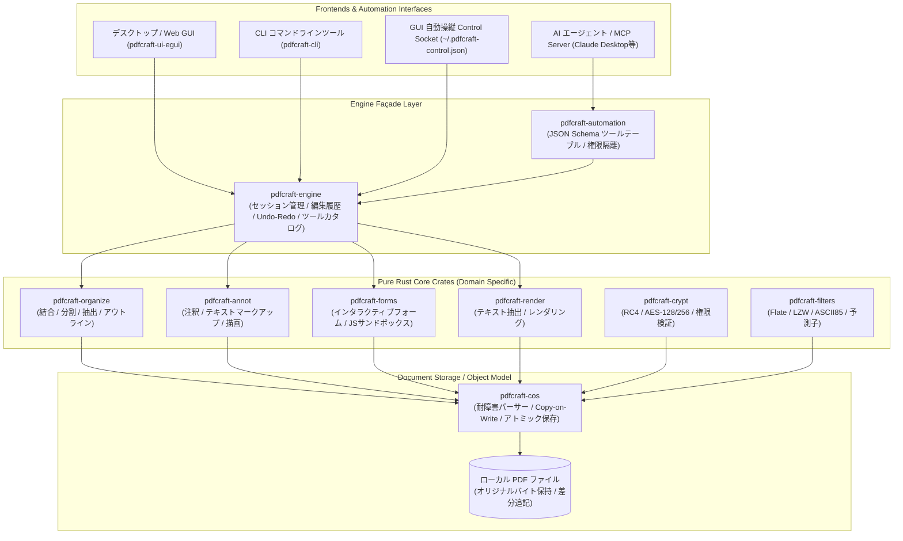

# pdfcraft: 概要

storytold/pdfcraft は 2026-09-30 に GitHub で作成されたリポジトリです。2026-10-13 時点のスター数は 11,454 です。

**PdfCraft**（`storytold/pdfcraft`）は、業界標準であるAdobe Acrobatの機能を、外部の巨大C/C++ライブラリに頼らず**純粋なRust（Pure Rust）でゼロからクリーンルーム再実装**した次世代のオープンソースPDFワークベンチです。

macOS、Windows、Linux、FreeBSD向けの高速なネイティブデスクトップアプリとして動作するだけでなく、同一コードベースからWebAssembly（Wasm）としてブラウザ上でも動作します。アカウント登録不要、テレメトリ皆無、完全オフライン稼働という極めてプライベートな設計を徹底しています。

さらに特筆すべきは、**AIエージェント時代を前提とした設計（Agent-First Architecture）**です。GUIの操作にとどまらず、JSON Schemaで定義されたCLIツール群、ClaudeなどのLLMエージェントと直接通信可能な**標準MCPサーバー**、さらにはアクセシビリティツリーを介したヘッドレスGUI自動操縦プロトコルまで標準搭載しています。

## 解決する主要な課題とアーキテクチャ

従来のPDFツールエコシステムは、以下の深刻な課題を抱えていました。

1. **レガシーC/C++製エンジンの脆弱性**: PopplerやPDFiumなどの既存エンジンはバッファオーバーフロー等のメモリ破壊リスクを常に抱えている。
2. **商用製品（Adobe等）のベンダーロックインと高額ライセンス**: 企業でのシート単位課金、クラウド強制アップロードによる情報漏洩リスク。
3. **データ損失を招く破壊的保存**: 編集時にオリジナルバイト列を不可逆に変更し、フォームや注釈、レイヤーのメタデータが破損する。
4. **AI/プログラム連携の困難さ**: 高度なPDF編集（フォーム入力、注釈追加、特定ページ抽出）をCLIやLLMから安全かつ決定論的に実行する手段の欠如。

PdfCraftは、レイヤード・ワークスペースアーキテクチャを採用し、UIとコアロジックを完全分離することでこれらの課題を解決しています。



### アーキテクチャの核心
- **インクリメンタル＆アトミックライト**: 元のバイト列に差分のみを追記（Incremental Update）し、一時ファイルへの書き込み完了後にアトミックにスワップするため、保存中の電源断でもファイルが破損しません。
- **耐障害パース性能**: pdf.jsのテストコーパス983ファイル中、963ファイルがクラッシュゼロで正常描画され、損傷した構造も自動修復します。
- **多言語・縦書き完全対応**: 日本語の縦書きテキスト、アラビア語・ヘブライ語（RTL）、デーヴァナーガリー文字、カラー絵文字まで正確にレンダリングします。

## インストール（README からの転記）

以下は [README](https://github.com/storytold/pdfcraft#readme) のインストール手順のコードブロックを、そのまま転記したものです。当サイトでは動作を確認していません。最新の手順は README を確認してください。

```sh
git clone https://github.com/storytold/pdfcraft
cd pdfcraft
cargo xtask models                                # fetch the OCR models Scan & OCR needs (release builds include them)
cargo run --release -p pdfcraft -- some.pdf     # desktop app
cargo xtask demo-pdf                              # build the showcase PDF used in these screenshots
cargo xtask screenshots                           # regenerate every screenshot in this README
```

```sh
git clone https://github.com/storytold/craft-fonts ../craft-fonts
CRAFT_FONTS_DIR=../craft-fonts cargo run --release -p pdfcraft -- some.pdf
```

```sh
eselect repository add snakebyte git https://github.com/switch87/snakebyte-overlay.git
emaint sync -r snakebyte
echo 'app-text/pdfcraft-bin ~amd64' >> /etc/portage/package.accept_keywords/pdfcraft
emerge --ask app-text/pdfcraft-bin
```

## ライセンス

- ライセンス: Apache License 2.0（SPDX: Apache-2.0）
- 確認先: [LICENSE ファイル](https://github.com/storytold/pdfcraft/blob/main/LICENSE-APACHE)

この節はライセンスの名称と確認先を示すもので、法的な助言ではありません。利用の可否は、LICENSE ファイルの本文と利用する状況に照らして確認してください。
