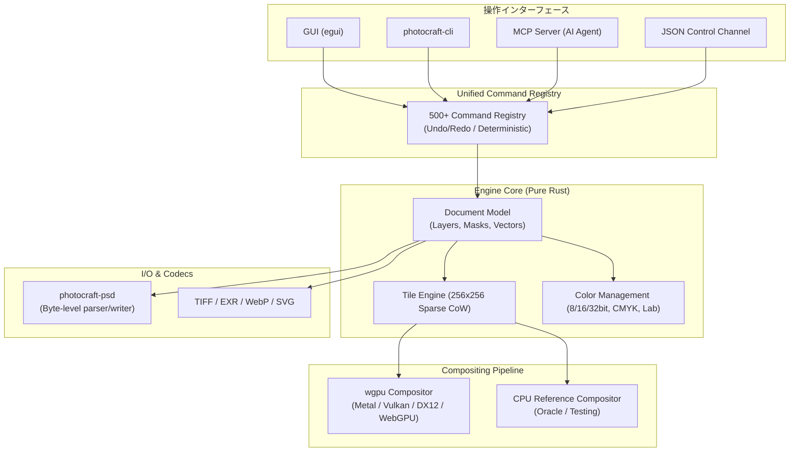

# photocraft: 概要

storytold/photocraft は 2026-09-30 に GitHub で作成されたリポジトリです。2026-10-10 時点のスター数は 35,313 です。

**PhotoCraft**（フォトクラフト）は、Adobe Photoshopをクリーンルーム設計（仕様の分析と振る舞い観察のみに基づき、プロプライエタリなコードを一切参照しない完全新規実装）により、**Pure Rust**で再構築したオープンソースの本格的画像編集アプリケーションです。

単なる「Photoshop風のUIを持つペイントソフト」にとどまらず、PSDファイルの高精度な可逆性（psd-toolsテストセット309件中307件で描画完全一致）、非破壊調整レイヤー、レイヤースタイル、高度なベクターパス、スマートオブジェクト、カラーマネジメント（ICC、CMYK/Lab、32bit HDR対応）に対応すると README に記載されています。さらに、**「AIエージェント対応（MCP / CLI / JSON制御）」**を中核に設計されており、人間がGUIから操作するツールとしてだけでなく、LLMや自動化パイプラインから操作できるグラフィックエンジンとして設計されています。

---

## 解決する主要な課題とアーキテクチャ

### 1. 解決する技術課題
- **ベンダーロックインと月額コストの高騰**: 商用SaaSやAdobe CCの高額ライセンス、クラウド強制同期、データ主権の問題を完全ローカル・オフライン動作で解決。
- **リソース過剰消費と非効率なUIスタック**: 近年のデスクトップアプリに多いElectron/Chromiumベースではなく、Pure Rustとegui、GPUネイティブコンポジタを採用。
- **自動化とヘッドレス運用の障壁**: 従来のDTP/グラフィックツールはGUI主導であり、サーバーサイドでのバッチ処理やAI連携が困難だったが、全機能をコマンド駆動化。

### 2. コアアーキテクチャ設計
PhotoCraftは24のクレートから構成される強固なレイヤードアーキテクチャを持ち、UI層とドキュメントエンジン層が完全に分離されています。



- **統一コマンドレジストリ**: 500以上の全操作がコマンドとして抽象化され、GUIクリックもMCP経由のプロンプト指示も全く同じ内部関数を叩きます。
- **Copy-on-Write (CoW) タイルエンジン**: キャンバスを256×256ピクセルのスパースタイルで管理。大解像度キャンバスでも変更部分のみを複製するため、ヒストリー（Undo）がメモリを圧迫しません。
- **デュアルコンポジタ**: CPUリファレンスコンポジタ（テスト用正解オラクル）と、`wgpu`を用いたマルチバックエンド（Vulkan, Metal, DirectX 12, WebGPU）GPUコンポジタを備え、画質の完全性とミリ秒単位の描画を両立。

---

## インストール（README からの転記）

以下は [README](https://github.com/storytold/photocraft#readme) のインストール手順のコードブロックを、そのまま転記したものです。当サイトでは動作を確認していません。最新の手順は README を確認してください。

```sh
git clone https://github.com/storytold/photocraft
cd photocraft
cargo run --release -p photocraft -- image.psd   # the desktop app
cargo test --workspace                           # the test suite
```

```sh
git clone https://github.com/storytold/craft-fonts ../craft-fonts
CRAFT_FONTS_DIR="$PWD/../craft-fonts" cargo run --release -p photocraft
```

```sh
flatpak install --user photocraft-<version>-linux-x86_64.flatpak   # or -linux-aarch64
flatpak run ai.storyteller.photocraft
```

```sh
ditto -x -k photocraft-cli-<version>-macos-universal.zip .
spctl --assess --type install -vv photocraft-cli-<version>-macos-universal/photocraft-cli
# ... accepted, source=Notarized Developer ID
```

## ライセンス

- ライセンス: Apache License 2.0（SPDX: Apache-2.0）
- 確認先: [LICENSE ファイル](https://github.com/storytold/photocraft/blob/main/LICENSE-APACHE)

この節はライセンスの名称と確認先を示すもので、法的な助言ではありません。利用の可否は、LICENSE ファイルの本文と利用する状況に照らして確認してください。
