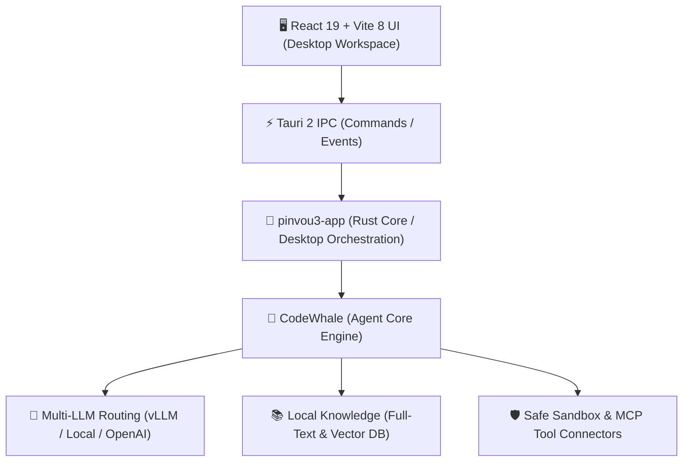

# pinvou-agent: 概要

Pinvou/pinvou-agent は 2026-07-24 に GitHub で作成されたリポジトリです。2026-10-09 時点のスター数は 2,399 です。

**pinvou-agent**は、「対話して終わり」のチャットボットから脱却し、実務における**具体的成果物（Deliverables）の生成・編集・反復作業**を完結させるために設計されたオープンソースのデスクトップAIエージェント環境です。

デスクトップランタイムには最新の**Tauri 2**と**Rust**を採用し、フロントエンドに**React 19 / Vite 8**を組み合わせています。軽量・高速かつ強固なセキュリティ境界を維持しつつ、MCP、ローカルナレッジ（RAG）、ACPを統合した「3-in-1（Work / Design / Code）」ワークスペースを提供します。

### コアバリュー
1. **チャットから成果物（Artifact）中心のアプローチへ**: 生成されたMarkdown、ポスター、図解、コードを専用の「Artifact Panel」で即座にプレビュー・直接編集可能。
2. **ACPによるマルチエージェント協調**: Codex、Claude Code、Kimiなどの独立コーディングエージェントをローカルプロジェクトに安全に接続・常駐。
3. **ローカルファーストなプライバシー設計**: vLLM等のローカル推論基盤と組み合わせることで、完全エアギャップ（オフライン）環境でのエンタープライズ実行が可能。

---

## 解決する主要な課題とアーキテクチャ

### 既存AIツールの課題
- **コンテキストの断片化**: ドキュメント作成、デザイン、コーディングでツールが分断され、コピペの往復が発生する。
- **実行権限と安全性のジレンマ**: 自律エージェントにシェル権限を渡す際、不透明な実行によるシステム破壊リスクが存在する。
- **データプライバシーの懸念**: 機密コードや社内ナレッジを外部SaaSへアップロードすることへのコンプライアンス制限。

### アーキテクチャ構成

- **UI層とエンジン層の完全分離**: デスクトップ制御を担う`pinvou3-app`と、モデル推論・ツール呼び出し・コンテキスト圧縮を司る`CodeWhale`エンジンが疎結合に設計されており、拡張性と保守性に優れています。
- **MCP & コネクタエコシステム**: Lark（飛書）、DingTalk、Obsidianなどの企業内ツールや、ローカル/リモートのMCPサーバーを統一管理ストアから導入可能です。

---

## インストール（README からの転記）

以下は [README](https://github.com/Pinvou/pinvou-agent#readme) のインストール手順のコードブロックを、そのまま転記したものです。当サイトでは動作を確認していません。最新の手順は README を確認してください。

```bash
git clone --recursive https://github.com/Pinvou/pinvou-agent.git
cd pinvou-agent/pinvou3-app
npm ci
cd ..
./pinvou3-app/run-dev.sh
```

```bash
git submodule update --init --recursive
```

## ライセンス

- ライセンス: MIT License（SPDX: MIT）
- 確認先: [LICENSE ファイル](https://github.com/Pinvou/pinvou-agent/blob/main/LICENSE)

この節はライセンスの名称と確認先を示すもので、法的な助言ではありません。利用の可否は、LICENSE ファイルの本文と利用する状況に照らして確認してください。
