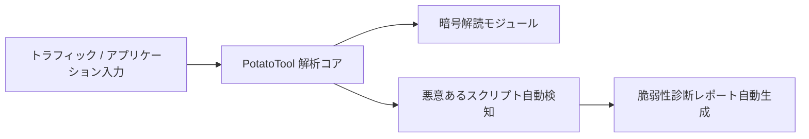

# PotatoTool: 概要

potato-security/PotatoTool は 2024-05-07 に GitHub で作成されたリポジトリです。2026-10-09 時点のスター数は 1,237 です。

オープンソースプロジェクト「PotatoTool」は、ネットワークセキュリティの専門家、レッドチーム・ブルーチームのメンバー、そしてセキュリティ愛好家のために設計された、多機能な総合セキュリティツールです。JavaFXをベースとしたデスクトップアプリケーションとして提供され、直感的で使いやすいインターフェースを通じて、多様なセキュリティタスクを効率的に実行できます。

## 解決する主要な課題とアーキテクチャ

現代のサイバーセキュリティ環境は複雑化の一途を辿り、セキュリティ担当者はWebshellの解析、トラフィックの監視、脆弱性スキャン、インシデントの追跡など、多岐にわたるタスクに直面しています。これらのタスクには通常、複数の専門ツールが必要となり、ツールの切り替えやデータ連携に手間がかかることが課題でした。

PotatoToolは、これらの課題を解決するために、以下の主要機能を一つのアプリケーションに統合しています。

-   **一括解読機能**: Webshellのインタラクティブトラフィック、ネットワークトラフィック、多様な暗号化方式（AES, DES, RSA, XOR, Base64など）、強固な難読化、コンポーネントやミドルウェアの暗号化データなどを一括で解読します。AI分析による悪意あるスクリプトの検出もサポート。
-   **情報収集**: Fofa, Hunter, Quake, ZoomEye, Shodanといった主要なサイバー測量プラットフォームと連携し、IP、ドメイン、企業情報などを効率的に収集・整理します。スマート拡散検索や敏感情報検索も可能です。
-   **脆弱性スキャン**: 内蔵されたPOCスクリプトと高い言語互換性により、多様な脆弱性スキャンをサポートします（現在テスト版）。
-   **逆コンパイル**: Javaの逆コンパイル機能を提供し、コード分析を支援します。
-   **AI分析**: 独自のAIモデルを搭載し、悪意あるスクリプトの分析やコマンドのインテリジェントな解答を提供します。ChatGPTの手動設定も可能です。
-   **その他**: IPフィルタリング、ブロックチェーン追跡、帰属地照会、ファイルメタ情報抽出、免殺（アンチウイルス回避）、カスタムメモリコード生成、コマンド生成・照会、KB昇格照会、プロセス分析、情報生成など、幅広い補助機能が利用できます。

アーキテクチャはJavaFXを基盤としたデスクトップアプリケーションであり、Java 8またはJava 11+（推奨）で動作します。これにより、Windows、Linux、Macといった主要なOSでクロスプラットフォームな利用が可能です。

## インストール（README からの転記）

README にインストール手順のコードブロックが見つかりませんでした。導入方法は [README](https://github.com/potato-security/PotatoTool#readme) を確認してください。

## ライセンス

- ライセンス: Apache License 2.0（SPDX: Apache-2.0）
- 確認先: [LICENSE ファイル](https://github.com/potato-security/PotatoTool/blob/main/LICENSE)

この節はライセンスの名称と確認先を示すもので、法的な助言ではありません。利用の可否は、LICENSE ファイルの本文と利用する状況に照らして確認してください。
