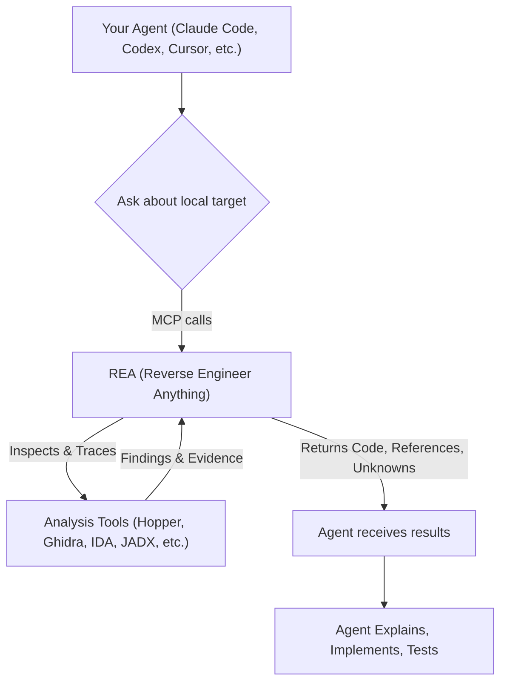

# rea: 概要

morluto/rea は 2026-04-14 に GitHub で作成されたリポジトリです。2026-10-22 時点のスター数は 354,932 です。

`rea` (Reverse Engineer Anything) は、エージェントを活用してアプリケーションの挙動からネイティブバイナリまで、あらゆるものをリバースエンジニアリングするためのオープンソースプロジェクトです。単一のMCPを通じて、バイナリ、アプリケーション、ランタイム挙動を横断的に解析できる点が特徴です。

## 🎯 成熟度の目安（AI による見立て）
`rea` はGitHubで35万を超えるスターを獲得しており、非常に高いコミュニティの関心と活発な開発が伺えます。多言語対応のREADME、詳細なドキュメント、FAQ、具体的なショーケースが提供されており、プロジェクトとしての成熟度は高いと見られます。

このプロジェクトは、以下のような用途で検証候補になります。
- AIエージェントを活用したアプリケーション挙動解析の自動化
- ソースコードがない状態での機能理解やセキュリティ分析
- 複数のリバースエンジニアリングツール（Hopper, Ghidra, IDAなど）の統合的な利用
- さまざまなターゲット（JavaScript/Electron、.NET、Android、ネイティブバイナリなど）に対する統一的な解析インターフェースの構築

## 解決する主要な課題とアーキテクチャ
`rea` は、アプリケーションの特定の機能がどのように動作するかを、ソースコードなしで理解し、その証拠を提示し、自分のプロジェクト向けに再構築するという課題を解決します。従来、手動で行われていた複雑なリバースエンジニアリングプロセスを、AIエージェントと連携させることで効率化します。

### アーキテクチャ概要
`rea` の中核は、AIエージェントと多様な分析ツールをMCPを介して連携させる点にあります。エージェントはREAに解析要求を送り、REAはそれに応じて適切な分析ツール（Hopper、Ghidra、IDA、JADXなど）を起動し、ターゲットを検査します。解析結果は、コード、参照、不明点といった形でエージェントに返され、エージェントはこれらを利用して挙動の説明、実装、テストを行います。CLIコマンドも同様のワークフローで動作します。



このアーキテクチャにより、ユーザーは単一のエージェントインターフェースから、バイナリ、アプリケーション、ランタイム挙動といった多岐にわたるターゲットに対して、一貫したリバースエンジニアリングワークフローを適用できます。分析はローカルで実行され、結果には各結論の根拠と限界が含まれます。

## インストール（README からの転記）

以下は [README](https://github.com/morluto/rea#readme) のインストール手順のコードブロックを、そのまま転記したものです。当サイトでは動作を確認していません。最新の手順は README を確認してください。

```bash
npx rea-agents setup
```

```text
Understand how search works in the Notes app, show me the evidence, and build a
similar feature for my project.
```

```bash
npx -y rea-agents@latest analyze-javascript-application /absolute/path/to/app --json
```

```bash
npm install --global rea-agents
rea --help
```

## ライセンス

- ライセンス: MIT License（SPDX: MIT）
- 確認先: [LICENSE ファイル](https://github.com/morluto/rea/blob/main/LICENSE)

この節はライセンスの名称と確認先を示すもので、法的な助言ではありません。利用の可否は、LICENSE ファイルの本文と利用する状況に照らして確認してください。
