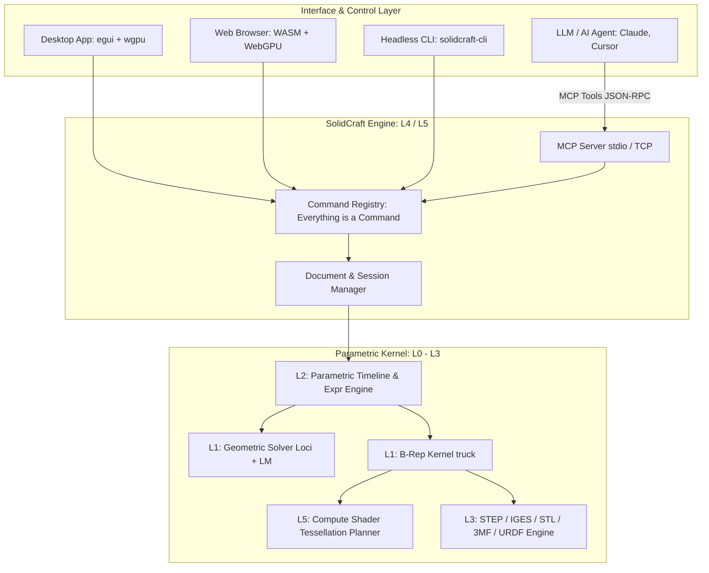

# solidcraft: 概要と革新性

`SolidCraft`は、純粋なRust（Pure Rust）でフルスクラッチ開発されたオープンソースのパラメトリック3D CADアプリケーションです。Autodesk Fusionなどの商用CADと同様の幾何拘束スケッチ、フィーチャータイムライン、パラメトリックリビルド、板金加工、アセンブリモデリングをローカルデスクトップ、Webブラウザ（WebGPU/WASM）、ヘッドレスCLIのすべてで動作させます。

特筆すべき最大のエッジは、**「Model Context Protocol（MCP）サーバー」をコアCLIに内蔵している点**です。LLMエージェント（Claude DesktopやCursor等）がMCPツール経由で3Dパーツを直接生成・計測・操作できる「AIネイティブCAD」として、製造業DXおよび自動設計パイプラインにパラダイムシフトをもたらしています。

## 🎯 成熟度の目安（AI による見立て）

**判定: 【TRIAL】（PoC・特定ユースケースでの実戦投入推奨）**

- **根拠**:
  - GitHubスター数5,700超を獲得し、コミュニティの熱狂的な支持を集めている。
  - 幾何オラクル検証において、76個の参照パーツ中75個でFreeCADや解析解と体積・重心・バウンディングボックスが完全一致する高精度ジオメトリ処理を実現。
  - レイヤードアーキテクチャ（L0〜L5）が極めて堅牢であり、MIT/Apache-2.0デュアルライセンスのクリーンルーム実装。
  - 現時点では複雑な曲面モデリングや大規模アセンブリで未実装な領域があるため「ADOPT」には届かないが、**「AIによる定型治具・ブラケットの自動生成」「Web上での3Dカスタマイザー」「ヘッドレスCADパイプライン」としては即座にTRIAL（導入検証）すべきフェーズ**にあります。

## 解決する主要な課題とアーキテクチャ

従来のオープンソースCAD（FreeCADやOpenSCAD等）や商用CAD（Fusion 360, SolidWorks等）が抱えていた以下の課題を根本から解決します。

1. **AIエージェント親和性の欠如**: 従来のGUI中心CADは外部APIが貧弱であり、AIエージェントによるリアルタイム操作が困難だった。
2. **パフォーマンスと依存性の肥大化**: C++で書かれた旧来のCADエンジンはビルドが複雑でWeb展開が困難。SolidCraftはPure Rust＋WebGPUによりWebブラウザでもネイティブ同様に60fpsで動作。
3. **テッセレーションのボトルネック**: 独自のGPU Compute Shaderを用いたパッチ生成により、従来比50〜65倍（78ボディの評価が約65ms）の超高速メッシュ化を実現。

### システムアーキテクチャ ＆ データフロー図



## 競合ツール/商用SaaSとの徹底比較

| 評価項目 | SolidCraft (Pure Rust) | FreeCAD (C++ / Python) | Autodesk Fusion (商用SaaS) | OpenSCAD (CSG) |
|---|---|---|---|---|
| **ライセンス** | Apache-2.0 / MIT (OSS) | LGPL / GPL (OSS) | プロプライエタリ (年約10万円〜) | GPL (OSS) |
| **パラメトリックGUI** | ◯ (egui/タイムライン) | ◯ (PartDesign) | ◎ (業界標準タイムライン) | × (コード記述のみ) |
| **AIエージェント連携** | **◎ (ネイティブMCP内蔵)** | △ (非公式拡張スクリプト) | △ (制限付きCloud API) | △ (テキスト生成のみ) |
| **Webブラウザ動作** | **◎ (WebGPU/WASM完備)** | × (Web版なし) | ◯ (Webビューア中心) | ◯ (WASM版あり) |
| **レンダリング速度** | **◎ (Compute Shader 65ms)** | △ (CPU依存で低速) | ◯ (GPU/クラウド) | △ (CSGブーリアン負荷高) |
| **ロボティクス出力** | **◎ (URDF直出力対応)** | △ (要プラグイン) | △ (要コンバータ) | × |

## 💡 ビジネス・マネタイズ活用アイデア（実践例）

1. **製造業向け「自然言語CADモデリング」受託開発**
   - 工場の治具（ジグ）や試作ブラケットを、技術者がチャットで「M4ネジ用の通し穴を幅50mmピッチで配置したRaspberry Piケース」と指示するだけで3Dモデル（STEP/STL）を全自動生成する社内システムを構築。
2. **ECサイト連動型「3Dオーダーメイド部品Webカスタマイザー」**
   - SolidCraftのWebGPU/WASMエンジンを自社ECに組み込み、顧客がブラウザ上で寸法スライダーを動かすと、リアルタイムで3D再計算・見積もり・製造用STEPデータ出力まで完結するマイクロSaaS。
3. **ロボット開発シミュレーション用「自律URDFアセンブリビルダー」**
   - ロボットアームや移動ロボット（Rover）の機構パラメータを入力すると、SolidCraftがジョイントと質量特性を反映したURDFと3Dメッシュを同時出力し、Isaac SimやGazeboへダイレクト連携。

## インストール & クイックスタート手順

### 1. インストール（バイナリまたはCLI）

```bash
# macOS (Homebrew / Cargo)
cargo install --git https://github.com/tangency-labs/solidcraft solidcraft-cli

# デスクトップ版の直接起動（サンプル部品表示）
cargo run --release -p solidcraft -- --sample
```

### 2. ヘッドレスCLIによるスクリプト実行とSTEP出力

```bash
# JSONレシピからSTEPファイルとPNGレンダリングを自動生成
solidcraft-cli run examples/bracket.json --out bracket.step
solidcraft-cli snapshot examples/bracket.json --out bracket.png
```

## 商用利用可否 & ライセンス考察

- **ライセンス**: Apache-2.0 OR MIT（クリーンルーム設計思想で開発）。
- **商用利用**: **完全に商用利用可能**。ソースコードの改変・組み込み、閉鎖環境での利用、商用SaaSのバックエンドとしての運用が法的に認められています。
- **特筆事項**: 幾何カーネルやテッセレーションも含めてGPL汚染のないPure Rustエコシステムで統一されているため、プロプライエタリな自社製品や受託システムへ組み込んでもソースコード開示義務は発生しません。
