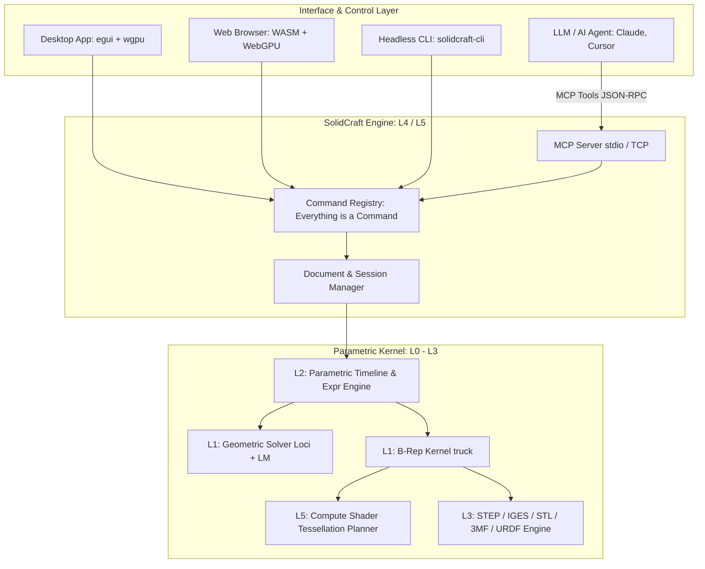

# solidcraft: 概要

tangency-labs/solidcraft は 2026-10-08 に GitHub で作成されたリポジトリです。2026-10-19 時点のスター数は 5,717 です。

`SolidCraft`は、純粋なRust（Pure Rust）でフルスクラッチ開発されたオープンソースのパラメトリック3D CADアプリケーションです。Autodesk Fusionなどの商用CADと同様の幾何拘束スケッチ、フィーチャータイムライン、パラメトリックリビルド、板金加工、アセンブリモデリングをローカルデスクトップ、Webブラウザ（WebGPU/WASM）、ヘッドレスCLIのすべてで動作させます。

特筆すべき最大のエッジは、**「Model Context Protocol（MCP）サーバー」をコアCLIに内蔵している点**です。LLMエージェント（Claude DesktopやCursor等）がMCPツール経由で3Dパーツを直接生成・計測・操作できる「AIネイティブCAD」として、製造業DXおよび自動設計パイプラインにパラダイムシフトをもたらしています。

## 🎯 成熟度の目安（AI による見立て）

- **根拠**:
  - 記事作成時点の GitHub スター数は 5,700 を超えています（スター数は品質の保証ではありません）。
  - 幾何オラクル検証において、76 個の公開参照パーツのうち 75 個で、体積・面積・重心・バウンディングボックスが解析解または FreeCAD の計算結果と一致したと README に記載されています（残り 1 個は既知の不具合として追跡中）。
  - レイヤードアーキテクチャ（L0〜L5）で構成された、MIT/Apache-2.0デュアルライセンスのクリーンルーム実装。
  - README では「Early but usable for simple parts」（初期段階だが単純な部品には使える）とされ、複雑な曲面モデリングや大規模アセンブリには未実装の領域があります。**「AI による定型の治具・ブラケットの生成」「Web 上の 3D カスタマイザー」「ヘッドレス CAD パイプライン」**などの限られた用途で検証候補になります。

## 解決する主要な課題とアーキテクチャ

従来のオープンソースCAD（FreeCADやOpenSCAD等）や商用CAD（Fusion 360, SolidWorks等）が抱えていた以下の課題を根本から解決します。

1. **AIエージェント親和性の欠如**: 従来のGUI中心CADは外部APIが貧弱であり、AIエージェントによるリアルタイム操作が困難だった。
2. **パフォーマンスと依存性の肥大化**: C++で書かれた旧来のCADエンジンはビルドが複雑でWeb展開が困難。SolidCraftはPure Rust＋WebGPUで、Webブラウザでも動作することを目指している。
3. **テッセレーションのボトルネック**: 独自のGPU Compute Shaderを用いたパッチ生成でメッシュ化します。性能の数値は README で確認してください。

### システムアーキテクチャ ＆ データフロー図

## インストール（README からの転記）

README にインストール手順のコードブロックが見つかりませんでした。導入方法は [README](https://github.com/tangency-labs/solidcraft#readme) を確認してください。

## ライセンス

- ライセンス: Apache License 2.0（SPDX: Apache-2.0）
- 確認先: [LICENSE ファイル](https://github.com/tangency-labs/solidcraft/blob/main/LICENSE-APACHE)

この節はライセンスの名称と確認先を示すもので、法的な助言ではありません。利用の可否は、LICENSE ファイルの本文と利用する状況に照らして確認してください。
