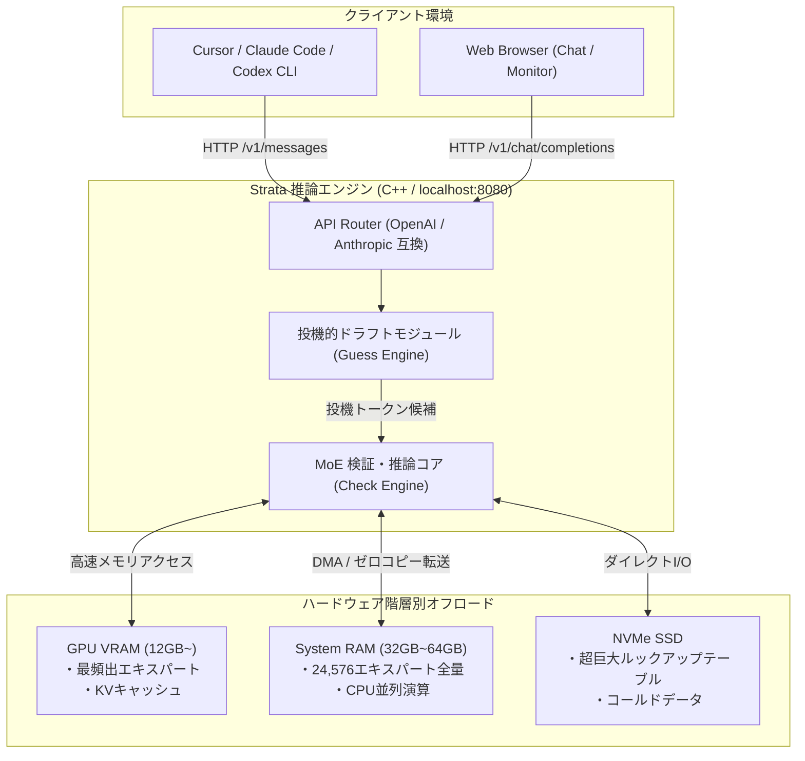

# Strata: 概要

Niko1221/Strata は 2026-09-25 に GitHub で作成されたリポジトリです。2026-10-10 時点のスター数は 19,544 です。

**Strata** は、1250億パラメータ規模の次世代オープンウェイトモデル「Qwen3.8-Flash-Next」を、一般的なコンシューマー向けゲーミングPC（VRAM 12GB〜）上で高速推論させるC++製オープンソース推論エンジンです。

Strataは階層型のメモリ管理と投機的デコーディング（Speculative Decoding）を組み合わせ、12GB GPU の環境で大規模な MoE モデルを動かすことを目指しています。対応 GPU と速度の数値は README で確認してください。

さらに、`localhost:8080`上でOpenAI API互換（`/v1/chat/completions`、`/v1/responses`）およびAnthropic API互換（`/v1/messages`）のエンドポイントを透過的に提供するため、Claude Code、Cursor、Codex CLIといった既存の開発エコシステムへ一切のコード改変なしで接続可能です。

---

## 解決する主要な課題とアーキテクチャ

大規模モデルの推論におけるボトルネックは「GPU VRAM容量の不足」と「メモリ帯域幅」です。StrataはMoE（Mixture of Experts）構造のスパース性を活用し、ハードウェア資源（VRAM・メインメモリ・NVMe SSD）を階層的に最適配置する設計を採用しています。

### 1. 24,576エキスパートの階層的オフロード（Pantry & Counterモデル）
モデル全体が内包する24,576のエキスパートのうち、各トークン生成で活性化するのはごく一部（約10エキスパート）です。Strataは頻出する「コア・エキスパート」のみを高速なGPU VRAM（Counter）に常駐させ、全エキスパート実体をシステムRAM（Pantry）に、巨大ルックアップテーブルをNVMe SSDに分散配置します。

### 2. 投機的推論（Speculative Guess & Check）
軽量なドラフトモデルが数トークン先を投機的に予測（Guess）し、巨大な本体モデルが一括検証（Check）を行うことで、推論速度を従来の1.6〜1.8倍に引き上げています。



---

## インストール（README からの転記）

以下は [README](https://github.com/Niko1221/Strata#readme) のインストール手順のコードブロックを、そのまま転記したものです。当サイトでは動作を確認していません。最新の手順は README を確認してください。

```sh
curl -fsSL https://github.com/Niko1221/Strata/releases/latest/download/install.sh | sh
```

> ⚠️ 注意: インターネットから取得したスクリプトをそのまま実行する手順です。実行前にスクリプトの中身を確認し、可能であればバージョン（タグやコミット）を固定してください。

```powershell
irm https://github.com/Niko1221/Strata/releases/latest/download/install.ps1 | iex
```

> ⚠️ 注意: インターネットから取得したスクリプトをそのまま実行する手順です。実行前にスクリプトの中身を確認し、可能であればバージョン（タグやコミット）を固定してください。

```sh
strata launch
```

```sh
strata launch --model q2_0 --yes --no-tui
```

## ライセンス

- ライセンス: MIT License（SPDX: MIT）
- 確認先: [LICENSE ファイル](https://github.com/Niko1221/Strata/blob/main/LICENSE)

この節はライセンスの名称と確認先を示すもので、法的な助言ではありません。利用の可否は、LICENSE ファイルの本文と利用する状況に照らして確認してください。
