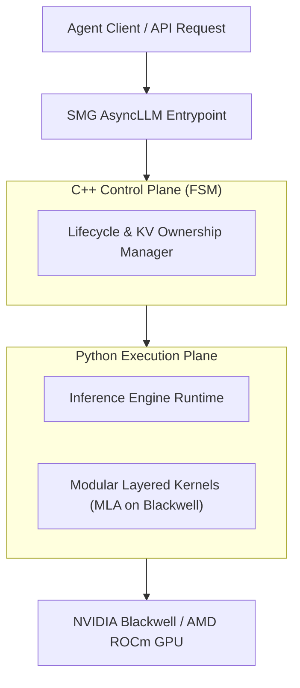

# tokenspeed: 概要

lightseekorg/tokenspeed は 2026-05-06 に GitHub で作成されたリポジトリです。2026-10-09 時点のスター数は 2,201 です。

`tokenspeed`は、GitHubで2200以上のスターを獲得している、Python製のオープンソースLLM推論エンジンです。その名の通り「光速」のLLM推論を実現することを目指し、特に**エージェントワークロード**に最適化されています。TensorRT-LLMレベルのパフォーマンスとvLLMレベルの使いやすさを両立させることを目標に掲げ、プロダクション環境でのエージェントワークロードにおいて最も高性能な推論エンジンとなることを目指しています。

README によると、PyTorch Foundation は TokenSpeed を PyTorch Ecosystem Landscape に迎えた際に、そのアーキテクチャ上の特徴（コントロールプレーンと実行プレーンの分離など）を紹介しています（[PyTorch のブログ](https://pytorch.org/blog/pytorch-ecosystem-landscape-q3-update/)）。また README には、非営利団体の LightSeek Foundation が支援し、NVIDIA や AMD などのベンダーからハードウェア・エンジニアリング面の支援を受けていると記載されています。

## 解決する主要な課題とアーキテクチャ

現代のLLMアプリケーション、特に複雑なタスクを自律的に実行するエージェントAIにおいては、推論速度と安定性がビジネスの成否を大きく左右します。従来のLLM推論エンジンは、汎用性や開発の容易さを追求する一方で、エージェントワークロード特有の動的なリクエストパターンやKVキャッシュ管理の課題に対して、最適なパフォーマンスを提供しきれていないケースがありました。

TokenSpeedは、この課題に対し根本的に異なるアーキテクチャアプローチで挑みます。

### アーキテクチャの核心

1.  **コントロールプレーンと実行プレーンの分離:**
    *   **コントロールプレーン (C++):** リクエストのライフサイクル、KVキャッシュの所有権、オーバーラップタイミングなどを有限状態機械（FSM）としてC++で実装。コンパイル時に型システムによって安全なKVリソースの再利用を強制し、実行時のエラーリスクを最小限に抑え、高い信頼性とパフォーマンスを実現します。
    *   **実行プレーン (Python):** 実際の推論実行ロジックはPythonで実装されており、研究者やエンジニアが迅速なイテレーションと低い認知負荷で開発を進められる柔軟性を提供します。
    この分離により、コアスケジューリングシステムの強力な正確性保証と、高レベルな実行レイヤーの開発速度を両立させています。

2.  **モジュール化されたカーネルシステム:**
    *   プラグイン可能なレイヤードカーネルシステムを採用し、ポータブルな公開APIと集中型レジストリを通じて、コアエンジンからカーネルを分離しています。
    *   README によると、カーネルのレジストリには Blackwell 世代 GPU 向けのエージェントワークロード用 **MLA (Multi-head Latent Attention)** 実装が含まれます（README ではこの実装を "one of the fastest" と説明しています）。カーネルは公開 API とプラグインの仕組みで分離されており、異なるアクセラレータへの拡張を想定しています。

3.  **SMG統合AsyncLLMによる低オーバーヘッドなリクエスト処理:**
    *   エントリーポイントとしてSMG 統合のAsyncLLMを採用し、CPU側のリクエストハンドリングにおけるオーバーヘッドを最小限に抑え、全体的なスループット向上に貢献しています。

## インストール（README からの転記）

README にインストール手順のコードブロックが見つかりませんでした。導入方法は [README](https://github.com/lightseekorg/tokenspeed#readme) を確認してください。

## ライセンス

- ライセンス: MIT License（SPDX: MIT）
- 確認先: [LICENSE ファイル](https://github.com/lightseekorg/tokenspeed/blob/main/LICENSE)

この節はライセンスの名称と確認先を示すもので、法的な助言ではありません。利用の可否は、LICENSE ファイルの本文と利用する状況に照らして確認してください。
