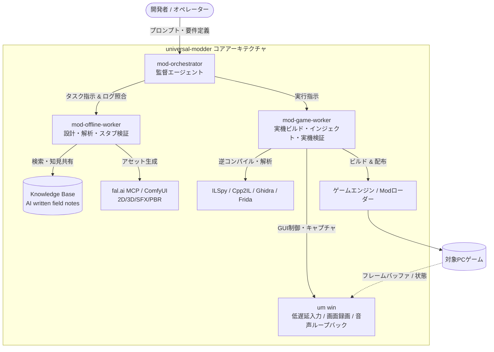

# universal-modder: 概要

rehan-remade/universal-modder は 2026-09-30 に GitHub で作成されたリポジトリです。2026-10-15 時点のスター数は 7,929 です。

`universal-modder`（GitHubスター数7,900超）は、Claude Code、Codex、Cursor、Gemini CLIなどのLLMコーディングエージェントに対して、**PCゲームのリバースエンジニアリング、コード生成、生成AIアセット作成、ゲーム内実機テスト、紹介動画作成**までの一連のMod開発パイプラインを統合実行させるオープンソースの自律型エージェント環境です。

従来、ゲームMod制作はアセンブリ解析、バイナリパッチ、ゲームエンジン固有の非公開データ構造調査、ピクセルアートや3Dモデル制作など、高度かつ多分野にわたる職人芸を要求されてきました。`universal-modder`は、Agent Skills仕様に準拠したツールチェーン、専用CLI（`um`）、fal.aiと連携するMCPサーバー、そして過去の解析知見を蓄積する自律型ナレッジベース（KB）を組み合わせることで、**「ゲームのパスとModの要件を自然言語で渡すだけで、AIが実バイナリを調査し、稼働するModを実装・検証する」**という異次元の開発体験を実現しています。

---

## 解決する主要な課題とアーキテクチャ

ゲームMod開発やレガシーバイナリのカスタマイズにおいて、エンジニアは以下の重大なボトルネックに直面していました。

1. **極度の文脈断片化**: ゲームエンジンの特定（Unity/Unreal/.NET/C++）、ローダー選定（BepInEx, Harmony, Fabric等）、逆コンパイルコードの解読という前工程の工数が膨大。
2. **クリエイティブアセットの調達コスト**: スプライト、3Dモデル、BGM/SFXの制作に別個のツールとスキルが必要。
3. **インゲーム検証のフィードバックループ欠如**: AIがコードを生成しても、実ゲーム内でクラッシュせず意図通り動くかを自律的にテストできない。

`universal-modder`は、これらを**3層マルチエージェント構造**と**OSレベルの低レイヤー自動化パイプライン**によって解決します。



### アーキテクチャの3大中核
1. **監督・分業型サブエージェント（Multi-Agent Roles）**
   - `mod-orchestrator`: 全体計画立案、各ワーカーの報告内容と実ログの監査、進行管理。
   - `mod-offline-worker`: 実機を汚さず、逆コンパイル結果の解析、SDK調査、パッチ設計、アセット生成を実施。
   - `mod-game-worker`: ゲームプロセスへのMod投入、実機プロセスメモリのプローブ計測、クラッシュログ解析を専任。
2. **OS/ゲーム自動化エンジン（`um win` CLI）**
   - DirectInput/RawInputをエミュレートし、バックグラウンドでも対象ゲームウィンドウのみに安全にキーストローク・マウス操作を送信。
   - プロセス単位のDirectX/Vulkanフレームキャプチャおよびオーディオループバック録音を行い、AIが目視・聴覚で挙動を検証。
3. **AI間ナレッジ蓄積ループ（Self-Updating Knowledge Base）**
   - 解決困難なエンジン固有の落とし穴（例: 特定バージョンのアンチチート挙動、メモリレイアウト）をMarkdown形式のフィールドノートとして自動生成。次世代のセッションへフィードバックされるエコシステムを形成。

---

## インストール（README からの転記）

以下は [README](https://github.com/rehan-remade/universal-modder#readme) のインストール手順のコードブロックを、そのまま転記したものです。当サイトでは動作を確認していません。最新の手順は README を確認してください。

```bash
uv tool install git+https://github.com/rehan-remade/universal-modder     # or: pipx install git+...
```

```bash
um fal key set                                                   # hidden prompt
export FAL_KEY="$(secret-tool lookup service fal.ai key api)"    # Linux: before starting the agent
```

## ライセンス

- ライセンス: MIT License（SPDX: MIT）
- 確認先: [LICENSE ファイル](https://github.com/rehan-remade/universal-modder/blob/main/LICENSE)

この節はライセンスの名称と確認先を示すもので、法的な助言ではありません。利用の可否は、LICENSE ファイルの本文と利用する状況に照らして確認してください。
