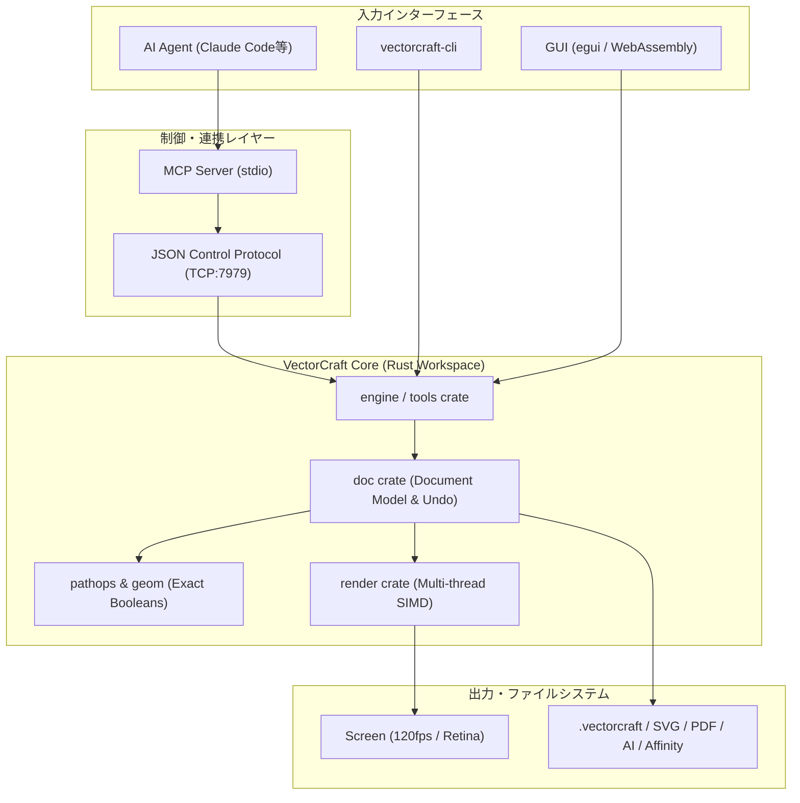

# vectorcraft: 概要

storytold/vectorcraft は 2026-09-30 に GitHub で作成されたリポジトリです。2026-10-15 時点のスター数は 8,898 です。

近年、クリエイティブツールの世界ではプロプライエタリなSaaSベンダーによる価格改定やライセンス形態の囲い込みに対する反発が強まっています。その中で公開されたのが**VectorCraft**です。

VectorCraftは、Adobe IllustratorのワークフローをピュアRust（ゼロからのフルスクラッチ）で完全クリーンルーム再実装したオープンソースのベクターグラフィックツールです。macOS、Windows、Linux、FreeBSD上でネイティブ動作するだけでなく、WebAssembly（WASM）によってブラウザ上でも全く同じインターフェースと描画エンジンが稼働します。

さらに最大の特徴は、**MCPサーバーを内包した「エージェント・ネイティブ」な構造**です。Claude CodeなどのLLM/自律型AIエージェントが、JSON制御プロトコル経由で人間のオペレーターと全く同じようにツール操作、描画、レイヤー編集、書き出しを行える設計となっています。

---

## 解決する主要な課題とアーキテクチャ

従来のベクターグラフィックソフトウェア（IllustratorやInkscapeなど）は、数十年にわたるレガシーC/C++コードベースを抱えており、以下の課題を抱えていました：

1. **メインスレッド描画のブロッキング**: 複雑なパス演算や万単位のオブジェクト配置によるUIのフリーズ
2. **ヘッドレス・自動化の困難さ**: GUI前提で設計されているため、CI/CDパイプラインやバックエンド処理でのベクター生成・レンダリングが重厚かつ不安定
3. **AIエージェント連携の不在**: スクリプティング言語（ExtendScript等）のAPI制限が厳しく、自律AIエージェントが自在に図面を操作できない

VectorCraftは、これらの課題をモダンRustの並列処理アーキテクチャとマイクロクレート設計により根本から解決しています。

### アーキテクチャとデータフロー

VectorCraftはコアエンジンとUIレイヤーが完全に分離されており、eguiを採用したUIスレッドとは独立したバックグラウンドスレッドでSIMD並列レンダリングを実行します。さらにCLIやMCPサーバーからの入力を共通の`Control Protocol`を経由して直接`Engine`に伝達します。



- **SIMD並列オフスレッドレンダリング**: 20,000個のベクターシェイプをRetina解像度においてわずか約27msで描画。UIフレームレートは120fpsを堅持。
- **堅牢な幾何演算エンジン**: 構造共有（Structural Sharing）による無限Undo/Redoと、厳密な幾何ブール演算（パスファインダー処理での「演算不能エラー」を徹底排除）。
- **完全なファイル相互運用性**: ネイティブJSON（`.vectorcraft`）に加え、SVG、PDF/X、AI（PDF互換層）、Affinity（`.afdesign`, `.afpub`等）のダイレクトインポートに対応。

---

## インストール（README からの転記）

以下は [README](https://github.com/storytold/vectorcraft#readme) のインストール手順のコードブロックを、そのまま転記したものです。当サイトでは動作を確認していません。最新の手順は README を確認してください。

```sh
git clone https://github.com/storytold/vectorcraft
cd vectorcraft

cargo run --release -p vectorcraft                          # desktop app
cargo run --release -p vectorcraft -- examples/dusk-poster.vectorcraft
cargo run --release -p vectorcraft -- --control 7979        # + JSON control channel
cargo run --release -p vectorcraft-cli -- mcp               # MCP server (stdio)
cargo run --release -p vectorcraft-cli -- run --in examples/ribbons.vectorcraft --export out.pdf   # headless batch
cargo run --release -p vectorcraft-cli -- bench examples/neon-drive.vectorcraft                   # render timing
cargo xtask bundle                                        # dist/VectorCraft.app (macOS)
cd apps/vectorcraft-web && trunk build --release            # web build → dist/web
cargo xtask ci                                            # fmt, clippy, tests, layering, wasm, vendor names
```

```sh
claude mcp add vectorcraft -- /path/to/vectorcraft-cli mcp
```

```sh
claude mcp add vectorcraft -- /path/to/vectorcraft-cli mcp --automation-read-root /work/project --automation-write-root /work/project
```

## ライセンス

- ライセンス: Apache License 2.0（SPDX: Apache-2.0）
- 確認先: [LICENSE ファイル](https://github.com/storytold/vectorcraft/blob/main/LICENSE-APACHE)

この節はライセンスの名称と確認先を示すもので、法的な助言ではありません。利用の可否は、LICENSE ファイルの本文と利用する状況に照らして確認してください。
