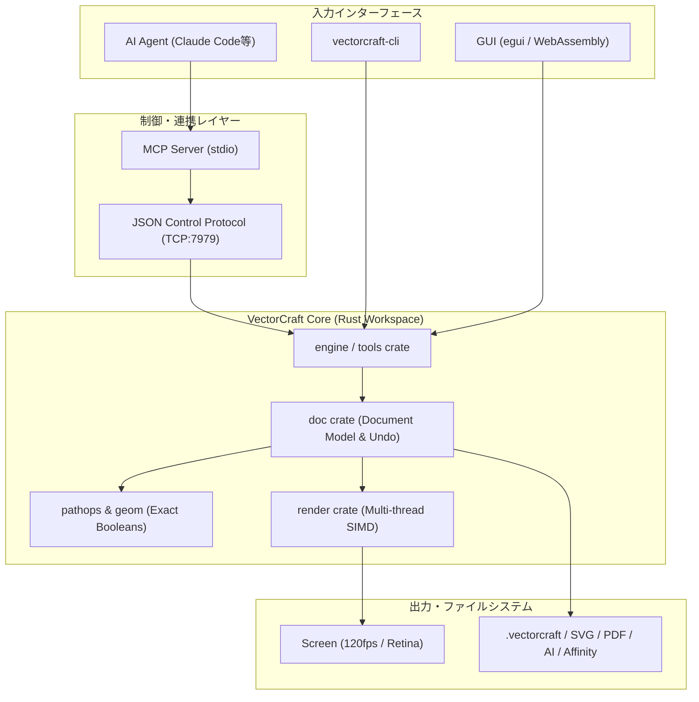

# vectorcraft: 概要と革新性

近年、クリエイティブツールの世界ではプロプライエタリなSaaSベンダーによる価格改定やライセンス形態の囲い込みに対する反発が強まっています。その中で突如登場し、すでにGitHubスター数8,800超えの熱狂的な支持を集めているのが**VectorCraft**です。

VectorCraftは、Adobe IllustratorのワークフローをピュアRust（ゼロからのフルスクラッチ）で完全クリーンルーム再実装したオープンソースのベクターグラフィックツールです。macOS、Windows、Linux、FreeBSD上でネイティブ動作するだけでなく、WebAssembly（WASM）によってブラウザ上でも全く同じインターフェースと描画エンジンが稼働します。

さらに最大の特徴は、**MCP（Model Context Protocol）サーバーを内包した「エージェント・ネイティブ」な構造**です。Claude CodeなどのLLM/自律型AIエージェントが、JSON制御プロトコル経由で人間のオペレーターと全く同じようにツール操作、描画、レイヤー編集、書き出しを行える設計となっています。

---

## 解決する主要な課題とアーキテクチャ

従来のベクターグラフィックソフトウェア（IllustratorやInkscapeなど）は、数十年にわたるレガシーC/C++コードベースを抱えており、以下の課題を抱えていました：

1. **メインスレッド描画のブロッキング**: 複雑なパス演算や万単位のオブジェクト配置によるUIのフリーズ
2. **ヘッドレス・自動化の困難さ**: GUI前提で設計されているため、CI/CDパイプラインやバックエンド処理でのベクター生成・レンダリングが重厚かつ不安定
3. **AIエージェント連携の不在**: スクリプティング言語（ExtendScript等）のAPI制限が厳しく、自律AIエージェントが自在に図面を操作できない

VectorCraftは、これらの課題をモダンRustの並列処理アーキテクチャとマイクロクレート設計により根本から解決しています。

### アーキテクチャとデータフロー

VectorCraftはコアエンジンとUIレイヤーが完全に分離されており、eguiを採用したUIスレッドとは独立したバックグラウンドスレッドでSIMD並列レンダリングを実行します。さらにCLIやMCPサーバーからの入力を共通の`Control Protocol`を経由して直接`Engine`に伝達します。



- **SIMD並列オフスレッドレンダリング**: 20,000個のベクターシェイプをRetina解像度においてわずか約27msで描画。UIフレームレートは120fpsを堅持。
- **堅牢な幾何演算エンジン**: 構造共有（Structural Sharing）による無限Undo/Redoと、厳密な幾何ブール演算（パスファインダー処理での「演算不能エラー」を徹底排除）。
- **完全なファイル相互運用性**: ネイティブJSON（`.vectorcraft`）に加え、SVG、PDF/X、AI（PDF互換層）、Affinity（`.afdesign`, `.afpub`等）のダイレクトインポートに対応。

---

## 競合ツール/商用SaaSとの徹底比較

| 機能・指標 | Adobe Illustrator | Inkscape | Figma | **VectorCraft** |
| :--- | :--- | :--- | :--- | :--- |
| **開発言語** | C++ (レガシー) | C++ / GTK | C++ / WebAssembly | **Pure Rust** |
| **ライセンス形態** | 月額課金（プロプライエタリ） | GPL v3 | 月額課金（SaaS） | **MIT / Apache-2.0** |
| **描画性能** | 大規模パスで遅延発生 | 大規模パスで低速 | WebGL高速描画 | **SIMDマルチスレッド (27ms/2万パス)** |
| **エージェント親和性 (MCP)** | 不可 (ExtendScriptのみ) | 不可 (Pythonプラグイン) | プラグインAPI経由 | **ネイティブMCP / JSON RPC対応** |
| **ヘッドレス実行** | 難（デスクトップ起動必須） | 可能（CLI対応） | 外部API依存（制限有） | **CLIネイティブで高速バッチ書き出し** |
| **プラットフォーム** | macOS / Windows | デスクトップ各種 | Web中心 / Electron | **macOS / Win / Linux / BSD / Web** |

---

## 💡 ビジネス・マネタイズ活用アイデア（実践例）

VectorCraftの真価は単なる「無料のIllustrator代替」にとどまりません。**Rust製ネイティブバイナリ＋MCP/CLI完備**という性質を活かした、次世代のビジネスモデルが成立します。

1. **AIネイティブなベクター生成・組版自動化エンジン**:
   - Claude Codeや自社エージェントを組み合わせ、自然言語指示から印刷用パンフレット、名刺、ポスターのパスデータを動的に自動生成する受託開発。
2. **オンプレミス型プライベートベクターSaaSの構築**:
   - WebAssembly版を活用し、機密情報を外部クラウドに送信できない官公庁・金融機関・製造業向けに、社内完結型ベクター編集プラットフォームを構築・保守提供。
3. **CI/CD組み込み型グラフィックアセット自動最適化パイプライン**:
   - GitHub Actions等のCIパイプライン上で`vectorcraft-cli`をヘッドレス動作させ、SVG/PDFの自動バリデーションやフォーマット変換バッチサービスを受託。

---

## インストール & クイックスタート手順

### 1. ソースコードからのビルドと起動

Rustツールチェーンがインストールされている環境であれば、数コマンドで起動できます。

```bash
# リポジトリのクローン
git clone https://github.com/storytold/vectorcraft
cd vectorcraft

# デスクトップアプリのネイティブ起動 (Releaseビルド)
cargo run --release -p vectorcraft

# 付属のサンプルファイルを開く
cargo run --release -p vectorcraft -- examples/dusk-poster.vectorcraft

# JSON制御チャネルを有効化して起動 (ポート7979)
cargo run --release -p vectorcraft -- --control 7979
```

### 2. MCPサーバーをClaude Codeに登録する

AIエージェントからVectorCraftを直接操作可能にします。

```bash
# MCPサーバーのバイナリをClaude CLIに登録
claude mcp add vectorcraft -- cargo run --release -p vectorcraft-cli -- mcp
```

### 3. ヘッドレスバッチ書き出し（CLI）

GUIを立ち上げることなく、CIサーバー上でPDFや各種ラスタ形式へレンダリングできます。

```bash
cargo run --release -p vectorcraft-cli -- run --in examples/ribbons.vectorcraft --export out.pdf
```

---

## 商用利用可否 & ライセンス考察

VectorCraftのコードベースは **MIT License または Apache License 2.0 のデュアルライセンス** で公開されています。

- **商用利用**: 自社プロダクトへの組み込み、受託開発での納品、自社SaaSのバックエンドエンジンとしての活用が完全に認められています。
- **フォークと再配布**: 商用クローズドソース製品への静的リンクや独自拡張バイナリの販売もライセンス条項（著作権表示等）を遵守する限り問題ありません。
- **商標に関する注意**: 「ArtCraft」「VectorCraft」のロゴおよびブランドマークは保護されており、商用フォークや独自配布を行う場合は独自アイコンへの差し替えが必要です。