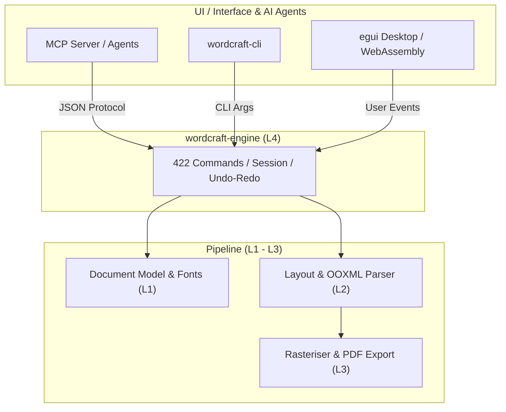

# wordcraft: 概要

storytold/wordcraft は 2026-10-07 に GitHub で作成されたリポジトリです。2026-10-14 時点のスター数は 11,077 です。

`storytold/wordcraft` は、Microsoft Word のワークフロー、UI（リボンUI）、そしてファイル仕様（.docx / OOXML）を、依存関係なしに **Pure Rust** でゼロからクリーンルーム再実装したオープンソースのデスクトップ・Web向けワードプロセッサです。

従来のオープンソースオフィス（LibreOffice等）が抱えていた「起動の重さ」「レガシーC++コードベース」「ヘッドレス運用の難しさ」「Electron製ツールのメモリ浪費」というペインを、Rustのメモリ安全性とGPUネイティブ描画（egui）、そしてレイアウトキャッシュ技術によって根本から解決しています。

### 主な革新性
1. **README に記載の性能**: 段落レイアウトをキャッシュするため、188 ページの文書で入力したときの再レイアウトが約 **1.4ms** と記載されています（当サイトでは計測していません）。Electron は使っていません。
2. **AIエージェント・ファースト設計**: 全422種類のUIアクションがユニークなコマンドIDとして公開されており、**MCP** サーバーまたはCLIを通じて、Claude 等の AI モデルからヘッドレスで文書の作成・編集を操作できます。
3. **オフライン・完全プライベート**: 校閲・文法チェック・PDF/DOCX変換が外部API通信なしにローカルで完結。

---

## 解決する主要な課題とアーキテクチャ

オフィスドキュメントの自動化において、従来の headless LibreOffice や Python-docx は「レイアウトの崩れをリアルタイムに検知できない」「フォントレンダリングや改ページ判定が本家Wordとズレる」という決定的な弱点を抱えていました。

WordCraftは、下図のように厳格なレイヤード・アーキテクチャを採用しており、レンダリングエンジン（`vello_cpu`）とレイアウトエンジン（`wordcraft-layout`）を分離しつつ、AIエージェントプロトコル（MCP）を最上位コントロール層に標準統合しています。



### アーキテクチャの特徴
- **L0〜L3（コアエンジン）**: 幾何計算（`wordcraft-geom`）、フォントシェーピング・ドキュメント構造（`wordcraft-doc`）、禁則処理・ページネーション・数式・表計算（`wordcraft-layout`）を完全分離。
- **L4（エンジン層）**: 422個のコマンドカタログで全操作を正規化。UIのクリックイベントも、エージェントからのMCPリクエストも同一のエントリポイントを通過。
- **L5〜L6（配信・フロント）**: ネイティブeguiとWasm対応。ヘッドレスサーバーでもGUIクライアントでも同一のバイナリコアで稼働。

---

## インストール（README からの転記）

以下は [README](https://github.com/storytold/wordcraft#readme) のインストール手順のコードブロックを、そのまま転記したものです。当サイトでは動作を確認していません。最新の手順は README を確認してください。

```sh
git clone https://github.com/storytold/wordcraft
cd wordcraft
cargo run --release -p wordcraft -- --sample        # the desktop app with the sample document
cargo run --release -p wordcraft -- report.docx     # open a document
```

```sh
wordcraft-cli convert report.docx report.pdf        # docx, pdf, odt, rtf, html, md, tex, txt, png
wordcraft-cli text report.docx                      # plain text
wordcraft-cli inspect report.docx                   # structure as JSON
wordcraft-cli run --template sample \
  --cmd 'select.text={"text":"Membership"}' --cmd format.bold --save out.docx
wordcraft-cli run --script job.json                 # the same from a file: commands, then save to docx and pdf
```

## ライセンス

- ライセンス: Apache License 2.0（SPDX: Apache-2.0）
- 確認先: [LICENSE ファイル](https://github.com/storytold/wordcraft/blob/main/LICENSE-APACHE)

この節はライセンスの名称と確認先を示すもので、法的な助言ではありません。利用の可否は、LICENSE ファイルの本文と利用する状況に照らして確認してください。
