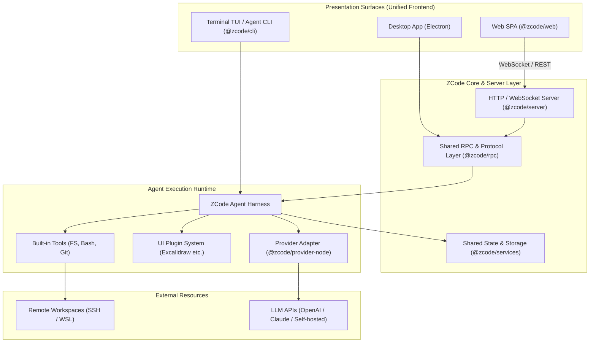

# ZCode: 概要

zai-org/ZCode は 2026-09-20 に GitHub で作成されたリポジトリです。2026-10-15 時点のスター数は 7,854 です。

近年、CursorやGitHub Copilot Workspace、Devinに代表される自律型コーディングエージェントがソフトウェア開発の現場を塗り替えています。しかし、商用クラウドサービスへのソースコード転送に対するセキュリティ懸念や、月額シート課金による運用コスト肥大化が多くのエンタープライズにとってのボトルネックとなっていました。

**ZCode** は、Z.aiがオープンソース（Apache License 2.0）として公開している統合コーディングエージェント・ハーネス（Harness）です。GitHubスター数は既に7,800を超え、世界中のAI開発者・プラットフォームエンジニアから強烈な支持を集めています。

ZCodeの最大の特徴は、**「デスクトップ（Electron）」「Webブラウザ（SPA/Remote Server）」「ターミナル（TUI/CLI）」という3つの実行サーフェスを、単一のTypeScriptモノレポから同一のコアランタイムとして提供している点**です。これにより、開発者はローカルマシンの閉域環境、社内の踏み台サーバー、クラウドコンテナなど、インフラ制約に合わせた柔軟なデプロイと拡張が可能になります。

---

## 解決する主要な課題とアーキテクチャ

ZCodeは、従来のAI開発ツールが抱えていた以下の課題を根本から解決します。

1. **インフラ・環境の断絶**: ローカル専用ツール（Cursor等）とリモート開発環境（SSH/WSL/コンテナ）の間の機能格差を解消。
2. **ベンダーロックインの排除**: 特定のモデルプロバイダに依存せず、独自のLLMエンドポイントやローカルモデルを差し替え可能なProviderレイヤー。
3. **拡張性の欠如**: UI Pluginアーキテクチャにより、Excalidraw等のホワイトボードや社内独自のデザインシステムをシームレスにエージェントワークスペースへ統合可能。

### システムアーキテクチャとデータフロー

以下は、ZCodeの主要コンポーネントとリクエスト実行フローを示すアーキテクチャ図です。

ZCodeはTypeScriptで統一されたモノレポ構成（`pnpm workspace`）を採用。コアとなる状態管理（ZustandベースのUI共有パッケージ）、RPC通信レイヤー、Provider抽象化レイヤーが疎結合に設計されており、ヘッドレスなCI/CDパイプラインからGUI重視のローカル開発まで、同一のAgent Harnessを使い回すことができます。

---

## インストール（README からの転記）

README にインストール手順のコードブロックが見つかりませんでした。導入方法は [README](https://github.com/zai-org/ZCode#readme) を確認してください。

## ライセンス

- ライセンス: Apache License 2.0（SPDX: Apache-2.0）
- 確認先: [LICENSE ファイル](https://github.com/zai-org/ZCode/blob/main/LICENSE)

この節はライセンスの名称と確認先を示すもので、法的な助言ではありません。利用の可否は、LICENSE ファイルの本文と利用する状況に照らして確認してください。
