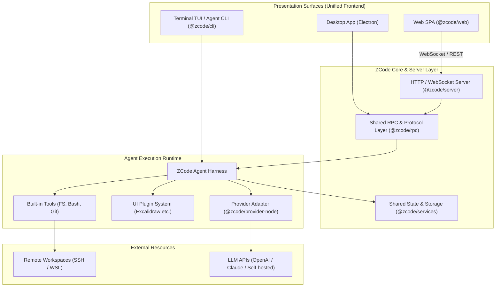

# ZCode: 概要と革新性

近年、CursorやGitHub Copilot Workspace、Devinに代表される自律型コーディングエージェントがソフトウェア開発の現場を塗り替えています。しかし、商用クラウドサービスへのソースコード転送に対するセキュリティ懸念や、月額シート課金による運用コスト肥大化が多くのエンタープライズにとってのボトルネックとなっていました。

**ZCode** は、Z.aiがオープンソース（Apache License 2.0）として公開している統合コーディングエージェント・ハーネス（Harness）です。GitHubスター数は既に7,800を超え、世界中のAI開発者・プラットフォームエンジニアから強烈な支持を集めています。

ZCodeの最大の特徴は、**「デスクトップ（Electron）」「Webブラウザ（SPA/Remote Server）」「ターミナル（TUI/CLI）」という3つの実行サーフェスを、単一のTypeScriptモノレポから同一のコアランタイムとして提供している点**です。これにより、開発者はローカルマシンの閉域環境、社内の踏み台サーバー、クラウドコンテナなど、インフラ制約に合わせた柔軟なデプロイと拡張が可能になります。

---

## 解決する主要な課題とアーキテクチャ

ZCodeは、従来のAI開発ツールが抱えていた以下の課題を根本から解決します。

1. **インフラ・環境の断絶**: ローカル専用ツール（Cursor等）とリモート開発環境（SSH/WSL/コンテナ）の間の機能格差を解消。
2. **ベンダーロックインの排除**: 特定のモデルプロバイダに依存せず、独自のLLMエンドポイントやローカルモデルを差し替え可能なProviderレイヤー。
3. **拡張性の欠如**: UI Pluginアーキテクチャにより、Excalidraw等のホワイトボードや社内独自のデザインシステムをシームレスにエージェントワークスペースへ統合可能。

### システムアーキテクチャとデータフロー

以下は、ZCodeの主要コンポーネントとリクエスト実行フローを示すアーキテクチャ図です。



ZCodeはTypeScriptで統一されたモノレポ構成（`pnpm workspace`）を採用。コアとなる状態管理（ZustandベースのUI共有パッケージ）、RPC通信レイヤー、Provider抽象化レイヤーが疎結合に設計されており、ヘッドレスなCI/CDパイプラインからGUI重視のローカル開発まで、同一のAgent Harnessを使い回すことができます。

---

## 競合ツール/商用SaaSとの徹底比較

| 評価軸 | ZCode (OSS) | Cursor / GitHub Copilot | Devin / Commercial Agents |
| :--- | :--- | :--- | :--- |
| **ライセンス** | **Apache-2.0 (完全オープンソース)** | プロプライエタリ | プロプライエタリ |
| **データプライバシー** | **完全オンプレミス / 閉域網対応** | ベンダー規定に依存 (送信必須) | ベンダー規定に依存 (クラウド実行) |
| **インターフェース** | **Desktop / Web / TUI / Headless** | Desktop (VS Code Fork) のみ | Webコンソールのみ |
| **リモート開発連携** | **SSH / WSL / 自社サーバー直接マウント** | ポート転送経由 | サンドボックスコンテナ限定 |
| **プラグイン拡張性** | **ReactベースのUI Plugin対応** | VS Code拡張に依存 | 不可 (クローズド) |
| **月額コスト** | **インフラ・LLMトークン実費のみ** | $20〜/月/ユーザー | $500〜/月（高額サブスク） |

---

## 💡 ビジネス・マネタイズ活用アイデア（実践例）

### 1. 金融・医療向け「完全閉域AIコーディング基盤」構築受託
クラウドサービスへのソースコード流出がコンプライアンス上禁止されている企業に対し、オンプレミスサーバー（または専用VPC）上にZCodeのWeb/Server構成を構築。ローカルLLM（Llama 3、DeepSeek Coder等）やAzure OpenAIプライベートエンドポイントと接続することで、セキュアな開発環境を一括納品。

### 2. 社内開発プラットフォーム（Internal Developer Platform）への組み込み
社内GitLabや社内ドキュメントシステムと連携するUI Pluginを開発。ZCodeの画面上から社内API仕様書を参照し、コード生成からPR作成、ステージング環境へのデプロイまでを自律実行する社内専用エージェントを構築。

### 3. バーティカル特化型AIコーディングSaaSの基盤
ZCodeのヘッドレスCLIとWeb UIをベースに、特定のフレームワーク（Flutter、Salesforce Apex、組込みC言語など）に特化したファインチューニングモデルを接続。ドメイン特化型SaaSとしてリブランディング展開。

---

## インストール & クイックスタート手順

### 必須環境
- Node.js `24.14.0` (mise等の利用推奨)
- pnpm `10.33.2`

### 1. リポジトリのクローンと初期化
```bash
git clone https://github.com/zai-org/ZCode.git
cd ZCode

# 依存関係のインストールと初期ビルド
pnpm bootstrap
```

### 2. ターミナルから起動（TUIモード）
```bash
# Agent CLI / TUI の起動
pnpm --filter @zcode/cli dev
```

### 3. ブラウザ版（Webモード）の起動
```bash
# ワークスペースを指定してWebサーバーを起動
ZCODE_SERVER_WORKSPACE=/path/to/your/project pnpm dev:web
```
ブラウザで `http://localhost:5173` にアクセスすることで、Web版のAIワークスペースが即座に利用可能です。

---

## 商用利用可否 & ライセンス考察

ZCodeは **Apache License 2.0** で公開されています。

- **商用利用**: 完全に許可（自社内での利用、有償サービスの基盤、受託開発でのクライアント納品が可能）。
- **改変と再配布**: ソースコードの改変や自社ブランディングでのパッケージング配布が可能。
- **特許の許諾**: コントリビューターからの明示的な特許ライセンスが付与されます。
- **義務要件**: 著作権表示およびライセンス通知の保持、改変履歴の明示が必要です。

ベンダーロックインを回避し、自社の知的財産として自律型AIコーディング基盤を内製化したい企業にとって、ZCodeは現在最も堅牢かつ実用的な選択肢です。
