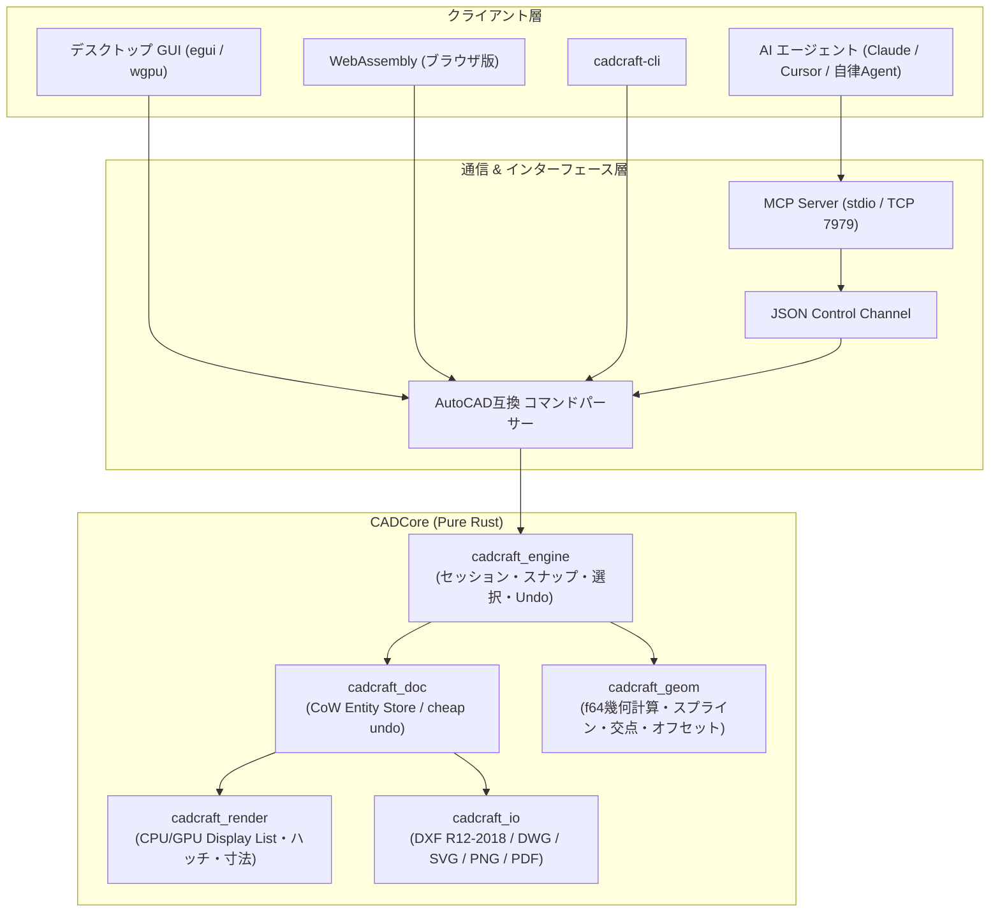

# cadcraft: 概要と革新性

CADソフトウェアの世界は数十年にわたり、Autodesk社のAutoCADをはじめとする独占的な商用プロプライエタリ製品が支配してきました。オープンソースの世界でもLibreCADやFreeCADなどが存在したものの、旧来のC++ベースの重厚なUIフレームワークへの依存や、スクリプト自動化・ヘッドレス運用の難しさが課題でした。

この現状を根本から打破するために登場したのが **「CADCraft」** です。
CADCraftは、クリーンルーム設計でPure Rustを用いて開発されたAutoCAD互換の2D/3D CADアプリケーションです。ElectronやWebViewを一切使わず、Rustの即時モードGUIフレームワーク「egui」と「wgpu」をダイレクトに駆動させることで、超軽量・瞬時起動・ゼロクラッシュの堅牢性を達成しています。

さらに最大の革新性は、**「AIエージェントによる自律設計（Agent-drivable over MCP）」** を設計思想の中核に据えている点です。コマンドライン、JSONコントロールチャネル、そして業界標準のMCP（Model Context Protocol）サーバーがネイティブ統合されており、LLM（ClaudeやGPTなど）が図面生成・編集・視覚的検証を完全自動で実行可能です。

## 🎯 ThoughtWorks成熟度リング判定（TRIAL）

**判定：TRIAL（試験的導入を強く推奨）**

- **根拠**:
  - **アーキテクチャの完成度**: C++のレガシーコードを持たず、Pure Rustで幾何計算（geom）、DXFパーサー（dxf）、エンティティDB（doc）、レンダラー（render）が分離されており、依存関係が極めてクリーン。
  - **互換性とパラメトリック機能**: DXF（R12〜2018）、DWG読み込み、拘束ソルバー、TrueType/OpenTypeフォントレンダリング、複線寸法（DIMSTYLE）をすでに網羅。
  - **早期開発（Early Development）フェーズ**: コア機能は完成度が高いものの、3Dソリッドモデリングや一部の高度な拡張エンティティは開発途上。
- **推奨フェーズ**:
  - 製造業・建築業における「図面フォーマット変換」「バッチレンダリング」「定型図面自動生成」のパイプラインから本番導入を推奨。エンドユーザーの本格作図端末としての全面移行は段階的な検証が適切です。

## 解決する主要な課題とアーキテクチャ

CADCraftは以下の課題を解決します。
1. **高額な年間サブスクリプションコスト**: 1シートあたり年間数十万円のライセンス費をゼロに。
2. **プラットフォーム縛り**: Windows、macOS（Apple Silicon/Intel）、Linux、FreeBSD、さらにはWebAssembly（ブラウザ内完全動作）まで同一バイナリ・コードベースで稼働。
3. **AI連携の断絶**: 従来のCADはGUI手作業が前提でしたが、CADCraftは全コマンドがJSONおよびMCP経由で実行可能。

### システムアーキテクチャ図

## 📖 続きと実務キットについて
本記事は Auto Tech Radar の無料解説の抜粋です。

- 📖 **無料**: アーキテクチャ・競合比較・ライセンス考察の全文 → [Auto Tech Radar で読む](https://ssk0224.github.io/auto-tech-radar/radar/cadcraft_zenn/)
- 🔒 **有料（note）**: 導入提案書テンプレート・工数見積表・公式READMEに基づく導入手順 → [note の有料記事・メンバーシップ](https://note.com/vast_ixora7005/membership)

