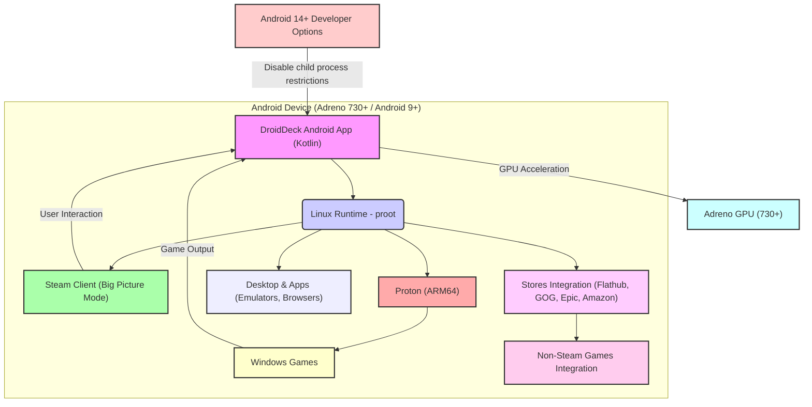

# DroidDeck: AndroidでSteamOS体験を実現する革新的なOSS

## 概要と革新性

DroidDeckは、Androidデバイス上でValveのSteamOS体験を再現し、Steam Big PictureモードとARM64版Protonを介してWindowsゲームの実行を可能にする画期的なオープンソースプロジェクトです。これにより、高性能なAdreno GPUを搭載したAndroidスマートフォンやタブレットが、ポータブルなゲーミングPCへと変貌します。

従来のAndroidゲーミングは、ネイティブアプリに限定されるか、クラウドゲーミングサービスに依存していました。DroidDeckは、この現状を打破し、デバイス上で直接PCゲームを動作させるという、これまでになかった自由とパフォーマンスを提供します。特に、Steam Deckのような専用ハードウェアに投資することなく、既存のAndroidデバイス資産を最大限に活用できる点が、その最大の魅力であり革新性と言えるでしょう。

## 解決する主要な課題とアーキテクチャ

DroidDeckが解決する主要な課題は以下の通りです。

1.  **AndroidデバイスでのPCゲーム体験の欠如:** 多くのAndroidデバイスは高性能なハードウェアを持つものの、PCゲームの実行環境がありませんでした。DroidDeckはProtonを導入することで、このギャップを埋めます。
2.  **高価な専用ゲーミングハードウェアへの依存:** Steam Deckのような専用デバイスは魅力的ですが、初期投資が必要です。DroidDeckは既存のAndroidデバイスを活用し、コストを削減します。
3.  **クラウドゲーミングの制約:** ネットワーク環境に依存し、遅延やデータ使用量の問題があるクラウドゲーミングに対し、DroidDeckはデバイス上でのローカル実行を可能にします。

DroidDeckのアーキテクチャは、Androidアプリケーション、Linuxランタイム、そしてValveの技術要素を巧みに統合しています。

1.  **DroidDeck Android App (Kotlin):** Androidデバイス上で動作するメインアプリケーション。ユーザーインターフェースを提供し、Linuxランタイムの起動と管理を行います。
2.  **Linux Runtime (proot):** Androidのサンドボックス内で動作する仮想的なLinux環境。`proot`技術を利用し、root権限なしでLinux環境をエミュレートします。
3.  **Steam Client (Big Picture Mode):** Linuxランタイム上で動作するSteamクライアント。ゲームライブラリへのアクセス、ダウンロード、起動を管理します。
4.  **Proton (ARM64):** Valveが開発したWindowsゲーム互換レイヤーのARM64版。WindowsゲームのAPIコールをLinux互換に変換し、Androidデバイス上でWindowsゲームを実行可能にします。
5.  **Adreno GPU (730+):** DroidDeckのパフォーマンスを支える重要なハードウェア要素。DirectX 11/12ゲームのレンダリングを高速化します。
6.  **Stores Integration:** FlathubからのLinuxアプリ、GOG、Epic Games、Amazon Gamesなどの外部ストアからゲームをダウンロードし、Steamに非Steamゲームとして統合する機能を提供します。

このアーキテクチャにより、DroidDeckはAndroidデバイスのハードウェア性能を最大限に引き出し、PCゲーミングの新たな可能性を切り開いています。

## 競合ツール/商用SaaSとの徹底比較

| 特徴/サービス | DroidDeck | Steam Deck (ハードウェア) | GeForce NOW (クラウドSaaS) | Xbox Cloud Gaming (クラウドSaaS) | 他のAndroidエミュレータ (例: ExaGear) |
| :------------ | :-------- | :----------------------- | :------------------------- | :----------------------------- | :---------------------------------- |
| **プラットフォーム** | Android | 専用Linux (SteamOS) | クラウド (PC, モバイル, TV) | クラウド (PC, モバイル, TV) | Android |
| **ゲーム実行場所** | デバイス上 (ローカル) | デバイス上 (ローカル) | クラウドサーバー | クラウドサーバー | デバイス上 (ローカル) |
| **対応ゲーム** | Steam (Windows/Linux), GOG, Epic, Amazon | Steam (Windows/Linux) | 対応タイトル限定 | Game Passタイトル限定 | Windowsアプリ (互換性低い) |
| **初期費用** | 既存Androidデバイス活用 (無料) | 59,800円〜 (ハードウェア) | 無料プランあり/月額課金 | 月額課金 | 無料 (アプリ) |
| **月額費用** | 0円 (OSS) | 0円 (ハードウェア購入後) | 1,980円〜 | 1,100円〜 | 0円 (OSS/フリーミアム) |
| **インターネット** | 必須 (ダウンロード時のみ) | 必須 (ダウンロード時のみ) | 必須 (常時) | 必須 (常時) | 必須 (ダウンロード時のみ) |
| **カスタマイズ性** | 高 (OSS) | 中 (SteamOS) | 低 | 低 | 低 |
| **パフォーマンス** | デバイス性能依存 | 高 (専用設計) | ネットワーク依存 | ネットワーク依存 | 低 (エミュレーション) |
| **特長** | 既存AndroidデバイスをゲーミングPC化、ProtonによるWindowsゲーム対応、多様なストア連携 | 専用設計による最適化、携帯性、Steamエコシステムとの完全統合 | 高性能PC不要、どこでもプレイ、低遅延 | Xboxエコシステムとの連携、豊富なゲームパスライブラリ | 古いWindowsアプリの限定的実行 |

DroidDeckは、既存のAndroidデバイスをゲーミングハブに変えることで、Steam Deckのような専用ハードウェアの初期投資を不要にし、GeForce NOWやXbox Cloud Gamingのようなクラウドサービスが抱えるネットワーク依存の問題を解決します。OSSであるため、カスタマイズの自由度が高く、特定のビジネスニーズに合わせたソリューション構築が可能です。

## 💡 ビジネス・マネタイズ活用アイデア（実践例）

DroidDeckは、その革新性から多岐にわたるビジネスチャンスを秘めています。

1.  **ゲーミングデバイスメーカーへの組み込み提案:**
    *   高性能Androidタブレットやポータブルゲーミングデバイスを開発するメーカーに対し、DroidDeckをプリインストールした「SteamOSライクなゲーミングタブレット/ハンドヘルド」として製品化を提案。独自のUI/UXを開発し、差別化を図ります。
    *   **実践例:** 特定のゲームジャンル（例: レトロゲーム、インディーズゲーム）に特化したカスタムROMを提供し、デバイスとセットで販売。
2.  **ゲーミングカフェ/eスポーツ施設向けソリューション:**
    *   既存のAndroidデバイスを安価なゲーミングステーションとして活用するソリューションを提供。高価なゲーミングPCの導入コストを抑えつつ、Steamライブラリへのアクセスを可能にします。
    *   **実践例:** DroidDeckをベースにした集中管理システムを開発し、各デバイスのゲームライブラリ、利用時間、課金などを一元管理するSaaSを提供。
3.  **技術サポート・コンサルティングサービス:**
    *   DroidDeckの導入、設定、最適化、トラブルシューティングに関する専門的な技術サポートサービスを提供。特に、Adreno GPUの最適化やProtonのカスタム設定など、高度な知識が求められる領域で価値を発揮します。
    *   **実践例:** 企業や個人ユーザー向けに、DroidDeckのカスタムビルド提供や、特定のWindowsゲームの動作保証サービスを有料で提供。
4.  **教育・開発用途での活用:**
    *   ゲーム開発者や学生向けに、Androidデバイス上でPCゲームの動作検証やプロトタイピングを行う環境としてDroidDeckを提案。低コストで開発環境を構築できます。
    *   **実践例:** DroidDeckをベースにした「ポータブルゲーム開発キット」を販売し、ゲーム開発の学習教材として提供。

## インストール & クイックスタート手順

DroidDeckのインストールは比較的シンプルですが、いくつかの要件があります。

1.  **デバイス要件の確認:**
    *   Android 9以降のOSを搭載していること。
    *   サポートされているAdreno GPU（730以降、または8xxシリーズ）を搭載していること。Adreno 6xxは実験的。Mali, Xclipse, PowerVR, Adreno 710は非サポートです。
    *   root化は不要です。
    *   ランタイム用に約3GB、デスクトップとエミュレータ用にさらに1.1GBのストレージが必要です。

2.  **APKのインストール:**
    *   GitHubの[Releasesページ](https://github.com/Droid-Deck/DroidDeck/releases)から最新のAPKファイルをダウンロードし、Androidデバイスにインストールします。

3.  **Linuxランタイムのインストール:**
    *   DroidDeckアプリを起動し、指示に従ってLinuxランタイムをインストールします。

4.  **Steamへのサインイン:**
    *   インストール後、「Play」ボタンをタップし、Steamアカウントでサインインします。初回起動時にSteamクライアントがダウンロードされます。

5.  **追加機能のインストール (オプション):**
    *   **Desktop & apps:** デスクトップ環境やエミュレータを使用したい場合にインストールします。
    *   **Store:** FlathubからのLinuxアプリやゲームをFlatpak経由でインストールできます。Appimagesやカスタムスクリプトの設定も可能です。
    *   **Stores (Setup › Stores › "Show Stores in the rail"):** GOG, Epic Games, Amazon Gamesにサインインし、それらのゲームをダウンロードしてSteamに非Steamゲームとして追加できます。

6.  **Android 14以降の注意点:**
    *   Android 14以降のデバイスでは、Steam起動前に「開発者向けオプション」で「**Disable child process restrictions**」をオンにする必要があります。Android 12/13デバイスでこのオプションがない場合、初回起動時に「Fix it for me」ボタンが表示され、自動設定を支援します。

## 商用利用可否 & ライセンス考察

DroidDeckは、**GNU General Public License v3.0 (GPL-3.0)** の下でライセンスされています。

**商用利用の可否:**
GPL-3.0ライセンスは、ソフトウェアの商用利用を許可しています。つまり、DroidDeckをベースにした製品やサービスを開発し、販売することは可能です。

**ライセンス上の注意点:**
しかし、GPL-3.0は「コピーレフト」ライセンスであり、以下の重要な義務を伴います。

*   **ソースコードの公開義務:** DroidDeckを改変して配布する場合、その改変版のソースコードもGPL-3.0または互換性のあるライセンスの下で公開しなければなりません。これは、製品として販売する場合でも適用されます。
*   **ライセンス表示の義務:** DroidDeckを使用していること、およびGPL-3.0ライセンスが適用されていることを明示する必要があります。
*   **保証の免責:** GPL-3.0は、ソフトウェアに一切の保証がないことを明記しています。商用製品として提供する場合、独自の保証を付与する必要があります。

**ビジネス上の考慮事項:**
商用利用を検討する際は、これらのGPL-3.0の特性を十分に理解し、法務部門と相談することが不可欠です。特に、ソースコード公開義務は、知的財産戦略に大きな影響を与える可能性があります。例えば、DroidDeckをベースにした独自の付加価値機能やUI/UXを開発した場合、その部分もGPL-3.0で公開する必要があるため、競合他社がそのコードを利用できるようになります。

このため、DroidDeckを商用利用する際は、提供する価値が「オープンソースの基盤の上に構築されたサービスやサポート」にあるのか、「独自のクローズドソース技術」にあるのかを明確にし、ライセンス戦略を慎重に検討する必要があります。

## 📖 続きと実務キットについて
本記事は Auto Tech Radar の無料解説の抜粋です。

- 📖 **無料**: アーキテクチャ・README から転記したインストール手順・ライセンスの確認先 → [Auto Tech Radar で読む](https://ssk0224.github.io/auto-tech-radar/radar/droiddeck/)
- 🔒 **有料（note）**: 導入提案書テンプレート（Markdown）と工数・見積表 → [note の有料記事・メンバーシップ](https://note.com/vast_ixora7005/membership)

