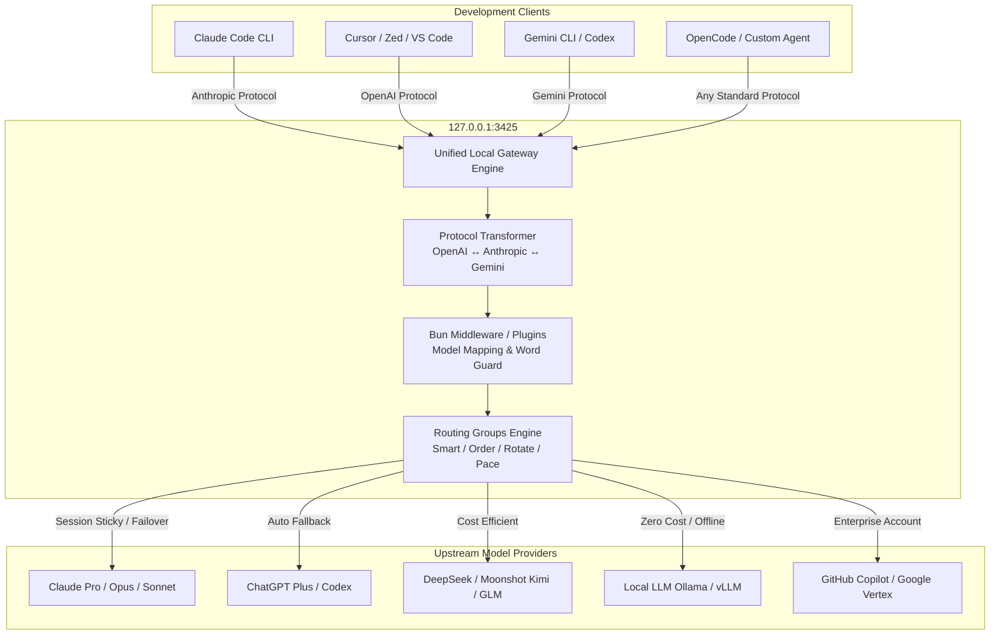

# magpie: 概要と革新性

近年、エンジニアの日常業務には「Claude Code」「Cursor」「Codex」「Gemini CLI」「OpenCode」といった多種多様なAIコーディングエージェントが入り乱れています。しかし、開発現場では深刻な**「エージェント・プロバイダーのサイロ化」**が発生しています。

各エージェントは独自の設定ファイル形式を持ち、有料サブスクリプション（ChatGPT Plus、Claude Pro、GitHub Copilot等）や個別のAPIキーが各ツール内部に閉じ込められています。そのため、「Claude CodeでDeepSeek V4を使いたい」「Cursorの裏側で割安なKimiやローカルLLMを動かしたい」「APIクォータが切れたら別アカウントへシームレスにフェイルオーバーさせたい」という要求に対して、設定ファイルの書き換えやプロトコル変換を泥臭く手作業で行う必要がありました。

このペインを劇的に解決するのが、Go言語製でGitHubスター数11,500を突破したオープンソース・統合ゲートウェイ**「magpie」**です。

### magpieのコア革新性
1. **全主要プロトコルのリアルタイム相互変換**：ローカルポート（`127.0.0.1:3425`）で待受し、OpenAI Chat/Responses、Anthropic Messages、Google GeminiのAPI仕様を自動相互トランスパイル（ストリーミング・Tool Use・Reasoning tags完全対応）。
2. **エージェント設定ファイルの非破壊的自動書き換え**：各CLIエージェントの設定（JSON, TOML, YAML等）の構造・コメントを壊すことなく、ターゲットURLとモデル指定をワンクリック／1コマンドで置換。
3. **インテリジェント・ルーティング＆クォータ・フェイルオーバー**：複数アカウントや異なるLLMをグループ化し、トークン残量、更新タイミング（smart/pace）、推論コスト（Intent Routing）に応じてリクエストを自動分散。
4. **JavaScript/Bunベースのゲートウェイミドルウェア拡張**：`onRequest`、`onResponse`をフックし、プロンプトの注入、マスク、モデルリライトを数行で実装可能。

---

## 解決する主要な課題とアーキテクチャ

従来のエージェント利用環境では、ツールごとに個別のAPI設定やキーの分散管理が必要であり、サブスクリプションの利用制限（Rate Limit）到達による作業停止が日常茶飯事でした。

magpieはローカルプロキシアーキテクチャを採用し、すべてのエージェントとすべてのLLMプロバイダ間に透過的なレイヤーを挟み込みます。



### アーキテクチャの強み
- **セッション維持（Sticky Session）**：プロンプトキャッシュの効果を最大化するため、同一セッションのリクエストはキャッシュが有効な同一プロバイダに固定。
- **意図ルーティング（Intent Routing）**：小型LLMがリクエスト内容を瞬時に判定。単純な質問は格安のDeepSeekやKimiへ、複雑なリファクタリングやテストコード生成はClaude Opus/GPT-4oへ自動振り分け。
- **安全な認証抽出**：OSのKeychainやローカルCLIの既存セッションから安全にサブスクリプション認証を同期し、追加キー発行なしで他エージェントに再利用可能。

---

## 競合ツール/商用SaaSとの徹底比較

| 機能・指標 | magpie (OSS) | LiteLLM (Proxy) | New API / One API | 商用AIゲートウェイ (Portkey等) |
| :--- | :--- | :--- | :--- | :--- |
| **主用途** | 開発エージェント・デスクトップ統合 | サーバーサイドAPI集約 | APIキー転売・リレー | エンタープライズAPI監視 |
| **クライアント設定自動化** | **◎ 完全自動（各エージェントのConfigを直書き換え）** | × 手動設定 | × 手動設定 | × 手動設定 |
| **デスクトップGUI/TUI** | **◎ メニューバー常駐 / TUI完備** | △ Web UIのみ | △ Web UIのみ | ○ クラウドダッシュボード |
| **個人サブスク流用** | **◎ 可能（Claude/Codex認証再利用）** | × APIキーのみ | × APIキーのみ | × APIキーのみ |
| **レイテンシ** | **極小（Goローカルプロセス）** | 低（Python） | 低（Go） | 中（外部クラウド経由） |
| **意図ルーティング** | **◎ ビルトインサポート** | ○ 設定次第 | △ プラグイン依存 | ○ クラウド設定 |
| **コスト** | **完全無料（MIT）** | OSS無料 / 有料版あり | OSS無料 | 月額従量課金（高額） |

---

## 💡 ビジネス・マネタイズ活用アイデア（実践例）

### 1. 開発組織向け「AIエージェント開発環境統合パック」（受託・導入支援）
- **ターゲット**: エンジニア数十名を抱える受託開発会社・スタートアップ。
- **提供価値**: Claude Code、Cursor、VS Code Copilotを全員が利用しつつ、裏側のモデルを会社契約のAzure OpenAI、DeepSeek、自社ホストLLMに一本化。月々のAPIコストを50〜70%削減。
- **提供モデル**: 要件定義・導入コンサルティング＋セキュア設定パッケージ（工数に応じた個別見積もり）。

### 2. ローカルLLM/オンプレミス接続アプライアンス化
- **ターゲット**: 金融・医療など社外へコードを送信できない機密保持企業。
- **提供価値**: 各開発者のローカル環境にmagpieを配布し、社内プライベートGPUサーバー（vLLM）またはOllamaへ強制ルーティング。Claude Code等の最新CLIツールを完全オフライン/オンプレ環境で動作させる。

### 3. 社内AIプロキシ＆監査ログゲートウェイ（マイクロSaaS / 社内ツール）
- **提供価値**: magpieのBunミドルウェア機能を拡張し、ソースコード送信時の機密情報（APIキー、個人情報、DBパスワード）を自動マスキング（Word Guard）。外部送信ログをOTLP/Datadogに連携するエンタープライズ統制基盤を構築。

---

## インストール & クイックスタート手順

### 1. ワンライナーによるインストール
macOS、Linux環境では公式のインストールスクリプトで導入できます。

```bash
curl -fsSL https://usemagpie.ai/install.sh | sh
```
※Go環境がある場合は `go install github.com/yetone/magpie@latest` でもビルド可能。

### 2. プロバイダーの追加（DeepSeekの例）
```bash
magpie provider add deepseek sk-xxxxxxxxxxxxxxxxxxxxxxxx
```

### 3. エージェントのモデルを瞬時に切り替え
Claude CodeのバックエンドモデルをDeepSeek V4に切り替える場合：
```bash
magpie claude deepseek/deepseek-v4-pro
```
このコマンド一発で、Claude Codeの設定ファイルが非破壊で更新され、次回実行時からDeepSeek経由で動作します。

### 4. クォータ自動フェイルオーバーグループの作成
```bash
# OpusアカウントとCopilotアカウントの冗長化グループを作成
magpie group add "Opus-Anywhere" \
  models=claude/claude-opus-5-5,copilot/claude-opus-5.5 \
  routing=smart

# Claude Codeに割り当て
magpie claude group/opus-anywhere
```

---

## 商用利用可否 & ライセンス考察

- **ライセンス**: **MIT License**
- **商用利用の可否**: **完全商用利用可能**。商用サービスへの組み込み、受託開発における顧客環境へのセットアップ、改変コードの非公開配布もライセンス上制限されません。
- **特記事項**:
  - 本リポジトリは外部からの直接Pull Requestを受け付けておらず、開発チームが主導する運用ポリシーを採っています。独自の社内機能を追加したい場合は、フォークして管理するか、提供されている「Bunベースのミドルウェア/プラグイン機構」を活用して非侵入的に拡張するのがベストプラクティスです。

## 📖 続きと実務キットについて
本記事は Auto Tech Radar の無料解説の抜粋です。

- 📖 **無料**: アーキテクチャ・README から転記したインストール手順・ライセンスの確認先 → [Auto Tech Radar で読む](https://ssk0224.github.io/auto-tech-radar/radar/magpie/)
- 🔒 **有料（note）**: 導入提案書テンプレート・工数見積表 → [note の有料記事・メンバーシップ](https://note.com/vast_ixora7005/membership)

