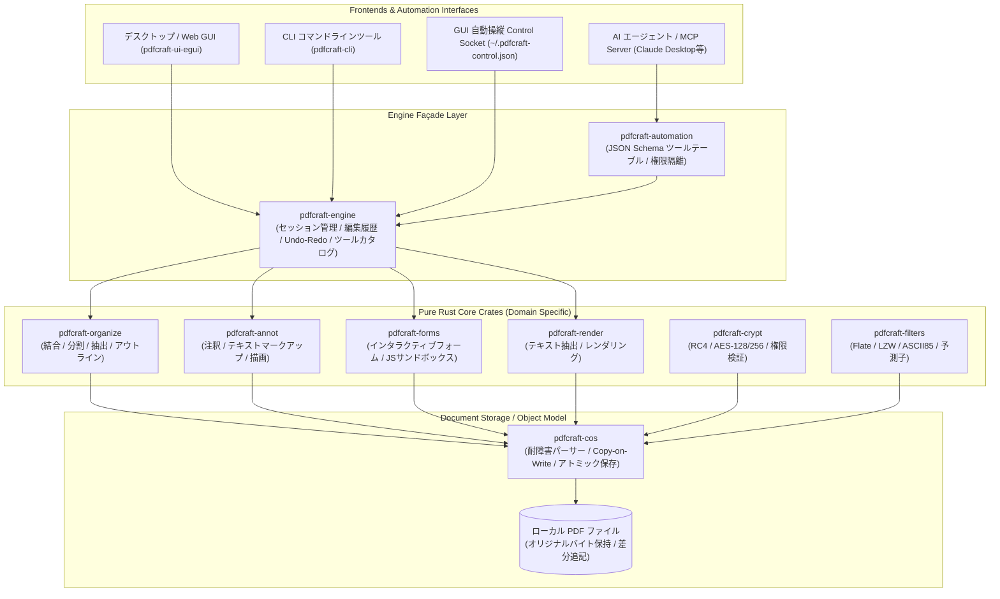

# pdfcraft: 概要と革新性

**PdfCraft**（`storytold/pdfcraft`）は、業界標準であるAdobe Acrobatの機能を、外部の巨大C/C++ライブラリに頼らず**純粋なRust（Pure Rust）でゼロからクリーンルーム再実装**した次世代のオープンソースPDFワークベンチです。

macOS、Windows、Linux、FreeBSD向けの高速なネイティブデスクトップアプリとして動作するだけでなく、同一コードベースからWebAssembly（Wasm）としてブラウザ上でも動作します。アカウント登録不要、テレメトリ皆無、完全オフライン稼働という極めてプライベートな設計を徹底しています。

さらに特筆すべきは、**AIエージェント時代を前提とした設計（Agent-First Architecture）**です。GUIの操作にとどまらず、JSON Schemaで定義されたCLIツール群、ClaudeなどのLLMエージェントと直接通信可能な**標準MCP（Model Context Protocol）サーバー**、さらにはアクセシビリティツリーを介したヘッドレスGUI自動操縦プロトコルまで標準搭載しています。

## 解決する主要な課題とアーキテクチャ

従来のPDFツールエコシステムは、以下の深刻な課題を抱えていました。

1. **レガシーC/C++製エンジンの脆弱性**: PopplerやPDFiumなどの既存エンジンはバッファオーバーフロー等のメモリ破壊リスクを常に抱えている。
2. **商用製品（Adobe等）のベンダーロックインと高額ライセンス**: 企業でのシート単位課金、クラウド強制アップロードによる情報漏洩リスク。
3. **データ損失を招く破壊的保存**: 編集時にオリジナルバイト列を不可逆に変更し、フォームや注釈、レイヤーのメタデータが破損する。
4. **AI/プログラム連携の困難さ**: 高度なPDF編集（フォーム入力、注釈追加、特定ページ抽出）をCLIやLLMから安全かつ決定論的に実行する手段の欠如。

PdfCraftは、レイヤード・ワークスペースアーキテクチャを採用し、UIとコアロジックを完全分離することでこれらの課題を解決しています。



### アーキテクチャの核心
- **インクリメンタル＆アトミックライト**: 元のバイト列に差分のみを追記（Incremental Update）し、一時ファイルへの書き込み完了後にアトミックにスワップするため、保存中の電源断でもファイルが破損しません。
- **耐障害パース性能**: pdf.jsのテストコーパス983ファイル中、963ファイルがクラッシュゼロで正常描画され、損傷した構造も自動修復します。
- **多言語・縦書き完全対応**: 日本語の縦書きテキスト、アラビア語・ヘブライ語（RTL）、デーヴァナーガリー文字、カラー絵文字まで正確にレンダリングします。

## 競合ツール/商用SaaSとの徹底比較

| 評価項目 | PdfCraft (OSS) | Adobe Acrobat Pro (商用) | PDFium / Popplerベース系 |
|---|---|---|---|
| **ライセンス / コスト** | **オープンソース (Apache 2.0 / MIT)** | 年間約30,000円〜/ユーザー | OSS (GPL / BSD) |
| **開発言語** | **Pure Rust (メモリ安全)** | C++ / プロプライエタリ | C / C++ (メモリ安全性に懸念) |
| **テレメトリ / プライバシー** | **完全ゼロ（オフライン完結）** | クラウド強制・テレメトリ有 | ツール依存（ローカル可） |
| **AIエージェント連携 (MCP)** | **標準ビルトイン (CLI & MCP)** | 独自エコシステム / API従量課金 | 自前ラッパー開発が必須 |
| **保存メカニズム** | **アトミック差分追記 (無破壊)** | 独自最適化 (メタデータ消失リスク) | ライブラリ依存 |
| **GUI自動操縦** | **アクセシビリティツリー直結API** | 不可（OSネイティブ自動化依存） | 基本CLIのみ |
| **プラットフォーム** | Win/Mac/Linux/FreeBSD/Wasm | Windows / macOS | 主にLinux / 各OSバインディング |

## 💡 ビジネス・マネタイズ活用アイデア（実践例）

1. **金融・医療向け「完全エアギャップ型」高セキュアPDF基盤構築**
   クラウドへの機密文書アップロードが厳禁されている病院や金融機関に対し、外部通信が一切発生しないPdfCraftを社内端末および閉域イントラネット環境に展開。
2. **LLMエージェント駆動型「契約書レビュー・自動赤入れ」ソリューション**
   `pdfcraft-cli mcp`を社内ローカルLLM環境（OllamaやローカルvLLM）と統合し、契約書の特定条項を自動検索してハイライト注釈やコメントスレッドを付与する自動校閲基盤の販売。
3. **官公庁向け「申請書フォーム自動埋め戻し＆バッチ分割」マイクロSaaS**
   `pdfcraft-cli run`のJSONスクリプト機能をバックエンドに組み込み、数千件の届出PDFから特定ページのみを抽出し、DBの値を用いてインタラクティブフォームを自動充填するバッチ処理SaaS。

## インストール & クイックスタート手順

### 1. バイナリのインストール
公式リリースページまたはGitHub Releasesから各OS用のバイナリを取得可能です。

```bash
# macOS (Homebrewまたは公式DMG)
# Linux (AppImage / .deb / .rpm)
chmod +x pdfcraft-*.AppImage && ./pdfcraft-*.AppImage
```

### 2. ソースコードからのビルド（Rust 1.95+）
```bash
git clone https://github.com/storytold/pdfcraft
cd pdfcraft

# 日本語フォントサポートを有効化する場合（任意）
git clone https://github.com/storytold/craft-fonts ../craft-fonts
CRAFT_FONTS_DIR=../craft-fonts cargo run --release -p pdfcraft -- sample.pdf
```

### 3. CLIツールによる基本操作
```bash
# 複数PDFの結合（しおり・リンク階層を完全維持）
pdfcraft-cli combine cover.pdf body.pdf appendix.pdf --out merged.pdf

# 特定ページの抽出
pdfcraft-cli extract merged.pdf --pages 1,3,5-7 --out summary.pdf

# ページの回転と削除、メタデータ更新をワンショットで実行
pdfcraft-cli edit in.pdf --rotate 1:90 --delete 2 --title "2026年度 決算報告" --out final.pdf
```

### 4. Claude等のAIエージェントと接続（MCPサーバー起動）
エージェント設定ファイル（例: `claude_desktop_config.json`）に以下を追記するだけで、AIにPDFの操作権限を安全に付与できます。

```json
{
  "mcpServers": {
    "pdfcraft": {
      "command": "pdfcraft-cli",
      "args": ["mcp", "--root", "/Users/username/Documents/PDFs", "--compact"]
    }
  }
}
```

## 商用利用可否 & ライセンス考察

PdfCraftのソースコードは **Apache License 2.0 および MIT License のデュアルライセンス** で公開されており、**商用利用、改変、受託システムへの組み込み、自社SaaSバックエンドへの採用は完全に無償かつ自由**です。特許侵害リスクへの保護も含まれるApache 2.0が含まれている点は、エンタープライズ採用において極めて大きなメリットとなります。

**注意点（商標条項）:**
- リポジトリ内のロゴおよび「ArtCraft」の名称（`docs/brand/`配下）はArtCraft Teamの商標であり、オープンソースライセンスの適用外です。
- 独自製品としてリブランド・再配布・SaaS提供を行う場合は、**ブランドロゴを差し替え、自社名称でビルド**する必要があります。

## 📖 続きと実務キットについて
本記事は Auto Tech Radar の無料解説の抜粋です。

- 📖 **無料**: アーキテクチャ・競合比較・ライセンス考察の全文 → [Auto Tech Radar で読む](https://ssk0224.github.io/auto-tech-radar/radar/pdfcraft/)
- 🔒 **有料（note）**: 導入提案書テンプレート・工数見積表・公式READMEに基づく導入手順 → [note の有料記事・メンバーシップ](https://note.com/vast_ixora7005/membership)

