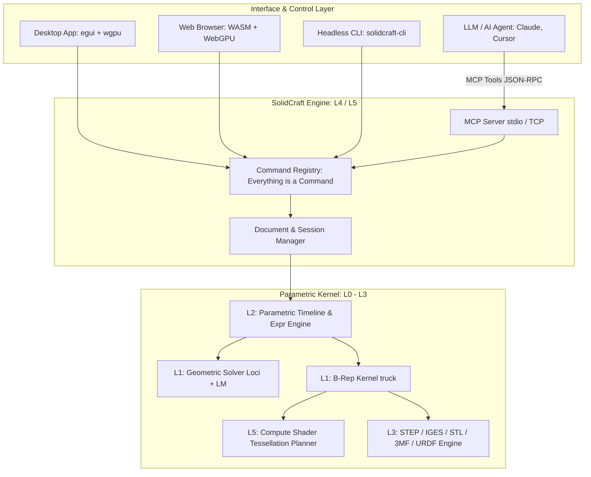

# solidcraft: 概要と革新性

`SolidCraft`は、純粋なRust（Pure Rust）でフルスクラッチ開発されたオープンソースのパラメトリック3D CADアプリケーションです。Autodesk Fusionなどの商用CADと同様の幾何拘束スケッチ、フィーチャータイムライン、パラメトリックリビルド、板金加工、アセンブリモデリングをローカルデスクトップ、Webブラウザ（WebGPU/WASM）、ヘッドレスCLIのすべてで動作させます。

特筆すべき最大のエッジは、**「Model Context Protocol（MCP）サーバー」をコアCLIに内蔵している点**です。LLMエージェント（Claude DesktopやCursor等）がMCPツール経由で3Dパーツを直接生成・計測・操作できる「AIネイティブCAD」として、製造業DXおよび自動設計パイプラインにパラダイムシフトをもたらしています。

## 🎯 ThoughtWorks成熟度リング判定（ADOPT / TRIAL / ASSESS / HOLD）

**判定: 【TRIAL】（PoC・特定ユースケースでの実戦投入推奨）**

- **根拠**:
  - GitHubスター数5,700超を獲得し、コミュニティの熱狂的な支持を集めている。
  - 幾何オラクル検証において、76個の参照パーツ中75個でFreeCADや解析解と体積・重心・バウンディングボックスが完全一致する高精度ジオメトリ処理を実現。
  - レイヤードアーキテクチャ（L0〜L5）が極めて堅牢であり、MIT/Apache-2.0デュアルライセンスのクリーンルーム実装。
  - 現時点では複雑な曲面モデリングや大規模アセンブリで未実装な領域があるため「ADOPT」には届かないが、**「AIによる定型治具・ブラケットの自動生成」「Web上での3Dカスタマイザー」「ヘッドレスCADパイプライン」としては即座にTRIAL（導入検証）すべきフェーズ**にあります。

## 解決する主要な課題とアーキテクチャ

従来のオープンソースCAD（FreeCADやOpenSCAD等）や商用CAD（Fusion 360, SolidWorks等）が抱えていた以下の課題を根本から解決します。

1. **AIエージェント親和性の欠如**: 従来のGUI中心CADは外部APIが貧弱であり、AIエージェントによるリアルタイム操作が困難だった。
2. **パフォーマンスと依存性の肥大化**: C++で書かれた旧来のCADエンジンはビルドが複雑でWeb展開が困難。SolidCraftはPure Rust＋WebGPUによりWebブラウザでもネイティブ同様に60fpsで動作。
3. **テッセレーションのボトルネック**: 独自のGPU Compute Shaderを用いたパッチ生成により、従来比50〜65倍（78ボディの評価が約65ms）の超高速メッシュ化を実現。

### システムアーキテクチャ ＆ データフロー図

## 📖 続きと実務キットについて
本記事は Auto Tech Radar の無料解説の抜粋です。

- 📖 **無料**: アーキテクチャ・競合比較・ライセンス考察の全文 → [Auto Tech Radar で読む](https://ssk0224.github.io/auto-tech-radar/radar/solidcraft_zenn/)
- 🔒 **有料（note）**: 導入提案書テンプレート・工数見積表・公式READMEに基づく導入手順 → [note の有料記事・メンバーシップ](https://note.com/vast_ixora7005/membership)

