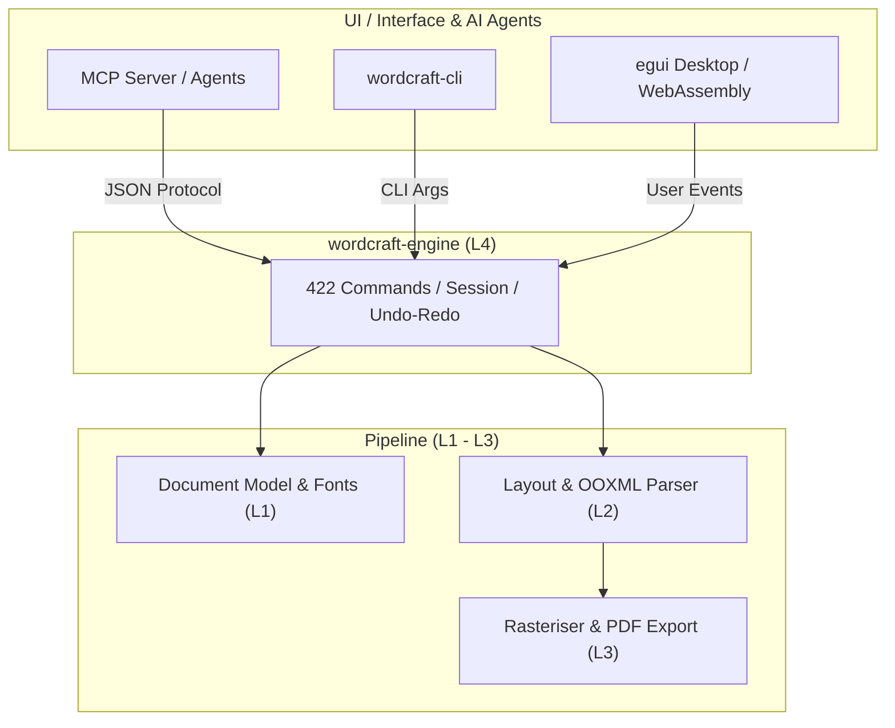

# wordcraft: 概要と革新性

`storytold/wordcraft` は、Microsoft Word のワークフロー、UI（リボンUI）、そしてファイル仕様（.docx / OOXML）を、依存関係なしに **Pure Rust** でゼロからクリーンルーム再実装したオープンソースのデスクトップ・Web向けワードプロセッサです。

従来のオープンソースオフィス（LibreOffice等）が抱えていた「起動の重さ」「レガシーC++コードベース」「ヘッドレス運用の難しさ」「Electron製ツールのメモリ浪費」というペインを、Rustのメモリ安全性とGPUネイティブ描画（egui）、そしてレイアウトキャッシュ技術によって根本から解決しています。

### 主な革新性
1. **README に記載の性能**: 段落レイアウトをキャッシュするため、188 ページの文書で入力したときの再レイアウトが約 **1.4ms** と記載されています（当サイトでは計測していません）。Electron は使っていません。
2. **AIエージェント・ファースト設計**: 全422種類のUIアクションがユニークなコマンドIDとして公開されており、**MCP（Model Context Protocol）** サーバーまたはCLIを通じて、Claude 等の AI モデルからヘッドレスで文書の作成・編集を操作できます。
3. **オフライン・完全プライベート**: 校閲・文法チェック・PDF/DOCX変換が外部API通信なしにローカルで完結。

---

## 解決する主要な課題とアーキテクチャ

オフィスドキュメントの自動化において、従来の headless LibreOffice や Python-docx は「レイアウトの崩れをリアルタイムに検知できない」「フォントレンダリングや改ページ判定が本家Wordとズレる」という決定的な弱点を抱えていました。

WordCraftは、下図のように厳格なレイヤード・アーキテクチャを採用しており、レンダリングエンジン（`vello_cpu`）とレイアウトエンジン（`wordcraft-layout`）を分離しつつ、AIエージェントプロトコル（MCP）を最上位コントロール層に標準統合しています。



### アーキテクチャの特徴
- **L0〜L3（コアエンジン）**: 幾何計算（`wordcraft-geom`）、フォントシェーピング・ドキュメント構造（`wordcraft-doc`）、禁則処理・ページネーション・数式・表計算（`wordcraft-layout`）を完全分離。
- **L4（エンジン層）**: 422個のコマンドカタログで全操作を正規化。UIのクリックイベントも、エージェントからのMCPリクエストも同一のエントリポイントを通過。
- **L5〜L6（配信・フロント）**: ネイティブeguiとWasm対応。ヘッドレスサーバーでもGUIクライアントでも同一のバイナリコアで稼働。

---

## 競合ツール/商用SaaSとの徹底比較

| 項目 | Microsoft Word / 365 | LibreOffice / OpenOffice | Google Docs API | **WordCraft (本リポジトリ)** |
|---|---|---|---|---|
| **ライセンス** | プロプライエタリ（月額課金） | MPL 2.0 / LGPL | プロプライエタリ（Cloud依存） | **MIT / Apache 2.0 (デュアル)** |
| **ランタイム** | C++ / 大型ランタイム | レガシーC++ / Java依存 | Web / REST API | **Pure Rust (シングルバイナリ)** |
| **起動・動作速度** | 普通〜やや重い | 重い（起動に数秒） | ネットワーク依存 | **極小（ミリ秒単位起動・1.4ms再描画）** |
| **AIエージェント連携** | Copilot (要追加料金/閉域) | プラグイン拡張が困難 | スクリプトベース | **MCP / CLI / JSON制御が標準装備** |
| **メモリ消費量** | 500MB〜1.5GB | 300MB〜800MB | ブラウザ依存（大） | **数十MB〜（GPUネイティブ）** |
| **データプライバシー** | クラウド同期が基本 | ローカル完結 | クラウド送信必須 | **完全オフライン動作** |

---

## 💡 ビジネス・マネタイズ活用アイデア（実践例）

### 1. 金融・士業向け「完全オンプレミスAI帳票・契約書自動生成基盤」
- **ペイン**: 秘匿性が極めて高い顧客情報や契約書を、外部のクラウドOfficeやSaaSにアップロードできない。
- **ソリューション**: 社内ローカルLLM（Ollama等）と `wordcraft-cli mcp` を連携。社内規定に沿ったフォーマットで .docx および検証済み PDF をミリ秒で生成・差分比較（Track Changes）するシステムを受託構築。

### 2. CI/CDパイプライン組み込み型「ドキュメントリント・自動パブリッシャー」
- **ソリューション**: Gitリポジトリ上のMarkdown / TeX文書をコミット時に自動でCI上で検知。WordCraftのCLI経由で、印刷クオリティの高品質な社外公開用DOCX/PDFへレンダリングし、タイポ・表記揺れを `wordcraft-proof` で弾く自動化SaaSを展開。

---

## インストール & クイックスタート手順

### 1. デスクトップ版のビルドと起動
Rustツールチェーン（`cargo`）がインストールされている環境で実行します。

```bash
# リポジトリのクローン
git clone https://github.com/storytold/wordcraft
cd wordcraft

# サンプルドキュメント付きでデスクトップアプリを起動
cargo run --release -p wordcraft -- --sample
```

### 2. CLIツールによるヘッドレス変換
```bash
# DOCXからPDFへの変換
cargo run --release -p wordcraft-cli -- convert input.docx output.pdf

# ドキュメント構造をJSONとして解析・ダンプ
cargo run --release -p wordcraft-cli -- inspect report.docx
```

### 3. Claude Desktop / AIエージェントとの連携（MCP設定）
Claude Desktopの `claude_desktop_config.json` に以下を追記するだけで、Claudeが直接ドキュメントを読み書きできるようになります。

```json
{
  "mcpServers": {
    "wordcraft": {
      "command": "wordcraft-cli",
      "args": ["mcp"]
    }
  }
}
```

---

## 商用利用可否 & ライセンス考察

WordCraftは **MIT License または Apache License 2.0 のデュアルライセンス** で提供されています。

- **商用利用**: ソースコードの改変、自社商用SaaSへの組み込み、プロプライエタリ製品のバックエンドとしての同梱・再配布が自由に行えます（著作権表示およびライセンス通知の保持が必要）。
- **特許・クリーンルーム設計**: Microsoft Officeのバイナリ解析やリバースエンジニアリングではなく、ECMA-376（OOXML仕様書）などの公開仕様に基づいたクリーンルーム実装であるため、法的な知財リスクが極小化されています。
- **商標に関する注意**: 「ArtCraft」およびそのブランドロゴは保護されているため、フォークして独自のSaaSや再配布パッケージを作成する場合はロゴの差し替えが必要です。

## 📖 続きと実務キットについて
本記事は Auto Tech Radar の無料解説の抜粋です。

- 📖 **無料**: アーキテクチャ・競合比較・ライセンス考察の全文 → [Auto Tech Radar で読む](https://ssk0224.github.io/auto-tech-radar/radar/wordcraft/)
- 🔒 **有料（note）**: 導入提案書テンプレート・工数見積表・公式READMEに基づく導入手順 → [note の有料記事・メンバーシップ](https://note.com/vast_ixora7005/membership)

